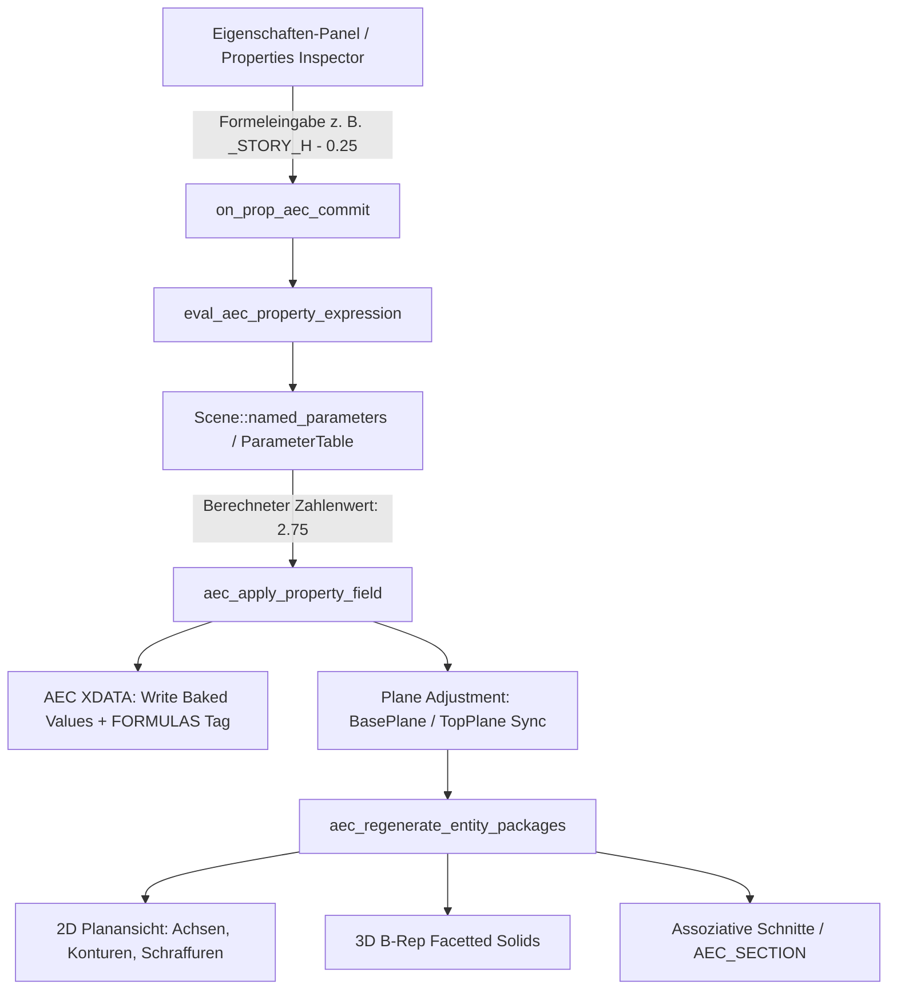

# Requirements

### Übersicht & Zielsetzung

Ziel dieses Vorhabens ist die vollständige Aktivierung und Harmonisierung der **Formel- und Parameterauswertung im Eigenschaften-Panel** für alle Kern- und Architekturbauteile (`AEC`), die **dauerhafte, assoziative Speicherung von Formeln** in den Bauteildaten (XDATA) sowie die **einheitliche Anbindung von Referenz- und Kontrollebenen (`BasePlane` und `TopPlane`)** für Wände, Geschossdecken, Wandöffnungen und Räume.

Zudem wird die bereits in OpenCADStudio existierende **GUI zur Variablenverwaltung (`PARAMETERS` / `PARAMETERSMANAGER` und `QuickCalc`)** nahtlos mit den Eingabefeldern des Eigenschaften-Panels verknüpft, sodass Parameteränderungen (z. B. Geschosshöhe `_STORY_H` oder Brüstungshöhe `_BRH`) unmittelbar und verlustfrei auf alle abhängigen Bauteile durchschlagen.

---

### Umfang (Scope)

- **Im Umfang (In Scope):**
  - **Formelauswertung im Eigenschaften-Panel:** Auswertung mathematischer Ausdrücke (z. B. `2.80 - 0.25`, `_BRH + 0.10 * 2`, `(wand_d / 2) + 0.05`) in allen numerischen Feldern (Wandhöhe, Wandstärken, Schichtdicken, Öffnungsmaße, Brüstungshöhen, Deckenstärken, Raumfaktoren).
  - **Dauerhafte Formel-Assoziativität:** Speicherung der eingegebenen Formel-Strings im AEC-XDATA (`ExtendedDataRecord`), sodass Formeln über Sitzungen und DWG/DXF-Speicherungen hinweg erhalten bleiben und bei Parameteränderungen in der `ParameterTable` die Geometrie automatisch aktualisiert wird.
  - **Ebenenbindung (BasePlane / TopPlane):** Einheitliche Dropdown-Auswahl und Handhabung für `BasePlane` und `TopPlane` bei Wänden und Geschossdecken sowie `SillPlane` und `HeadPlane` bei Fenstern, Türen und Durchbrüchen.
  - **Dynamische Höhenanpassung:** Beim Zuweisen einer neuen Ebene passt sich die Bauteilhöhe automatisch an den lichten Ebenenabstand an (`Offset = 0.0`).
  - **Verifikation der bestehenden Variablen-GUI:** Sicherstellung der perfekten Zusammenarbeit zwischen dem Befehl `PARAMETERS` / `PARAMETERSMANAGER`, der integrierten Parametertabelle im Eigenschaften-Panel und den AEC-Bauteilen.

- **Nicht im Umfang (Out of Scope):**
  - Neugestaltung des Kern-Geometrie-Solvers für 2D-CAD-Zwangsbedingungen (bleibt in `src/scene/parametric_constraints/`).
  - Änderung des IFC4-Exportschemas (IFC exportiert weiterhin die berechneten numerischen B-Rep-Solids).

---

### User Stories

- **Als Planer/Architekt** möchte ich in den Feldern für Wandhöhen, Brüstungshöhen und Deckenversätze Formeln wie `_STORY_H - 0.25` oder `_BRH + 0.125` eingeben können, damit ich Maße nicht manuell im Taschenrechner ausrechnen muss.
- **Als Planer** möchte ich, dass Formeln dauerhaft an den Bauteilen gespeichert bleiben, damit bei einer nachträglichen Änderung des Parameters `_STORY_H` im Parameter-Manager alle Wände und Decken automatisch in der Höhe nachgeführt werden.
- **Als Anwender** möchte ich Wänden, Decken und Fenstern im Eigenschaften-Panel per Dropdown eine `BasePlane` und `TopPlane` zuweisen, woraufhin sich das Bauteil sofort auf den korrekten lichten Abstand ausrichtet.

---

### Funktionale Anforderungen

1. **Numerische Formelauswertung:**
   - Jedes editierbare Zahlenfeld im Eigenschaften-Panel (Core & AEC) akzeptiert mathematische Terme mit Operatoren `+`, `-`, `*`, `/`, `^`, Klammern `()`, Konstanten `pi`, `e` und Funktionen `sqrt`, `sin`, `cos`, `tan`, `abs`, `round`.
   - Variablen aus der Zeichnungs-Parametertabelle (`ParameterTable`, z. B. `d1`, `_BRH`, `wand_d`) werden case-insensitive aufgelöst.
2. **XDATA-Persistierung von Formeln:**
   - Wird eine Eigenschaft über eine Formel definiert (z. B. `height = "_STORY_H - 0.25"`), wird der Formelstring in der `formulas`-Tabelle des AEC-XDATA-Satzes gesichert.
   - Der numerische Wert wird sofort berechnet und in die Geometrie (Polylinien-Elevation, B-Rep 3D-Prisma, Schnittprojektion) geschrieben.
3. **Assoziative Aktualisierung:**
   - Wird in der Parametertabelle ein Wert geändert (z. B. `_STORY_H = 3.20` statt `3.00`), durchläuft eine Update-Routine alle AEC-Elemente mit hinterlegten Formeln, re-evaluiert diese und triggert `aec_regenerate_entity_packages`.
4. **BasePlane / TopPlane Verhalten:**
   - Dropdown-Menüs im Eigenschaften-Panel listen alle Geschoss-Ebenen (`Storey.floor_plane_id`, `Storey.ceiling_plane_id`) und benutzerdefinierten Kontrollflächen (`ControlPlane`, `ControlPlaneFacet`) auf, ergänzt um `(keine)` / `(none)`.
   - Zuweisung einer `TopPlane` berechnet `wall.height = TopPlane.z(x,y) - BasePlane.z(x,y) - base_offset + top_offset` und setzt standardmäßig `top_offset = 0.0`.
   - Öffnungen berechnen ihre absolute Höhe und Lage relativ zu `SillPlane` und `HeadPlane` bzw. zur Wandbasis.

# Technical Design

### Aktueller Zustand & Analyse

1. **Variablen-Infrastruktur im Projekt:**
   - `src/scene/named_parameters.rs`: Enthält `ParameterTable` mit vollständigem AST (`Expr`), Abhängigkeitsgraph, Zykluserkennung (`ParamError::Cycle`) und mathematischer Funktionsauswertung.
   - `src/ui/window/named_parameters.rs`: Vollwertige GUI für `PARAMETERS` / `PARAMETERSMANAGER` mit Tabelle `(Name, Formel, Vorschau, Verwendet von)`.
   - `src/scene/model/object.rs`: Unterstützt `PropValue::ParamRow` und `PropValue::AddParamRow` für die Parametertabelle im Eigenschaften-Panel (bei Leerselektion).
2. **Bisherige Eigenschaften-Verarbeitung:**
   - In `src/app/update/command.rs` (`on_prop_geom_commit`) wird für Standardfelder `expr_eval::eval_to_string` verwendet, das jedoch keine Parameter aus `Scene::named_parameters` auflöst.
   - In `src/modules/aec/properties.rs` (`aec_apply_property_field`) werden Werte direkt mit `parse_f64` geparst, wodurch Ausdrücke wie `_BRH + 0.1` fehlschlagen.
3. **AEC Ebenen-Anbindung:**
   - `src/modules/aec/project/wall_planes.rs`, `slab_planes.rs` und `opening_planes.rs` enthalten die Logik zur Verknüpfung von Uuid-basierten Kontrollebenen, bieten jedoch noch keine automatisierte Höhenanpassung auf lichten Ebenenabstand bei Auswahl im Eigenschaften-Panel.

---

### Technische Architekturentscheidungen (Key Decisions)

1. **Zweistufiger Formel-Evaluator (Parser + Solver):**
   - Eigenschaftseingaben werden über den `ParameterTable`-Evaluator von `Scene` geparst. Dadurch stehen sämtliche benutzerdefinierten Parameter, mathematischen Funktionen und Konstanten einheitlich in Core- und AEC-Eigenschaften zur Verfügung.
2. **Hybride Persistenz: Zahlenwert + Formel-XDATA:**
   - *Zahlenwert (Baked Value):* Für volle DXF/DWG-Kompatibilität und maximale Rendering-Performance wird stets der numerische Endwert in die Standard-Geometrie und die bestehenden XDATA-Felder (`Distance`) geschrieben.
   - *Formel-Metadaten (Formulas Map):* Die Original-Formelstrings werden in einem standardisierten AEC-XDATA-Subrecord (`"FORMULAS"`) als Schlüssel-Wert-Paare (z. B. `{"height": "_STORY_H - 0.25", "sill_height": "_BRH"}`) persistiert.
3. **Ebenenabstand als primäre Höhenquelle:**
   - Bei Bindung an `BasePlane` und `TopPlane` bestimmt der analytische Abstand $Z_{\text{top}}(x,y) - Z_{\text{base}}(x,y)$ die Basishöhe. Manuelle Übersteuerungen erfolgen über `base_offset` und `top_offset`, welche ihrerseits Formeln akzeptieren.

---

### Datenmodelle & Verträge

#### 1. Formel-Zuordnung in AEC-Strukturen

```rust
// Ergänzung in Wall, Slab, Opening, Room
#[derive(Clone, Debug, Default, PartialEq, serde::Serialize, serde::Deserialize)]
pub struct AecFormulas {
    pub fields: std::collections::HashMap<String, String>,
}

impl AecFormulas {
    pub fn get(&self, field: &str) -> Option<&str> {
        self.fields.get(field).map(|s| s.as_str())
    }
    pub fn set(&mut self, field: &str, formula: String) {
        if formula.trim().is_empty() {
            self.fields.remove(field);
        } else {
            self.fields.insert(field.to_string(), formula);
        }
    }
}
```

#### 2. Auswertung im Eigenschaften-Handler

```rust
// src/modules/aec/properties.rs
pub fn eval_aec_property_expression(
    scene: &Scene,
    raw_input: &str,
) -> Result<f64, String> {
    let trimmed = raw_input.trim();
    if let Some(val) = crate::entities::common::parse_f64(trimmed) {
        return Ok(val);
    }
    // Auswertung über ParameterTable
    scene.named_parameters.eval_expression_with_params(trimmed)
}
```

---

### Architektur-Diagramm



---

### Risiken & Absicherungen

- **Zirkuläre Abhängigkeiten:** Werden bereits auf `ParameterTable`-Ebene durch Zykluserkennung (`ParamError::Cycle`) verhindert und abgefangen.
- **Ungültige Formeln bei Tippfehlern:** Fehleingaben (z. B. Tippfehler im Variablennamen) werden nicht übernommen; eine Fehlermeldung wird in der Befehlszeile / Statusleiste angezeigt und der vorherige Wert bleibt erhalten.
- **Performance bei vielen Bauteilen:** Die Geometrieberechnung arbeitet mit dem gecachten Zahlenwert; Formelauswertungen finden nur beim Editieren oder bei expliziter Änderung eines Zeichnungsparameters statt.

# Testing

### Validierungsansatz

Die Umsetzung wird durch automatisierte Unit-Tests für Formel-Parsing und Re-Evaluierung, Regressionstests für XDATA-DWG-Roundtrips sowie Verifikationstests der Ebenen- und Höhenanpassungen abgesichert.

---

### Test-Szenarien

1. **Formelauswertung im Eigenschaften-Panel:**
   - Eingabe von reinen mathematischen Ausdrücken (z. B. `2.5 + 0.3 * 2` -> `3.10`).
   - Eingabe von Ausdrücken mit Parametern (z. B. `_BRH + 0.15`, wobei `_BRH = 0.90` -> `1.05`).
   - Eingabe ungültiger Ausdrücke (z. B. `_UNBEKANNT + 1` oder `1 / 0`) -> Eingabe wird abgelehnt, Fehlermeldung erscheint, alter Wert bleibt bestehen.

2. **Dauerhafte Persistierung & DWG/DXF-Roundtrip:**
   - Erstellen einer Wand mit `height = "_STORY_H - 0.25"`.
   - Speichern als DWG/DXF und erneutes Öffnen der Datei.
   - Verifikation: Die Formel `_STORY_H - 0.25` ist weiterhin im AEC-XDATA vorhanden und der Wert beträgt exakt den berechneten Abstand.

3. **Assoziative Parameter-Aktualisierung:**
   - Parameter `_STORY_H` in `PARAMETERS` von `3.00` auf `3.20` ändern.
   - Verifikation: Alle Wände, Decken und Öffnungen mit Bezug auf `_STORY_H` aktualisieren ihre Geometrie und B-Rep-Solids automatisch auf die neuen Maße.

4. **BasePlane- und TopPlane-Wechsel:**
   - Wand mit `BasePlane = EG_OKFF (Z=0.0)` und `TopPlane = EG_UKD (Z=2.80)` verbinden.
   - Wechsel der `TopPlane` auf `OG_OKFF (Z=3.10)`.
   - Verifikation: Wandhöhe passt sich automatisch auf `3.10 m` an (`Offset = 0.0`), 3D-B-Rep und 2D-Schnittableitungen reflektieren die neue Höhe unmittelbar.

5. **Modultests:**
   - Ausführen der gesamten AEC-Testsuite: `cargo test --lib -- aec` (alle 1.047+ Tests erfolgreich).

# Delivery Steps

### ✓ Step 1: Formelauswertung und Parameter-Auflösung im Eigenschaften-Panel aktivieren
Die Eingabefelder im Eigenschaften-Panel werten mathematische Ausdrücke und benannte Zeichnungsparameter (`ParameterTable`) zuverlässig aus.

- Integration von `Scene::named_parameters` in den Auswertungsfluss von `src/app/update/command.rs` (`on_prop_geom_commit`).
- Ersetzen von reinem `parse_f64` in `src/modules/aec/properties.rs` (`aec_apply_property_field`) durch einen kontextsensitiven Expression-Evaluator für alle numerischen AEC-Felder (`wall_height`, `wall_base_offset`, `wall_top_offset`, `opening_width`, `opening_height`, `opening_sill_height`, `opening_sill_offset`, `opening_head_offset`, `slab_elevation_offset`, `slab_top_offset`, `room_factor`, `room_ceiling_height`).
- Unterstützung aller mathematischen Grundoperationen (`+`, `-`, `*`, `/`, `^`), Klammersetzung sowie mathematischer Konstanten (`pi`, `e`) und Standardfunktionen (`sqrt`, `sin`, `cos`, `tan`, `abs`, `round`).
- Bereitstellung von aussagekräftigen Fehlermeldungen bei ungültigen Formeln oder Division durch Null in der Statusleiste / Tooltip.

### ✓ Step 2: Dauerhafte Formelspeicherung und assoziative Aktualisierung in AEC-XDATA
Eingegebene Formeln bleiben im AEC-XDATA dauerhaft gespeichert und aktualisieren die Bauteilgeometrie automatisch bei Parameteränderungen.

- Erweiterung der AEC-Datenmodelle (`Wall`, `Slab`, `Opening`, `Room`) um eine optionale `formulas: HashMap<String, String>`-Struktur für parametrische Eigenschaften.
- Aktualisierung der XDATA-Serialisierung und -Deserialisierung in `src/modules/aec/engine/xdata.rs`, `slab_xdata.rs`, `opening_xdata.rs` und `room_xdata.rs` zur verlustfreien DWG/DXF-Persistierung der Formelstrings.
- Implementierung eines Re-Evaluierungs-Hooks bei Änderungen in `Scene::named_parameters` (via Befehl `PARAMETERS` oder Eigenschaften-Panel), der abhängige AEC-Objekte neu berechnet und deren Geometrie/B-Rep regeneriert.
- Anzeige des berechneten Zahlenwerts im Eigenschaften-Panel mit visueller Kennzeichnung / Tooltip für die zugrundeliegende Formel (z. B. `fx: _STORY_H - 0.25`).

### ✓ Step 3: BasePlane- und TopPlane-Anbindung für alle Architektur-Bauteile harmonisieren
Wände, Decken, Öffnungen und Räume unterstützen eine einheitliche Ebenenauswahl und passen ihre Höhen dynamisch an.

- Harmonisierung der Dropdown-Auswahl für `wall_base_plane`, `wall_top_plane`, `slab_base_plane`, `slab_top_plane`, `opening_sill_plane` und `opening_head_plane` in `src/modules/aec/properties.rs`.
- Implementierung der dynamischen Höhenanpassung beim Wechsel von BasePlane/TopPlane: Die Bauteilhöhe passt sich automatisch an den lichten Abstand der gewählten Ebenen an (`Offset = 0.0`), während manuelle Offsets erhalten oder gezielt über Formeln definiert werden können.
- Synchronisation der Z-Ebenenberechnung mit Storey-Höhen (`storey.elevation`) und Kontrollflächen-Facetten (`ControlPlaneFacet`) bei geneigten Dächern und versetzten Decken.
- Sofortige Triggerung der 2D-Polylinien-, Schraffur- und 3D-B-Rep-Regenerierung bei Ebenenwechsel.

### ✓ Step 4: GUI-Integration, Verifikation und automatisierte Tests
Die bestehende Variablen-Verwaltung (`PARAMETERS` / `QuickCalc`) ist nahtlos integriert und alle Workflows sind durch Tests abgesichert.

- Verifikation und Dokumentation der integrierten GUI-Dialoge (`PARAMETERS` / `PARAMETERSMANAGER` in `src/ui/window/named_parameters.rs` sowie integrierte Tabelle im Eigenschaften-Panel).
- Ergänzung von Unit- und Integrationstests in `src/modules/aec/properties.rs` und `src/scene/named_parameters.rs` zur Absicherung von Formelauswertung, Parameter-Bindungen, Zykluserkennung und DWG-Roundtrips.
- Erstellung von Anwendungsbeispielen in `examples/beispiel_haus/` mit parametrisierten Wandhöhen und Brüstungen (`_BRH`, `_STORY_H`).