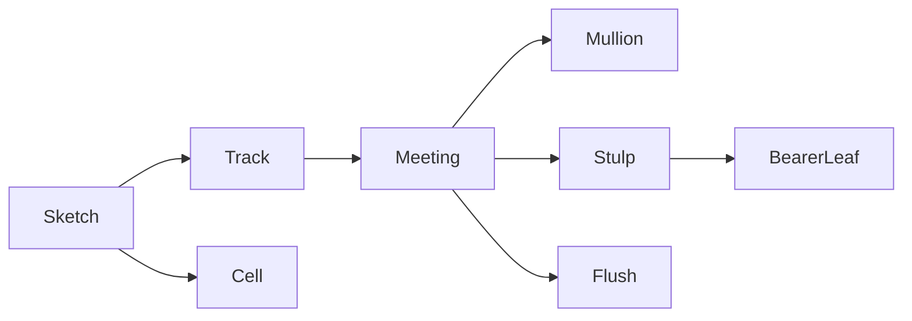
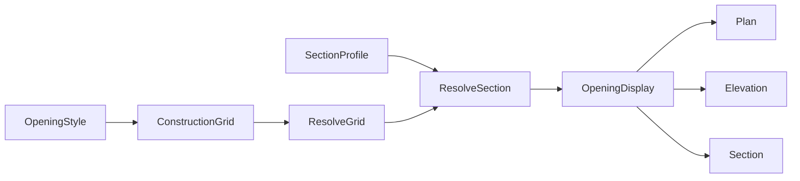

# Requirements

### Overview & Goals

Öffnungen bekommen ein verschachteltes Konstruktionsraster und benutzen den vorhandenen Profilkatalog an den Teilungsachsen. Das Raster definiert nur die Teilung. Modellgeometrie entsteht erst aus der aufgelösten Achse, der Zellregel und eigenen Sprossenstäben. Bezug für Sturz, Kasten und Sims ist die Rohbauöffnung. Glas, Flügel und Sims lesen den bereits aufgelösten Querschnitt, ohne den Katalog neu zu bauen. Mehrflügelige Fenster und Türen bleiben dasselbe Raster: symmetrisch oder asymmetrisch über die Achsmasse, ohne Pfosten nur dann, wenn der Stoss ein Stulp oder bündig ist.

Der Profilkatalog aus `2f0972d25` bleibt. `SectionProfile` und `resolve_section` sind die Leser. Ein späterer 3D-Sweep kann dieselbe Id ziehen. Diese Runde ändert das Volumen nicht in einen echten Sweep. Ein verglaster Flügel wird aber ein Rahmenring wie der Festrahmen, keine geschlossene Platte.

Rückwärtskompatibilität gibt es nicht. Alte Zeichnungen werden nicht gelesen und nicht umgebaut. Generierte Beispiele und die Seed-Stile werden neu geschrieben. Ein Öffnungsstil, dessen JSON nicht mehr zum Schema passt, wird aus der Bibliothek gelöscht, nicht konvertiert.

### Vorschläge statt wörtlicher Umsetzung

- Das Raster lebt in `engine/construction_grid.rs`, nicht als privater Typ von `OpeningStyle`. Fassaden und Konstruktionsraster können ihn später benutzen. Diese Runde zeichnet keine Fassade.
- Feste Maße werden zuerst gelegt. Bruchteile teilen nur den Rest. Eine Summe der Bruchteile ungleich eins wird auf die gesetzten Bruchteile normiert, nicht auf die ganze Öffnung.
- Eine Achse mit Meeting `Mullion` trägt standardmäßig das Profil des Festrahmens. Ein gesetzter Achsenwert gewinnt. Die Zellfüllung darf eine Kante unterdrücken oder ersetzen. Zwei widersprüchliche Zellprofile: die Zelle mit der kleineren Zeile, dann der kleineren Spalte, gewinnt.
- Mehrflügelig ist kein eigener Öffnungstyp und kein Kindraster. Die Aufteilung bleibt die Achse. Symmetrisch sind gleiche Bruchteile. Asymmetrisch sind ein festes Mass plus Bruchteil oder ungleiche Bruchteile.
- Ein Pfosten entsteht nur bei `Mullion`. Zwei Flügel ohne Pfosten teilen eine Achse mit `Stulp`: der Standflügel trägt den Stulp aus dem Flügelprofil, der Gangflügel lässt diese Kante weg. Das schneidet die Wand nicht und ist kein Festrahmen.
- Falt- und Schiebeöffnungen mit mehreren Flügeln sind aneinanderliegende Zellen derselben Art. Ihre Innenachsen sind `Flush` oder `Stulp`, nicht automatisch ein Pfosten. Die Kette wird nur als Schema gezeichnet. Das 3D-Blatt stapelt und öffnet sich nicht.
- Vorgaben in der Skizze schreiben nur Achsen, Meetings und Zellarten. Ein Flag „zweiflügelig“ wird nicht gespeichert.
- Sprossen sind Stäbe in der Zelle, keine Teilungsachsen. Alle Stäbe eines Rasters lesen dasselbe Katalogprofil, wie der Festrahmen ein Profil für alle Seiten liest. Leer heißt lokale Breite und Tiefe, sonst die Hülle von `resolve_section`. Grundriss und Schnitt zeichnen den Umriss, das 3D-Volumen bleibt die Hülle. `vertical_muntins`, `horizontal_muntins` und `DivisionGrid` entfallen. Es gibt keinen Lesehelfer.
- Eine Türzelle lässt die untere Kante weg, solange die Achse kein eigenes Profil setzt. Ein expliziter Achsenwert gewinnt auch dort.
- `HingeSide` entfällt als gespeichertes Feld. Die Art heißt `LeafOperation`. Links und rechts sind `Turn`. Kipp, Drehkipp, Schwing, Schiebe und Falten sind in dieser Runde nur Schemas in Grundriss und Ansicht. Das 3D-Blatt bleibt geschlossen. Eigenschaften und XDATA schreiben die neue Art. Ein alter Wert wird nicht gelesen.
- Die seitliche Überlappung heißt `lateral_overlap`. Der Versatz in Wandquerrichtung ist `depth_offset`. `rebate_overlap` wird nicht als Alias gelesen. Seed-Stile setzen `lateral_overlap` direkt.
- Ein Fensterflügel und jede verglaste Zelle sind ein Ring, kein Quader. `build_opening_leaf_3d_with_depth` extrudiert heute die Innenkontur mit `build_faceted_prism`. Das wird `build_faceted_hollow_prism`, dieselbe Maschine wie `build_opening_frame_3d`. Die Aussenkontur ist die Zelle abzüglich der seitlichen Überlappung, die Innenkontur liegt um die Ansichtsbreite des Flügelprofils weiter innen. Glas sitzt in diesem Loch. Ein opakes Türblatt ohne Glas bleibt eine Platte, weil ein Türblatt kein Rahmen ist. „Geschlossen“ meint nur die Lage: Kipp und Schiebe öffnen das 3D-Blatt nicht, das Loch bleibt offen.
- `GlazingDimensions.inset` ist der Glaseinstand in das umgebende Profil. Glas endet an der Innenkante und dringt um `inset` hinein. Ohne Profil ist die Zellengrenze die Kante, `inset` wird auf null begrenzt.
- Der Sims reicht innen bis an die Außenkante des Festrahmenprofils. Der Überstand liegt außerhalb der jeweiligen Wandseite, nicht als Lücke zum Rahmen. Ist der Rahmen aus, endet der Sims an der Rohbaukante.
- Sturz und Rolladenkasten ohne gesetzte Tiefe übernehmen die Vereinigung der Schichten mit `LayerFunction::Structural`. Fehlt eine tragende Schicht, gilt die Wanddicke, damit das Bauteil nicht verschwindet.
- `PreviewCamera::fit` für Grundriss und Schnitt benutzt Rohbauöffnung plus Beispielwand, nicht die Hülle der erzeugten Pfade. Eine geänderte Rahmenbreite verschiebt die Vorschau dann nicht.
- Ratings, Pfosten-Riegel-Fassade, Konstruktionsraster als Bauteil und der echte 3D-Sweep bleiben draussen. Der Rastertyp ist dafür offen, die Maske bekommt keinen Ratings-Tab.

### GUI-Skizze

Die Profilmaske bleibt. Geändert wird die Teilungsgruppe im Öffnungsstil und die beiden neuen Flügelwerte. Kein neuer Baumknoten.

Links die Ansichtsskizze, rechts die Auswahl. Ein Klick auf eine Kante wählt die Achse. Ein Klick in eine Zelle wählt die Füllung. Die Skizze zeigt das aufgelöste Raster, nicht die Modellstäbe.

```
Teilungen
+------------------------------+-----------------------------+
| Ansichtsskizze               | Achse                       |
| +--------+--------+          | Art [Bruch v] Maß [1] [1]   |
| | Dreh L | Dreh R |          | Stoss [Stulp v]             |
| +--------+--------+          | Träger [rechts v]           |
| |        Glas       |        | Profil [Flügel v]           |
| +-------------------+        | leer = Flügelprofil         |
| [Zweiflügelig] [Falt] [Schiebe] | Zelle                |
| [Zellen verbinden]           | Füllung [Tür v]             |
| [Kindraster]                 | Anschlag [Dreh links v]     |
|                              | Unten [ohne Profil v]       |
|                              |                             |
|                              | Sprosse in der Zelle        |
|                              | Profil [Sprosse 20 v]       |
|                              | leer = Breite und Tiefe     |
|                              | Breite [0.020] Tiefe [0.030]|
|                              | Lage [0.400]  [+]
+------------------------------+-----------------------------+
```

Feste Masse und Bruchteile teilen sich dasselbe Feld. Die Art schaltet nur die Bedeutung. `Stoss` schaltet Pfosten, Stulp oder bündig. Bei `Mullion` bleibt das Profil der Festrahmen. Bei `Stulp` ist der Träger der Standflügel, das Profil der Stulpstab. Ein Kindraster öffnet dieselbe Skizze eine Ebene tiefer, nicht einen zweiten Dialog.

`Zweiflügelig` schreibt zwei gleiche Bruchachsen, `Stulp`, entgegengesetzte Drehflügel und den Träger rechts. Die Masse bleiben danach editierbar, damit aus derselben Vorgabe eine asymmetrische Tür wird. `Falt` und `Schiebe` fragen nur die Flügelzahl, mindestens zwei, und schreiben ebenso viele Zellen mit bündigem Stoss. Ein festes Seitenteil daneben bleibt eine eigene Zelle mit Pfosten, kein Sonderfall der Vorgabe.

Das Sprossenprofil steht über den Stabmassen und gilt für alle Stäbe dieses Rasters. Ein Kindraster hat ein eigenes Profil und erbt es nicht. Eine gültige Id blendet Breite und Tiefe aus, wie die Profilzeile des Festrahmens Ansichtsbreite und Tiefe ausblendet. Die Lage bleibt, weil der Katalog nur den Querschnitt trägt. Der Picker ist derselbe wie am Festrahmen, inklusive des leeren Eintrags für die lokalen Masse.

Am Flügel stehen zwei Überlappungen. Die Profilzeile bleibt darüber und blendet weiter Ansichtsbreite und Tiefe aus.

```
Flügel                         [x] aktiv
Profil        [Flügel 40 v]
Seitlich zum Festrahmen [0.010]
Versatz Wandquerschnitt [0.000]
```

Glas behält `inset` und beschriftet es als Glaseinstand. Sturz und Kasten zeigen die Tiefe. Leer oder null heißt tragende Schicht, nicht eine fehlende Eingabe, die das Bauteil löscht.



### Scope

#### In Scope

- `ConstructionGrid` mit festen Maßen, Bruchteilen, verbundenen Zellen und einem Kindraster je Zelle.
- `DivisionGrid` und `HingeSide` löschen. Kein `from_division_grid`, kein Serde-Alias, kein zweites Modell.
- Seed-Stile in `opening_style.rs` schreiben `ConstructionGrid` direkt. `window_double` und `door_double` werden zwei gleiche Bruchachsen mit `Stulp`, nicht ein altes Bruchfeld.
- `StyleLibrary` lässt einzelne unlesbare `opening_styles` fallen und speichert die bereinigte Datei. Wand-, Decken- und Materiallisten bleiben. Ein fehlerhafter Öffnungsstil setzt nicht die ganze Bibliothek auf den Seed zurück.
- Generatoren neu laufen lassen: `write_aec_wall_join_examples_dxf`, `build_and_export_sloped_walls_dxf_example` und `generate_sample_project` für `examples/beispiel_haus`.
- Achsenprofil aus dem Katalog, sonst Festrahmen. Zellregel darf unterdrücken oder ersetzen.
- Sprossenstab mit Lage in der Zelle und einem `muntin_profile_id` am Raster. Gültige Id erzeugt alle Stäbe aus dem Katalog, sonst Breite und Tiefe am Stab. Das Raster selbst schreibt keine Modellgeometrie.
- Türzelle ohne untere Kante, sofern die Achse kein Profil setzt.
- Zwei Flügelüberlappungen. Glaseinstand ins umgebende Profil. Bei vorhandenem Flügel ist das der Flügelring, sonst der Stab.
- Sims bis ans Festrahmenprofil. Überstand ausserhalb der Wandseite. Sturz und Kasten ohne Tiefe aus der tragenden Schicht.
- Bezug Rohbauöffnung für Sturz, Kasten und Sims.
- Stabile Grundriss- und Schnittvorschau. 2D-Schema für Dreh, Kipp, Drehkipp, Schwing, Schiebe und Falten, auch als Kette mehrerer Zellen.
- Stulp und bündiger Stoss ohne Pfosten. Symmetrische und asymmetrische Aufteilung über die vorhandenen Achsmasse.
- Teilungsskizze mit Stoss, Träger und den drei Vorgaben, wie in der Skizze.

#### Out of Scope

- Pfosten-Riegel-Fassade, Konstruktionsraster als eigenes Bauteil, Ratings.
- Echter 3D-Sweep. Die Stäbe eines Rings bleiben der Hüllkörper von `resolve_section`. Der Flügel ist kein Plattenkörper der ganzen Zelle mehr.
- Geöffnete oder gestapelte 3D-Lage von Kipp, Schwing, Schiebe und Falten. Jeder Flügel bleibt in seiner Zelle geschlossen.
- Laufschienen, Beschlagreihenfolge und ein automatischer Wechsel von Gang- und Standflügel über den gespeicherten Träger hinaus.
- Umbau der Profilmaske oder von `StyleLibrary.profiles`.
- `wall_profile_store.rs`, `ViewProfileId`, Flip-Griff, Linienstärke.
- Zeichnungsmigration und ein Leser für altes Öffnungs-JSON oder alte `OPENING`-XDATA.
- `examples/architecture-created` und `examples/dynamic-block`. Dafür gibt es keinen Generator. Sie dürfen brechen.

### User Stories

- Als Planer will ich eine Teilung in Metern oder als Bruchteil des Restes angeben, damit ein festes Türblatt und zwei gleiche Oberlichter in einem Raster liegen.
- Als Planer will ich Zellen verbinden und ein Kindraster in eine Zelle setzen, damit ein Oberlicht anders geteilt sein kann als das Türblatt.
- Als Planer will ich an der Achse das Zargenprofil sehen und es je Zelle unterdrücken können, damit eine Tür unten offen bleibt.
- Als Planer will ich Sprossenmasse getrennt von der Teilung pflegen, damit das Raster nicht schon ein Stab ist.
- Als Planer will ich allen Sprossen eines Rasters dasselbe Katalogprofil zuweisen, damit ich die Stabmasse nicht in jedem Stil wieder tippe.
- Als Planer will ich Glas bis in den Falz zeichnen und den Flügel seitlich und in der Wandtiefe getrennt überlappen lassen.
- Als Planer will ich durch den Fensterflügel hindurch das Glas sehen, damit der Flügel ein Rahmen ist und keine geschlossene Platte.
- Als Planer will ich Sturz, Kasten und Sims von der Rohbauöffnung aus messen, damit eine geänderte Rahmenbreite die Lage nicht verschiebt.
- Als Planer will ich Kipp und Schiebe im Grundriss und in der Ansicht erkennen, ohne dass sich das 3D-Blatt öffnet.
- Als Planer will ich ein zweiflügeliges Fenster oder eine Tür ohne Pfosten anlegen, symmetrisch oder mit einem festen Flügelmass, damit die Flügel am Stulp schliessen.
- Als Planer will ich eine Falt- oder Schiebeöffnung mit mehreren Flügeln sehen, ohne dass zwischen den Flügeln ein feststehender Pfosten erscheint.

### Functional Requirements

- Eine leere Achsenliste ist eine Zelle über die ganze Rohbauöffnung. Das entspricht dem heutigen impliziten Einzelfeld.
- Feste Achsen, die zusammen breiter als die Öffnung sind, werden proportional auf die Öffnung gekürzt. Bruchteile eines leeren Restes werden null und erzeugen keine Achse.
- Eine verbundene Zelle überspannt Zeilen und Spalten. Eine Zelle, die von einer anderen vollständig überdeckt wird, wird beim Auflösen verworfen.
- Ein Kindraster teilt nur das Innere seiner Zelle. Die Tiefe ist nicht begrenzt, ein Zyklus ist unmöglich, weil das Kind im Wert liegt und nicht per Id zeigt.
- Eine Achse ohne `profile_id` und mit Meeting `Mullion` benutzt `parts.fixed_frame`, aufgelöst über `resolve_section`. Eine unbekannte Id fällt auf die lokalen Rahmenmasse zurück und löscht sie nicht.
- `Suppress` an einer Zellkante entfernt den Stab, ausser die Achse hat ein gesetztes Profil. `Profile` an der Kante ersetzt nur, wenn die Achse leer ist.
- Eine Türzelle setzt unten `Suppress`, solange weder Achse noch Zelle eine andere Regel speichert. Der Planer kann das in der Skizze auf ein Profil umstellen.
- Ein Sprossenstab liegt in Zellenkoordinaten. Er ist keine Achse und teilt die Nachbarzelle nicht. Ist `muntin_profile_id` gesetzt und gültig, kommen Ansichtsbreite und Tiefe aus `resolve_section`. Grundriss und Schnitt zeichnen den Umriss, das 3D-Volumen bleibt die Hülle. Eine unbekannte Id fällt auf die am Stab gespeicherte Breite und Tiefe zurück und löscht die Id nicht. Sind Profil und Stabmasse leer, gilt die Hülle des Flügelprofils, wie heute ohne `DivisionGrid.profile_id`. Breite oder Tiefe null ohne auflösbares Profil erzeugen keinen Stab. Ein Sprossenprofil wird nicht zur Achse und schneidet die Wand nicht.
- Glas einer Zelle endet an der Innenkante des umgebenden Stabes und reicht um `inset` in diesen Stab. `inset` grösser als die Stabbreite wird auf die Stabbreite begrenzt.
- `lateral_overlap` schiebt den Flügel in der Ansicht über den Festrahmen. `depth_offset` verschiebt ihn in Wandquerrichtung. Ein JSON mit `rebate_overlap` ist unlesbar und wird gelöscht, nicht umbenannt.
- Sims-Innenkante ist die Aussenkante des Festrahmenprofils auf dieser Wandseite. Aussenkante ist die Wandseite plus `overhang`. Der Bezug der Höhen von Sturz und Kasten ist die Oberkante der Rohbauöffnung, nicht die Rahmenoberkante.
- `LintelDimensions` bekommt `depth`, Default null. Null an Sturz oder Kasten bedeutet die Vereinigung der `Structural`-Schichten. Die gespeicherte null bleibt null und wird nicht beim Laden mit einer Wanddicke überschrieben.
- Grundriss und Schnitt der Stilvorschau behalten Massstab und Lage, wenn sich nur `face_width`, `wall_depth` oder ein Profil ändert. Ansicht und 3D dürfen weiter auf ihren Inhalt passen.
- `LeafOperation` ist `Turn`, `Tilt`, `TiltTurn`, `Pivot`, `Slide` oder `Fold`, jeweils mit Seite, Richtung oder Stapelseite. Grundriss und Ansicht zeichnen dafür ein Schema. Die 3D-Lage bleibt geschlossen.
- `TrackMeeting` ist `Mullion`, `Stulp { bearer }` oder `Flush`. Der Default ist `Mullion`. Nur `Mullion` erzeugt einen Pfosten. `Stulp` und `Flush` erzeugen keinen, auch wenn an derselben Stelle eine Teilungsachse steht.
- Ein Stulp zeichnet den Stab nur am Trägerflügel. Leer heißt Flügelprofil, eine gesetzte Id ein Katalogprofil. Beides ist ein Flügelstulp, kein `FixedFrame`, und schneidet die Wand nicht. Die Nachbarzelle lässt diese Ringkante weg. Fehlt die Nachbarzelle, fällt der Stoss auf `Mullion` zurück.
- Zwei `Fraction(1)` sind symmetrisch. `Fixed` plus `Fraction`, oder ungleiche Bruchteile, sind asymmetrisch. Dafür gibt es keinen zweiten Mass-Typ.
- Aneinanderliegende Zellen mit derselben `Slide`- oder `Fold`-Art und Innenstoss `Flush` oder `Stulp` bilden eine Kette. Das Schema zeigt die Kette. Jede Zelle bleibt im 3D ein eigener geschlossener Ring oder, bei opakem Türblatt, eine Platte. Ein festes Seitenteil mit `Mullion` gehört nicht zur Kette.
- Die Vorgaben schreiben nur Achsen und Zellen. `Zweiflügelig` schreibt zwei gleiche Bruchachsen, `Stulp`, entgegengesetzte `Turn` und Träger `End`. `Falt` und `Schiebe` schreiben mindestens zwei Zellen, `Flush` und die passende Art. Nach dem Schreiben sind die Masse editierbar. Die Vorgabe selbst ist kein Feld.
- Ein verglaster Flügel ist ein Hohlrahmen. Die Ringbreite ist die Hülle von `resolve_section` des Flügelprofils, sonst `LeafFrameDimensions.face_width`. Die Tiefe ist dieselbe Hülle, kein Sweep. Glas endet an der Innenkante dieses Rings und reicht um `inset` hinein, begrenzt auf die Ringbreite. Fehlt der Flügel, gilt der umgebende Stab. Ein Fensterflügel hat vier Seiten. Eine verglaste Türzelle lässt die untere Flügelseite weg, analog zur unterdrückten Rahmenkante. Ein opakes Türblatt ohne Glas bleibt eine Platte. Die Ansicht zeichnet den Flügel als äusseren und inneren Umriss, nicht als gefülltes Rechteck.
- Ein Bibliothekseintrag ohne `columns` oder mit `vertical` und `horizontal` ist unlesbar. Er wird aus `opening_styles` entfernt. Die übrigen Stile derselben Datei bleiben. Ein neuer Stil schreibt nur `columns`, `rows` und `cells`.

# Technical Design

### Current Implementation

`DivisionGrid` in `src/modules/aec/engine/opening_style.rs` hält `vertical` und `horizontal` als Brüche, dazu `vertical_muntins`, `horizontal_muntins` und `cells`. `OpeningStyle.grid` und `DivisionPreset.grid` benutzen genau diesen Typ. `representation_levels` in `opening_display.rs` macht aus jeder nicht leeren Liste schon eine Darstellungsstufe und damit Geometrie. Verbundene Zellen, Kindraster und feste Masse gibt es nicht.

`HingeSide` ist nur `Left` und `Right`. `OpeningCell.hinge` und `OpeningStyle.hinge` speichern das. `LeafFrameDimensions` hat ein Feld `rebate_overlap`. `GlazingDimensions.inset` ist gespeichert. `LintelDimensions` hat Höhe und Auflager, keine Tiefe. `ShutterBoxDimensions.depth` und `seat_above_frame` beziehen sich heute auf den Rahmen, nicht auf die Rohbauöffnung.

`SectionProfile` und `resolve_section` liegen in `engine/section_profile.rs`. Rahmen, Flügel, Sims, Brett, Schwelle, Kasten und Sturz haben bereits `profile_id`. `DivisionGrid.profile_id` ist heute eine Id für Pfosten und Sprossen zugleich. Ohne diese Id fällt die Sprossenbreite auf die Flügelhülle zurück, die Pfostenbreite auf den Festrahmen. Die Bake in `opening_display.rs` setzt den Umriss in Grundriss und Schnitt und gibt dem 3D-Rohr nur die Hülle. Der Katalog wird nicht erneut gebaut. Die neue Sprosse liest denselben Leser.

`build_opening_frame_3d` benutzt `build_faceted_hollow_prism`. `build_opening_leaf_3d_with_depth` nimmt nur die Innenkontur und extrudiert sie mit `build_faceted_prism` zu einer Platte, Default-Tiefe 0,04 m. Die Ansicht zeichnet keinen Flügelring, nur Aufschlag und Glasfüllung. `LeafFrameDimensions` hat schon `face_width` 0,04 m und `depth` 0,06 m. Die fehlen dem Körper als Ringbreite.

`PreviewCamera::fit` in `ui/style_manager/forms/opening.rs` passt Massstab und Ursprung an die Hülle der gebackenen Pfade. Eine breitere Zarge ändert deshalb die Vorschau. Die Teilungsskizze liegt in `forms/opening_division_sketch.rs` und editiert das alte Bruchraster.

`LayerFunction::Structural` steht in `engine/wall_style.rs`. Die Öffnungs-Bake liest diese Vereinigung noch nicht als Tiefe von Sturz und Kasten.

Stile liegen in `StyleLibrary.opening_styles`. `from_toml` in `engine/library.rs` parst die ganze Datei. Ein einzelner unlesbarer Öffnungsstil lässt heute `load_or_seed` auf `seed_default_library` zurückfallen und überschreibt damit auch Wandstile. Die Standardliste kommt aus `seed_opening_styles`. `window_double` und `door_double` setzen noch `grid.vertical = [0.5, 0.5]`.

Generierte Beispiele, kein Handumbau: `write_aec_wall_join_examples_dxf` schreibt `docs/examples/aec-wall-joins.dxf`, `build_and_export_sloped_walls_dxf_example` schreibt `docs/examples/aec-sloped-walls.dxf`, `generate_sample_project` schreibt `examples/beispiel_haus`. `examples/architecture-created` hat keinen Generator.

### Key Decisions

- `ConstructionGrid` ist ein eigener Engine-Typ. `OpeningStyle` speichert ihn. Eine Fassade kann ihn später importieren, ohne `opening_style.rs` zu öffnen.
- Der Katalog wird nicht angefasst. Achse, Stulp und Sprosse lesen `resolve_section`. Leere Id bedeutet bei `Mullion` den Festrahmen, bei `Stulp` das Flügelprofil, bei der Sprosse die Stabmasse oder, wenn die null sind, die Flügelhülle. `Flush` erzeugt keinen Stab. Ein Sprossenprofil gilt für alle Stäbe dieses Rasters, nicht für die Achsen und nicht pro Stab.
- Kein Migrationsleser. `OpeningStyle.grid` ist nur `ConstructionGrid`. `DivisionGrid` und `HingeSide` werden gelöscht, nicht als Leseform behalten.
- `from_toml` darf an einem einzelnen Öffnungsstil nicht scheitern. Der Eintrag fällt weg, der Rest der `StyleLibrary` bleibt, und die Datei wird einmal geschrieben. `load_or_seed` setzt nur dann auf den Seed zurück, wenn die Datei als Ganzes kein Objekt ist.
- Eigenschaften und XDATA schreiben `LeafOperation`. Ein alter Links-/Rechts-Wert wird nicht gelesen. Alte Zeichnungen werden nicht repariert.
- Mehrflügelig bleibt das Raster. Der Unterschied zwischen Pfosten und Stulp ist `TrackMeeting` an der Achse, nicht ein eigener Öffnungstyp und nicht ein Kindraster. Leere Id am Track bedeutet nur bei `Mullion` den Festrahmen.
- Die Vorschau von Grundriss und Schnitt passt auf Rohbauöffnung und Beispielwand. Ansicht und 3D bleiben auf dem Inhalt.

### Proposed Changes

Neues Modul `src/modules/aec/engine/construction_grid.rs`, angemeldet in `engine/mod.rs`. Es löst Achsen auf, wendet Spannweiten und Kindraster an und liefert die Kantenregeln. `OpeningStyle.grid` und `DivisionPreset.grid` sind `ConstructionGrid`. `DivisionGrid` und `HingeSide` werden gelöscht. `window_double` und `door_double` bauen zwei `Fraction(1)` mit `Stulp`. Die übrigen Seeds bleiben ein leeres Raster, also eine Zelle.

Der Verwurf sitzt am Feld `opening_styles`, nicht nur in `from_toml`. `ProjectFile::load` deserialisiert dieselbe `StyleLibrary` und darf an einem alten Öffnungsstil nicht scheitern. Was nicht als `OpeningStyle` parst, wird verworfen. Materialien und Wandstile parsen weiter als Ganzes. `load_or_seed` schreibt die Standarddatei einmal, wenn die Rohzahl der Öffnungsstile größer ist als die gelesene. Eine Projektdatei verliert die Einträge beim nächsten Speichern. Es gibt keine Feldumbenennung.

`sample_project.rs` braucht keinen eigenen Stilumbau. `build_sample_library` nimmt die neuen Seeds. Nach dem Modellwechsel laufen die drei Generatoren und überschreiben `docs/examples/aec-wall-joins.dxf`, `docs/examples/aec-sloped-walls.dxf` und `examples/beispiel_haus`.

`opening_display.rs` zeichnet Stäbe nur aus der aufgelösten Kantenliste und aus `CellBar`. `vertical_muntins` ist danach keine Geometriequelle mehr. Glas, Flügel, Sims, Sturz und Kasten benutzen die neuen Bezüge. `build_opening_leaf_3d_with_depth` baut für einen verglasten Flügel denselben Hohlkörper wie der Festrahmen. Ein opakes Türblatt behält `build_faceted_prism`. Die Ansicht bekommt den äusseren und inneren Flügelumriss. `floorplan_engine.rs`, `cut_engine.rs` und `elevation_engine.rs` bleiben Aufrufer. Die Schemazeichen für `LeafOperation` liegen neben dem heutigen Aufschlag in `opening_display.rs`, nicht in einer neuen View-Engine. Eine Kette aus mehreren Zellen wird dort aus der aufgelösten Nachbarschaft gezeichnet. `Stulp` setzt den Stab an den Trägerflügel und lässt die gegenüberliegende Ringkante weg. `Flush` lässt beide Meeting-Kanten ohne Pfosten.

Die Maske folgt der Skizze. `opening_division_sketch.rs` wählt Achse oder Zelle und schreibt feste Masse, Bruchteile, Profil, Stoss, Träger, Füllung, Kantenregel und Kindraster. Die drei Vorgaben sind Schreiber, keine gespeicherten Felder. `forms/opening.rs` zeigt die zwei Flügelwerte und die optionale Sturztiefe. `PreviewCamera::fit` bekommt für Grundriss und Schnitt ein festes Weltrechteck. Texte in beiden Locale-Dateien. Die Profilmaske und `StylesNode::Profiles` bleiben.

### Data Models / Contracts

```rust
pub enum TrackMeasure {
    Fixed(f64),
    Fraction(f64),
}

pub enum TrackMeeting {
    Mullion,
    Stulp { bearer: TrackEnd },
    Flush,
}

pub enum TrackEnd {
    Start,
    End,
}

pub struct GridTrack {
    pub measure: TrackMeasure,
    pub profile_id: Option<String>,
    pub meeting: TrackMeeting,
}

pub enum EdgeRule {
    Suppress,
    Profile(Option<String>),
}

pub enum CellFill {
    Glass,
    Opaque,
    Door,
    Fixed,
    Nested(ConstructionGrid),
}

pub struct GridCell {
    pub column: u32,
    pub row: u32,
    pub columns: u32,
    pub rows: u32,
    pub fill: CellFill,
    pub operation: Option<LeafOperation>,
    pub bottom: Option<EdgeRule>,
    pub bars: Vec<CellBar>,
}

pub enum BarAxis {
    Vertical,
    Horizontal,
}

pub struct CellBar {
    pub along: BarAxis,
    pub position: f64,
    pub face_width: f64,
    pub depth: f64,
}

pub struct ConstructionGrid {
    pub columns: Vec<GridTrack>,
    pub rows: Vec<GridTrack>,
    pub cells: Vec<GridCell>,
    pub muntin_profile_id: Option<String>,
}

pub fn resolve_grid(grid: &ConstructionGrid, width: f64, height: f64) -> ResolvedGrid;
```

`resolve_section` bleibt der Profil-Leser und wird nicht geändert. `muntin_profile_id` fehlt im JSON und ist leer. Eine gültige Id ersetzt `face_width` und `depth` aller `CellBar` dieses Rasters, bevor die Bake läuft. `ResolvedGrid` nennt jede Innenkante mit Profil, `Suppress` oder Stulpstab, plus die Zellstäbe mit der aufgelösten Hülle. Aussenkanten des Festrahmens bleiben `FixedFrameDimensions`, nicht Tracks. Eine Türzelle ohne gespeicherte `bottom`-Regel gilt als `Suppress`. `meeting` fehlt im JSON und ist `Mullion`. `Fold` trägt die Stapelseite, `Slide` die Richtung. Die Kette ergibt sich aus der Nachbarschaft, nicht aus einem eigenen Feld.

`LeafFrameDimensions` hat `lateral_overlap` und `depth_offset`. `rebate_overlap` existiert nicht. `LintelDimensions.depth` ist neu, Default null. `seat_above_frame` bleibt der Feldname, die Bake misst ihn ab der Rohbauoberkante. Es gibt keine stille Addition der Rahmenbreite und keinen Alias. Fehlende neue Felder mit `#[serde(default)]` sind leere Defaults eines neuen Stils, keine Lesbrücke für das alte Raster.

### File Structure

- Neu: `src/modules/aec/engine/construction_grid.rs`, angemeldet in `engine/mod.rs`.
- Modell: `engine/opening_style.rs`. `DivisionGrid` und `HingeSide` löschen.
- Bibliothek: `engine/library.rs`. `from_toml` verwirft unlesbare Öffnungsstile.
- Beispiele: `wall_command_tests.rs` schreibt die beiden DXF neu. `sample_project.rs` schreibt `examples/beispiel_haus` neu.
- Bake: `engine/opening_display.rs`. Aufrufer `engine/views/floorplan_engine.rs`, `cut_engine.rs`, `elevation_engine.rs` bleiben Aufrufer.
- Maske: `ui/style_manager/forms/opening_division_sketch.rs`, `ui/style_manager/forms/opening.rs`, `styles/opening_style_manager.rs`.
- Texte: `locales/de-DE/opencadstudio.ftl`, `locales/en-US/opencadstudio.ftl`.
- Nicht anfassen: `engine/section_profile.rs`, `styles/section_profile_manager.rs`, `forms/section_profile.rs`, `wall_profile_store.rs`. `library.rs` nur für den Verwurf unlesbarer Öffnungsstile, nicht für den Profilkatalog.

### Architecture Diagram



### Risks

- Ein Flügelring, dessen `face_width` die Zelle schliesst, fällt auf die Platte zurück, statt ein negatives Loch zu erzeugen. Glas wird dann nicht gezeichnet.
- Ein Sprossenprofil, dessen Hülle die Zelle füllt, erzeugt keinen Stab. Die Id bleibt gespeichert. Ein Kindraster erbt `muntin_profile_id` nicht.
- `representation_levels` darf eine leere Sprossenliste nicht mehr als Grund lesen, sonst zeichnet ein reines Raster weiter Stäbe, bevor die Kantenregel lief.
- Ein unlesbarer Öffnungsstil darf `from_toml` nicht als Ganzes fehlschlagen lassen. Sonst überschreibt `load_or_seed` Wandstile mit dem Seed.
- Eine Öffnung, deren `style_id` nach dem Löschen fehlt, fällt auf `default_style_for_kind` zurück. Sie wird nicht aus einem alten Raster rekonstruiert.
- `seat_above_frame` misst ab der Rohbauoberkante. Seed-Stürze, die den Abstand über dem Rahmen meinten, werden im Konstruktor umgeschrieben, nicht per Leser korrigiert.
- Ein Kindraster in der Skizze darf den Formularpuffer nicht als zweites `OpeningStyle` speichern. Sonst gehen Looks und Profil-Ids der Elternöffnung verloren.
- Eigenschaften und Griffe, die noch `HingeSide` lesen, müssen auf `LeafOperation` zeigen. Ein paralleles Feld bleibt nicht.
- Ein Stulp an einer Aussenkante oder ohne Nachbarzelle darf keinen Stab ins Leere zeichnen. Er fällt auf `Mullion` zurück.
- Gemischte Arten an einer Innenachse bilden keine Falt- oder Schiebekette. Jede Zelle behält ihr eigenes Schema, und ein `Mullion` bleibt ein Pfosten.

# Testing

### Validation Approach

Tests stehen in `construction_grid.rs`, `opening_style.rs`, `opening_display.rs` und `library.rs`. Keine Core-Update-Tests. Altes JSON muss fehlschlagen und den Eintrag verlieren, nicht laden. Der Profilkatalog wird nicht erneut getestet.

### Key Scenarios

- Feste 0,40 m und zwei Bruchteile auf 1,20 m Breite ergeben 0,40 m und zweimal 0,40 m.
- Eine Zelle über zwei Spalten verwirft die überdeckte Einzelzelle.
- Ein Kindraster teilt nur seine Zelle. Die Elternachsen bleiben.
- Achse ohne Profil benutzt die Hülle des Festrahmens. Gesetzte Achsen-Id gewinnt gegen `Suppress`.
- Türzelle ohne gespeicherte Unterkante hat keinen unteren Stab. Ein explizites Achsenprofil setzt ihn trotzdem.
- `window_double` und `door_double` sind zwei `Fraction(1)` mit `Stulp`, nicht `vertical: [0.5, 0.5]`.
- Eine Bibliothek mit einem unlesbaren Öffnungsstil behält die übrigen Öffnungsstile und die Wandstile. Der unlesbare Eintrag ist nach `from_toml` weg.
- Eine gültige Sprossen-Id setzt Breite und Tiefe aus `resolve_section`. Leere Id mit Stabmasse 0,02 m bleibt lokal. Eine unbekannte Id löscht sich nicht und fällt auf die Stabmasse zurück.
- Glas reicht um `inset` in den Stab und nicht darüber hinaus.
- `lateral_overlap` und `depth_offset` überleben einen Roundtrip. `rebate_overlap` macht den Stil unlesbar.
- Grundriss-Bake eines Simses endet innen an der Rahmenaussenkante.
- Sturz mit `depth` null übernimmt die Vereinigung der tragenden Schichten, nicht die ganze Wand, wenn eine tragende Schicht da ist.
- Ein Fensterflügel ist ein Ring mit Loch. Glas liegt im Loch. Ein opakes Türblatt bleibt eine Platte.
- Zwei gleiche Bruchachsen mit `Stulp` erzeugen keinen Pfosten. Der Trägerflügel hat einen Stulpstab, der andere lässt die Kante weg.
- `Fixed(0.40)` und `Fraction(1)` auf 1,20 m bleiben 0,40 m und 0,80 m und ohne Pfosten, wenn das Meeting `Stulp` ist.
- Vier `Flush`-Zellen mit `Fold` zeichnen vier Flügelschemas und keinen Innenpfosten. Die 3D-Lage jeder Zelle bleibt geschlossen.

### Edge Cases

- Feste Masse grösser als die Öffnung werden proportional gekürzt. Bruchteile eines Restes von null ergeben keine Achse.
- Zwei Zellen setzen verschiedene Profile an derselben leeren Achse. Die Zelle mit der kleineren Zeile gewinnt.
- Unbekannte Profil-Id fällt auf die lokalen Rahmenmasse zurück und löscht sie nicht.
- Leeres Raster bleibt eine Zelle. `OpeningKind::Door` macht daraus eine Türzelle ohne unteren Stab.
- `PreviewCamera::fit` für Grundriss behält Massstab, wenn nur `face_width` wächst.

### Test Changes

- `construction_grid.rs`: feste Masse, Rest, Spanne, Kindraster, Tür-Unterkante, widersprüchliche Zellprofile, Stulp ohne Nachbar fällt auf `Mullion` zurück.
- `opening_style.rs`: Seed-Doppelflügel als `Stulp`, Roundtrip von `lateral_overlap`, fehlende `depth` ist null.
- `library.rs`: ein unlesbarer Öffnungsstil fällt weg, ein Wandstil in derselben Datei bleibt.
- `opening_display.rs`: Glas-Einstand, Sims an der Rahmenkante, Sturztiefe aus `Structural`, 2D-Schema für `Tilt`, Flügelring mit Loch, opakes Türblatt ohne Loch, Stulp ohne Pfosten, Faltkette ohne Innenpfosten, 3D-Lage bleibt geschlossen, Sprossen-Id setzt die Hülle und lässt das 3D ein Rechteck.
- `opening_division_sketch.rs`: die Vorgabe `Zweiflügelig` schreibt zwei Bruchachsen und `Stulp`, ohne ein eigenes Flag zu speichern. Eine gültige Sprossen-Id blendet Breite und Tiefe aus und lässt die Lage stehen.

# Delivery Steps

### Step 1: Verschachteltes Raster anlegen und das alte Raster löschen
`ConstructionGrid` löst feste Masse, Bruchteile, Spannweiten und Kindraster auf. `DivisionGrid` ist weg. Die Bake liest das neue Raster noch nicht als Geometrie.

- `src/modules/aec/engine/construction_grid.rs` anlegen und in `engine/mod.rs` anmelden.
- `TrackMeasure`, `GridTrack`, `TrackMeeting`, `GridCell`, `CellFill`, `EdgeRule`, `CellBar` und `resolve_grid` implementieren. `meeting` fehlt und ist `Mullion`.
- `OpeningStyle.grid` und `DivisionPreset.grid` auf `ConstructionGrid` stellen. `DivisionGrid` und `HingeSide` löschen. Aufrufer, die `.vertical` lesen, auf das neue Feld umstellen, ohne schon Stäbe zu zeichnen.
- `window_double` und `door_double` als zwei `Fraction(1)` mit `Stulp` schreiben. Die übrigen Seeds bleiben ein leeres Raster.
- Tests in derselben Datei: Rest nach festen Massen, überdeckte Zelle, Kindraster, Tür ohne unteren Stab, Widerspruch zweier Zellprofile, Stulp ohne Nachbar fällt auf `Mullion` zurück.

### Step 2: Achsenstäbe und Sprossen aus dem aufgelösten Raster zeichnen
Die Öffnung zeichnet Teilungsstäbe nur noch aus `resolve_grid` und `CellBar`. Ein Raster ohne Profil und ohne Sprosse erzeugt keine zusätzlichen Modellstäbe.

- `opening_display.rs` stellt `representation_levels` und die Sprossen-Bake auf die aufgelöste Kantenliste um. `vertical_muntins` ist keine Geometriequelle mehr.
- Leere Achsen-Id benutzt bei `Mullion` `resolve_section` des Festrahmens. Gesetzte Id gewinnt. `Suppress` entfernt den Stab nur bei leerer Achse. `Stulp` und `Flush` erzeugen in diesem Schritt keinen Pfosten. Der Stulpstab folgt mit dem Schema.
- `muntin_profile_id` wie den Festrahmen auflösen. Eine gültige Id ersetzt Breite und Tiefe aller `CellBar` dieses Rasters. Grundriss und Schnitt zeichnen den Umriss, das 3D-Volumen bleibt die Hülle. Leere oder unbekannte Id behält die Stabmasse. Beides leer liest die Flügelhülle. Das Profil wird nicht zur Achse.
- Tür-Unterkante weglassen, solange keine explizite Achsen-Id gesetzt ist.
- Test: zwei `Fraction(1)` mit `Mullion` zeichnen den Festrahmenstab. `Stulp` und `Flush` zeichnen denselben Pfosten nicht.

### Step 3: Rohbauöffnung, Glaseinstand und die zwei Flügelüberlappungen
Glas, Flügel, Sims, Sturz und Kasten messen von der Rohbauöffnung und vom aufgelösten Profil. Die Grundriss- und Schnittvorschau bleibt stehen, wenn sich nur die Rahmenbreite ändert.

- `rebate_overlap` durch `lateral_overlap` ersetzen, plus `depth_offset` Default null. Kein Serde-Alias.
- Glas endet an der Stabinnenkante und dringt um `inset` ein, begrenzt auf die Stabbreite. Bei vorhandenem Flügel ist der Stab der Flügelring.
- `build_opening_leaf_3d_with_depth` erzeugt für Fenster und verglaste Zellen `build_faceted_hollow_prism`. Ringbreite aus `resolve_section` des Flügelprofils, sonst `face_width`. Opakes Türblatt ohne Glas bleibt `build_faceted_prism`. Die Ansicht zeichnet beide Umrisse.
- Test: der Fensterflügel hat ein Loch, das Glas liegt darin. Ein opakes Türblatt hat keins. Die 3D-Lage bleibt geschlossen.
- Sims innen an der Aussenkante des Festrahmenprofils, aussen an der Wandseite plus Überstand. Ohne Rahmen endet er an der Rohbaukante.
- `LintelDimensions.depth` Default null. Null an Sturz und Kasten liest die Vereinigung von `LayerFunction::Structural`, sonst die Wanddicke. Der gespeicherte Wert bleibt null.
- Höhen von Sturz und Kasten ab der Rohbauoberkante. `seat_above_frame` wird nicht um die Rahmenhöhe korrigiert.
- `PreviewCamera::fit` für Grundriss und Schnitt auf Rohbauöffnung plus Beispielwand. Ansicht und 3D unverändert.
- Test: Sims-Innenkante, Glaseinstand, Sturztiefe, unveränderter Vorschaumassstab.

### Step 4: 2D-Anschlag und die Teilungsskizze
Grundriss und Ansicht zeigen das Schema der neuen Anschlagart. Die Maske editiert Achse, Zelle und Sprosse wie in der Skizze. Das 3D-Blatt bleibt geschlossen.

- `LeafOperation` für Dreh, Kipp, Drehkipp, Schwing, Schiebe und Falten. Einzelflügel-Schema neben dem heutigen Aufschlag in `opening_display.rs`. Die 3D-Lage nicht öffnen. Der Flügelring aus dem vorherigen Schritt bleibt ein Ring.
- `opening_division_sketch.rs` auf `ConstructionGrid`: Klick wählt Achse oder Zelle, feste Masse und Bruchteile, Profil, Verbinden, Kindraster, Sprossenstab.
- Dieselbe Skizze zeigt das Sprossenprofil über Breite und Tiefe. Der Picker ist derselbe wie am Festrahmen, inklusive des leeren Eintrags. Eine gültige Id blendet Breite und Tiefe aus. Die Lage bleibt editierbar. Ein Kindraster schreibt sein eigenes `muntin_profile_id`.
- Dieselbe Skizze zeigt `Stoss`, Träger und Profil. `Zweiflügelig` schreibt zwei gleiche Bruchachsen, `Stulp`, entgegengesetzte Drehflügel und Träger `End`. `Falt` und `Schiebe` schreiben mindestens zwei Zellen mit `Flush`. Die Masse bleiben danach editierbar. Kein gespeichertes Vorgabe-Flag.
- Stulpstab nur am Trägerflügel, Nachbarkante weg. `Flush` ohne Pfosten und ohne Stulpstab. Aneinanderliegende `Fold`- oder `Slide`-Zellen derselben Art zeichnen eine Kette im Grundriss und in der Ansicht. Ein benachbartes `Mullion`-Seitenteil bleibt Pfosten und gehört nicht zur Kette.
- Flügelmaske in `forms/opening.rs`: seitliche Überlappung und Wandversatz. Sturztiefe mit Hinweis auf die tragende Schicht. Glaseinstand als Beschriftung von `inset`.
- Texte in `locales/de-DE/opencadstudio.ftl` und `locales/en-US/opencadstudio.ftl`.
- Test: `Tilt` erzeugt ein Ansichtsschema und lässt die 3D-Lage geschlossen. Symmetrischer Stulp ohne Pfosten, asymmetrische 0,40 m neben dem Rest, vier Faltflügel ohne Innenpfosten, 3D je Zelle geschlossen. Die Vorgabe überlebt Laden und Speichern nur als Achsen und Zellen.

### Step 5: Unlesbare Stile löschen und generierte Beispiele neu schreiben
Ein Öffnungsstil, der nicht zum neuen Schema passt, ist aus der Bibliothek verschwunden. Die generierten Beispiele zeigen das neue Raster.

- Der Deserializer von `StyleLibrary.opening_styles` liest die Einträge einzeln. Unlesbare fallen weg. Wand-, Decken- und Materiallisten bleiben. `from_toml` und `ProjectFile::load` teilen sich diesen Weg.
- `load_or_seed` schreibt die bereinigte Datei einmal, wenn ein Eintrag fehlte. Ein komplett unlesbares Dokument fällt weiter auf den Seed zurück.
- Test: eine Datei mit einem guten und einem alten Öffnungsstil behält den guten und den Wandstil.
- `write_aec_wall_join_examples_dxf` und `build_and_export_sloped_walls_dxf_example` neu ausführen, damit `docs/examples/aec-wall-joins.dxf` und `docs/examples/aec-sloped-walls.dxf` neu entstehen.
- `generate_sample_project` für `examples/beispiel_haus` neu ausführen. `examples/architecture-created` und `examples/dynamic-block` nicht anfassen.