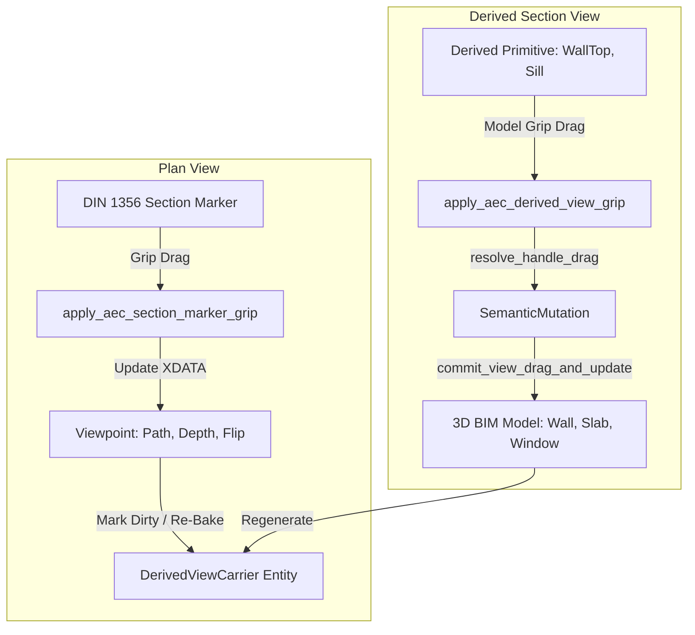

# Requirements

### Overview & Goals
Ziel dieses Plans ist die **konsequente Fortsetzung und Vollendung der modellassoziierten 2D-Schnitt-, Ansichts- und Grundriss-Erzeugung** in OpenCADStudio AEC gemäß dem aktiven Arbeitsplan `.junie/plans/derived-views-and-sections.md`.

Nach dem vorangegangenen Sitzungsabbruch müssen zunächst die bestehenden Compiler- und Testfehler in der Arbeitskopie (speziell im Bereich von `src/app/update/viewport.rs` und `src/modules/aec/views/din1356.rs`) behoben werden, um Step 1 abzuschließen. Anschließend werden die nachfolgenden Stufen für semantische Modellgriffe im Schnitt, die präzise Grundriss-Lokalisierung sowie Verdeckungs- und XREF-Härtung implementiert und durch das Beispielprojekt validiert.

---

### Scope

#### In Scope
- **Abschluss Step 1 (Marker-Grips & Properties):**
  - Korrektur der Compilerfehler in `src/app/update/viewport.rs` (Importe und `commit_active_grip_edit()`).
  - Platzierung der Modultests im AEC-Bereich (`din1356.rs`) nach den Architekturrichtlinien (`AEC != Core`).
  - Fertigstellung der assoziativen DIN 1356 Schnitt- und Ansichtsmarkierungen (`Din1356SectionMarker`).
- **Step 2 (Semantische Modell-Rückbearbeitung im Schnitt):**
  - Interaktive `EditHandle`-Griffe an abgeleiteten Schnittkanten (`WallTop`, `SlabTop`, `OpeningSill`, etc.).
  - Dispatching in Core-Hooks (`apply_aec_derived_view_grip`) und Transaktionscommit (`commit_view_drag_and_update`).
  - Live-Drahtvorschau während des interaktiven Ziehens.
- **Step 3 (Lokalisierte Grundriss-Engine):**
  - Relative Transformation zum Viewpoint-Ursprung in `floorplan_engine.rs`.
  - Exakte Einfügepunkt-Verortung des `DerivedViewCarrier`.
  - Nachträgliche Höhenverstellung der Schnittebene (`z_cut`).
- **Step 4 (Occlusion & XREF-Stabilität):**
  - 2D-Occlusion-Clipping gegen opake Flächenmasken in `silhouette.rs` und `cut_engine.rs`.
  - Geschlossene Schichtkonturen (`CutBoundary`) für Wände und Decken.
  - Stabile Erhaltung von 3D-Meshes und Schraffuren bei XREF-Darstellungswechseln.
- **Step 5 (End-to-End-Validierung):**
  - Aktualisierung der Beispieldateien in `examples/beispiel_haus/`.
  - Durchführung der Gesamttestsuite und Dokumentationsupdate.

#### Out of Scope
- Freiform- und Spline-Schnittführungen.
- Vollautomatische Bewehrungsplangenerierung in Schalplänen.

---

### User Stories
- **Als Architekt** möchte ich eine Schnittlinie im Grundriss anklicken und an Griffen strecken, verschieben oder die Blicktiefe anpassen können, sodass sich der zugehörige Schnitt synchron aktualisiert.
- **Als Konstrukteur** möchte ich im Schnitt die Oberkante einer Wand oder Decke per Griff ziehen können, wodurch sich die Wandhöhe im 3D-Modell und in allen Plänen ändert.
- **Als Planer** möchte ich einen horizontalen Grundriss an jedem beliebigen Punkt platzieren können, ohne dass Geometrien verschoben oder abgeschnitten werden.
- **Als Anwender** möchte ich zwischen Ausführungs-, Entwurfs- und Schalplan umschalten, ohne dass Bauteile referenzierter Geschosse verschwinden.

---

### Functional Requirements
- **FR-1:** DIN 1356 Schnitt- und Ansichtsmarkierungen besitzen Viewport-Griffe (Start, Ende, Tiefe, Flip, Jogs) und sind bidirektional an den `DerivedViewCarrier` gekoppelt.
- **FR-2:** Abgeleitete Schnittkanten stellen semantische Modellgriffe bereit, die 3D-BIM-Mutationen ausführen und Undo/Redo unterstützen.
- **FR-3:** Das Eigenschaften-Panel erlaubt die Bearbeitung von Name, Tiefe, Z-Bereich, Schnitthöhe und Maßstab mit automatischer Planaktualisierung.
- **FR-4:** Grundrisse und Deckenspiegel werden relativ zum Viewpoint-Ursprung transformiert und am gewählten Klickpunkt eingefügt.
- **FR-5:** Hintergrundkanten werden hinter opaken Schichten sauber beschnitten, und geschnittene Schichten weisen geschlossene Außenlinien auf.
- **FR-6:** Das Gesamtmodell behält ACIS-Meshes und Schraffuren über XREFs bei Planartenwechseln dauerhaft bei.

---

### Non-Functional Requirements
- **Architekturtreue:** Core (`src/app/**`) enthält nur minimale, delegierende Hooks; die Fachlogik und Tests verbleiben in `src/modules/aec/**`.
- **Performanz:** Schnelle Bounding-Box-Vorfilterung und flüssige Live-Vorschau ohne vorzeitigen Full-Rebuild während des Ziehens.
- **Lokalisierung:** Konsistente Übersetzung (de-DE und en-US) für alle Grifftipps und Eigenschaftsfelder.

# Technical Design

### Current Implementation
- In der Arbeitskopie liegt die Implementierung von `Din1356SectionMarker` in `src/modules/aec/views/din1356.rs` und die Griff-Definition in `src/modules/aec/properties.rs` vor.
- In `src/app/update/viewport.rs` wurde der Dispatcher `apply_aec_section_marker_grip` integriert. Am Ende der Datei befindet sich jedoch ein unvollständiger Test mit Compilerfehlern (private Importe, falsche Signatur von `commit_active_grip_edit`).
- Das Fundament für Modellgriffe (`resolve_handle_drag`, `commit_view_drag_and_update`) existiert in `src/modules/aec/engine/views/edit_ops.rs`, muss jedoch noch an die Viewport-Ereignisschleife angebunden werden.

---

### Key Decisions
1. **Regelkonforme Testorganisation (AEC != Core):**
   - *Entscheidung:* Der Regressionstest für Schnittmarkierungs-Grips und Undo-Verhalten wird aus `src/app/update/viewport.rs` in `src/modules/aec/views/din1356.rs` (bzw. ein Testmodul unter `src/modules/aec/`) überführt.
   - *Begründung:* Gewährleistet die Einhaltung der AGENTS-Richtlinie, dass keine AEC-Fachlogik und keine AEC-spezifischen Unittests in `src/app/**` wachsen.
2. **Entkopplung der Live-Vorschau von der Schnittberechnung:**
   - *Entscheidung:* Während des Mausziehens an Schnitt- oder Modellgriffen wird nur eine Vektor-Vorschau (`grip_reference_wires`) gerendert. Die vollständige Schnitt- und Modellaktualisierung erfolgt erst beim Commit beim Loslassen der Maustaste.
   - *Begründung:* Garantiert 60 FPS bei der Interaktion auch in komplexen Multi-Storey-Gebäudemodellen.
3. **Relative Koordinatentransformation in der Grundriss-Engine:**
   - *Entscheidung:* Alle Schnittkanten in `floorplan_engine.rs` werden über `pt - viewpoint.origin` in den lokalen Viewpoint-Raum überführt, bevor der Carrier sie im Modellbereich positioniert.
   - *Begründung:* Beseitigt Koordinatenversätze und garantiert die exakte Platzierung am Benutzer-Klickpunkt.

---

### Proposed Changes
- **Core-Bereinigung (`src/app/update/viewport.rs`):**
  - Bereinigung des Testabschnitts und der ungenutzten Variablen.
  - Anbindung von `apply_aec_derived_view_grip` an die Selektions- und Grip-Schleife analog zu den Marker-Grips.
- **AEC-Modul (`src/modules/aec/**`):**
  - Fertigstellung und Testabsicherung der DIN 1356 Marker in `views/din1356.rs`.
  - Ergänzung der Modellgriff-Anbindung in `properties.rs` und `walls/axis_session.rs`.
  - Koordinatenkorrektur in `engine/views/floorplan_engine.rs` und `carrier.rs`.
  - 2D-Occlusion-Härtung in `engine/views/silhouette.rs` und `cut_engine.rs`.

---

### Data Models / Contracts
```rust
// Din1356SectionMarker in src/modules/aec/views/din1356.rs
pub struct Din1356SectionMarker {
    pub viewpoint_id: ViewpointId,
    pub carrier_handle: Option<Handle>,
    pub label: String,
    pub path: SectionPath,
    pub far_depth: Option<f64>,
    pub z_min: f64,
    pub z_max: f64,
    pub flip_direction: bool,
}

// Semantischer Modellgriff in src/modules/aec/engine/views/edit_ops.rs
pub fn resolve_handle_drag(
    viewpoint: &Viewpoint,
    model_view: &ModelView,
    scene: &SceneGeometryCollector,
    primitive: &DerivedPrimitive,
    handle_idx: usize,
    view_delta: Vector2,
) -> Result<SemanticMutation, EditOpError>;

pub fn commit_view_drag_and_update(
    doc: &mut CadDocument,
    carrier_handle: Handle,
    mutation: &SemanticMutation,
) -> Result<DerivedViewCarrier, Box<dyn std::error::Error>>;
```

---

### Architecture Diagram


---

### File Structure
- `src/app/update/viewport.rs`: Core-Grip-Dispatching (Marker & Modellgriffe).
- `src/modules/aec/views/din1356.rs`: Parametrische Marker-Entität, Vektoren und Tests.
- `src/modules/aec/properties.rs`: Grip-Definitionen und Properties-Panel-Anbindung.
- `src/modules/aec/engine/views/`:
  - `edit_ops.rs`: Semantische Modellmutationen.
  - `floorplan_engine.rs`: Horizontalschnitte und Grundrisse.
  - `cut_engine.rs`: Vertikalschnitte und geschlossene Konturen.
  - `silhouette.rs`: 2D-Occlusion-Clipping.
  - `carrier.rs`: Träger-Persistenz und Koordinatentransformation.

---

### Risks & Mitigations
- **Degenerierte Griffe bei schrägen Projektionen:** Strikte Validierung der Normalenvektoren in `resolve_handle_drag`; bei unzulässigen Winkeln wird der Griff blockiert.
- **Performance-Einbruch beim kontinuierlichen Ziehen:** Vollständiges Re-Bake erfolgt erst im Commit beim Loslassen der Maus; während der Bewegung wird nur eine leichte Drahtvorschau aktualisiert.

# Testing

### Validation Approach
Die Validierung erfolgt mehrstufig:
1. **Kompilierung & statische Prüfung:** Sicherstellung, dass `cargo check --lib` und `cargo test --lib` ohne Fehler und unzulässige Warnungen durchlaufen.
2. **Modul- und Unit-Tests:** Dedizierte Tests für Marker-Serialisierung, Grip-Transformationen, semantische Modellmutationen und Schnitthöhenkorrekturen.
3. **Interaktive Viewport- und Properties-Tests:** Überprüfung von Start-/Endgriff, Tiefengriff, Flip-Griff sowie Parameteränderungen im Eigenschaften-Panel.
4. **End-to-End-Prüfung im Beispielhaus:** Regenerierung aller Geschosse und des Gesamtmodells in `examples/beispiel_haus/` mit Validierung von 2D- und 3D-Darstellungen.

---

### Key Scenarios
- **Szenario 1: DIN 1356 Schnittmarkierung manipulieren:**
  - Schnittlinie im Grundriss auswählen, Startpunkt und Blicktiefengriff ziehen.
  - *Erwartetes Ergebnis:* Schnittverlauf und Blicktiefe passen sich an; der assoziierte Schnitt wird korrekt aktualisiert.
- **Szenario 2: Blickrichtung umkehren (Flip):**
  - Flip-Griff an der Schnittmarkierung betätigen.
  - *Erwartetes Ergebnis:* Richtungspfeile und Beschriftung kehren sich um; der Schnitt spiegelt sich normgerecht.
- **Szenario 3: Wandoberkante im Schnitt per Griff anheben:**
  - Oberkante einer Wand im Schnitt auswählen und nach oben ziehen.
  - *Erwartetes Ergebnis:* 3D-Wandhöhe ändert sich; alle Grundrisse, Schnitte und das 3D-Modell spiegeln die neue Höhe wider.
- **Szenario 4: Grundriss lokalisieren:**
  - `AEC_FLOORPLAN` an Punkt (40, 10) einfügen.
  - *Erwartetes Ergebnis:* Die Geometrie erscheint ohne Versatz exakt am gewählten Klickpunkt.
- **Szenario 5: Planarten-Wechsel im Gesamtmodell:**
  - Umschalten zwischen Entwurfs-, Ausführungs- und Schalplan im Gesamtmodell.
  - *Erwartetes Ergebnis:* XREF-Bauteile behalten ihre Schraffuren und 3D-Solids bei, ohne Darstellungsabbrüche.

---

### Edge Cases
- **Ziehoperationen an schreibgeschützten XREF-Bauteilen:** Sichere Blockierung mit Benutzerhinweis ohne Fehlermutation.
- **Koplanare Wandflächen im Schnitt:** Keine doppelten Trennlinien oder fehlerhaften Verdeckungsartefakte.
- **Undo/Redo nach Griffbearbeitung:** Einzelschritt-Undo stellt den vorherigen Zustand des Markers, seiner Kindelemente und des Schnitt-Trägers exakt wieder her.

# Delivery Steps

### ✓ Step 1: Bereinigung und Fertigstellung von Step 1 (Marker-Grips, Properties & Tests)
Alle Komponenten von Step 1 kompilieren fehlerfrei, die Markierungs-Griffe funktionieren im Viewport wie im Eigenschaften-Panel und werden durch saubere AEC-Tests abgesichert.

- Behebung der Compilerfehler in `src/app/update/viewport.rs`: Beseitigung der privaten Typenimporte (`ModelViewId`, `ScaleDenominator`, `ViewProfileId` aus `views`) und Korrektur des argumentlosen Aufrufs von `commit_active_grip_edit()`.
- Verschiebung bzw. Ausrichtung der AEC-Marker-Grip- und Undo-Tests in das dafür vorgesehene Modul `src/modules/aec/views/din1356.rs` gemäß den Projektrichtlinien (AEC-Logik und -Tests verbleiben strikt im AEC-Modul).
- Verifikation des synchronen Dirty-Trackings und der Neuberechnung verknüpfter `DerivedViewCarrier`-Instanzen bei Marker-Manipulationen (Start, Ende, Blicktiefe, Flip, Jog-Segmente).
- Validierung der Parameteranpassungen im Eigenschaften-Panel (`marker_prop_section`, `carrier_prop_section`) über `cargo test --lib din1356`.

### ✓ Step 2: Viewport-Anbindung semantischer Modellgriffe an abgeleiteten Schnittkanten
Abgeleitete Kanten im Schnitt bieten interaktive Griffe im Viewport, deren Manipulation über Transaktions-Commits direkt das 3D-BIM-Modell verändert.

- Erweiterung von `append_derived_view_grips` in `src/modules/aec/properties.rs`, um für ausgewählte `DerivedPrimitive`-Entitäten ihre `edit_handles` als interaktive Ziehgriffe anzuzeigen.
- Implementierung von `apply_aec_derived_view_grip` in Core-Dispatch (`src/app/update/viewport.rs`), das über `resolve_handle_drag` und `commit_view_drag_and_update` (`edit_ops.rs`) atomare Modellmutationen ausführt.
- Bereitstellung einer Live-Drahtvorschau während des Ziehens (z. B. Wandoberkantenlinie oder Brüstungsrechteck) ohne vorzeitiges Zerstören der bestehenden Schnittgrafik.
- Vollständige Einbindung in das Undo/Redo-System und automatische Aktualisierung abhängiger Ansichten nach dem Commit.

### ✓ Step 3: Lokalisierte Koordinatentransformation & Korrektur der Grundriss-Engine
Grundrisse und Deckenspiegel werden exakt relativ zum Viewpoint-Ursprung am gewählten Einfügepunkt abgeleitet und erlauben nachträgliche Höhenkorrekturen.

- Anpassung von `src/modules/aec/engine/views/floorplan_engine.rs` zur relativen Projektion aller Schnittpolygone, Leibungen und Öffnungssymbole in das lokale Koordinatensystem des Viewpoints (`p - origin`).
- Korrektur der Bounding-Box- und Einfügepunkt-Zuordnung in `src/modules/aec/engine/views/carrier.rs` (`transform_pt`), sodass der vom Anwender gewählte Klickpunkt exakt der Ursprung der platzierten 2D-Zeichnung ist.
- Unterstützung der nachträglichen Höhenänderung der Schnittebene (`z_cut`, Z-Range) sowohl über Eigenschaften (`view_cut_height`) als auch über interaktive Griffe.
- Validierung der Decken-, Wand- und Öffnungsdarstellung (inkl. Anschlagssymbole und Türöffnungswinkel) in 2D-Grundrissen.

### ✓ Step 4: Härtung der Verdeckungsberechnung, Schichtkonturen & XREF-Planartensynchronisation
Hintergrundkanten sind an Schnittflächen verdeckt, Bauteile weisen geschlossene Konturen auf und XREF-Geschosse bleiben im Gesamtmodell stabil gerendert.

- Präzisierung des 2D-Occlusion-Clippings in `src/modules/aec/engine/views/silhouette.rs` und `cut_engine.rs` gegen opake Flächenmasken (`SurfaceFill` / `CutFill`) zur Vermeidung durchscheinender Hintergrundlinien.
- Sicherstellung geschlossener Randkonturen (`CutBoundary`) für jede einzelne Wandschicht und Deckenkante auch an Öffnungsleibungen und Stufenübergängen.
- Härtung des XREF-Geometrie- und Tessellierungs-Caches im Gesamtmodell: Erhaltung von 3D-Meshes (ACIS SAT) und Schichtschraffuren beim Hin- und Herschalten zwischen Entwurf, Ausführung, Schalplan und 3D.
- Absicherung gegen Schnittartefakte bei koplanaren Bauteilen und Vermeidung doppelter Kanten.

### ✓ Step 5: End-to-End-Validierung, Beispielprojekt-Aktualisierung & Dokumentation
Das Gesamtsystem für Schnitte, Ansichten und Modell-Rückbearbeitung ist vollständig integriert, im Beispielhaus validiert und dokumentiert.

- Neugenerierung aller DWG-, DXF- und OCSProj-Dateien im Beispielprojekt `examples/beispiel_haus/` mit den neuen assoziativen DIN 1356 Markierungen und aktualisierten Ableitungen.
- Gesamttest aller Workflows: Schnittlinien-Manipulation per Griff im Grundriss, Höhenverstellung per Griff im Schnitt, Modifikation im Properties-Panel und Planarten-Umschaltung.
- Ausführung der gesamten Testsuite (`cargo test --lib`) zur Sicherstellung von Regressionsfreiheit über das gesamte AEC- und Core-Modul.
- Dokumentation der neuen Schnitt- und Ansichtsfunktionen, Tastenkürzel und Griff-Interaktionen in der Anwenderdokumentation.