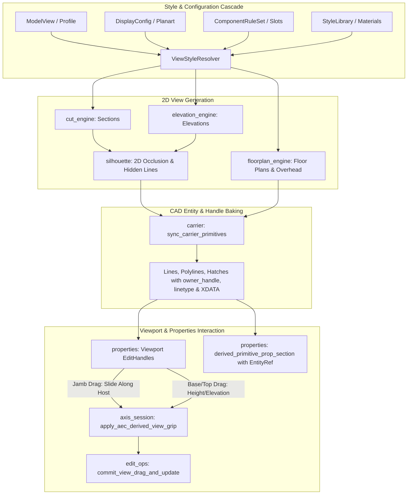

# Requirements

### Overview & Goals
Ziel dieses Plans ist die **präzise Korrektur und Vervollständigung der 2D-Grundriss-, Schnitt- und Ansichtserzeugung** in OpenCADStudio AEC entlang dreier konkreter Kernanforderungen:
1. **Korrekte verdeckte Linien:** Zuverlässige Erkennung und Erzeugung verdeckter Kanten (als gestrichelte Linien auf dedizierten Layern) sowie Überkopf-Kanten (z. B. Öffnungsstürze und Unterzüge über der Schnittebene im Grundriss) unter Eliminierung von Verdeckungsartefakten.
2. **Linientypen, Schraffuren & Stile aus Planart und Komponenten:** Vollständige Ablösung fest verdrahteter Muster (`ANSI31`, feste Linienstärken) durch eine dynamische Stil- und Darstellungskaskade basierend auf der aktiven Planart (`DisplayConfig`), Komponentenregeln (`ComponentRuleSet`), Bauteilstilen (`WallStyle`, `SlabStyle`, `OpeningStyle`) und der Materialbibliothek.
3. **Korrektur und Vervollständigung von Handles an assoziativen Elementen:** Durchgängige Etablierung sowohl nativer CAD-Entity-Handles (Besitzerhierarchie `owner_handle`, bidirektionale Marker-Träger-Kopplung, Quell-Handle-Rückverfolgung in XDATA) als auch interaktiver Viewport-Ziehgriffe (`EditHandle`) für Öffnungsleibungen (Verschieben entlang der Wandachse), Wandunterkanten und Deckenunterkanten im Schnitt und Grundriss.

---

### Scope

#### In Scope
- **Verdeckte Linien & Überkopf-Darstellung:**
  - Konfigurierbare Ausgabe verdeckter Kanten (`emit_hidden_lines`) in `CutEngineOptions` und `FloorPlanEngineOptions` gesteuert über `DisplayConfig` / `ModelView`.
  - Ableitung von Überkopf-Kanten (`FeatureKey::OpeningHead`, Deckenkanten über Schnittebene) in `floorplan_engine.rs` als `PrimitiveRole::HiddenEdge` mit gestricheltem Linientyp.
  - Härtung des 2D-Occlusion-Clippings in `silhouette.rs` für kolineare Segmentüberlappungen und saubere Zuteilung des Linientyps `"DASHED"` und Layers `"AEC_HIDDEN"` / `"AEC_SECTION_HIDDEN"`.
  - Übertragung von Linientyp (`linetype`), Farbe (`color`) und Linienstärke (`lineweight`) auf native CAD-Entities in `carrier.rs`.
- **Planart-, Komponenten- und Material-Stile:**
  - Zentraler Style-Resolver `resolve_view_primitive_style` mit Kaskade: `ModelView.graphic_overrides` > `DisplayConfig` (Regeln & Komponenten-Slots) > Bauteilstil > Materialbibliothek > Fallback-Rolle.
  - Berücksichtigung von `DisplayConfig.detail` (Schraffuren ein/aus, Schichtfilterung nach Tragfähigkeit `StructuralOnly`/`CoreOnly`, Öffnungssymbole ein/aus).
  - Berücksichtigung von Phasenfiltern (`DisplayConfig.phase_filter` für Abbruch/Bestand) mit normgerechten Liniendarstellungen.
  - Materialschraffuren mit dynamischem Muster, Maßstab, Drehwinkel und Farbe in Schnitten und Grundrissen.
- **CAD- und Viewport-Handles an assoziativen Elementen:**
  - Zuweisung der CAD-Besitzerhierarchie `ent.common_mut().owner_handle = carrier.handle` für alle abgeleiteten Kind-Entities.
  - Speicherung des direkten Quell-Bauteil-Handles (`source_handle`) in der `DERIVED_PRIMITIVE`-XDATA und robuste Indizierung.
  - Bidirektionale Verknüpfung von `Din1356SectionMarker` und `DerivedViewCarrier` (`marker.carrier_handle` und `carrier.marker_handle` via `owner_index::link_peers`).
  - Vervollständigung der interaktiven Viewport-Modellgriffe (`EditHandle`) in `properties.rs` und `axis_session.rs` für `WallBase` (Wandunterkante), `SlabBottom` (Deckenunterkante) und `OpeningLeftJamb`/`OpeningRightJamb` (horizontales Verschieben entlang der Wandachse).
  - Navigation zum Quell-Bauteil im Eigenschaften-Panel (`derived_primitive_prop_section`) über anklickbare `EntityRef`.

#### Out of Scope
- Beliebige 3D-B-Rep-Boolesche Schnittverschneidungen außerhalb von Wänden, Decken und Öffnungen.
- Automatische Text-Kollisionsvermeidung für Maßketten (Gegenstand eines separaten Bemaßungsplans).

---

### User Stories
- **Als Architekt** möchte ich, dass verdeckte Bauteilkanten hinter Schnittebenen oder opaken Schichten normgerecht gestrichelt gezeichnet werden, anstatt unsichtbar zu sein oder ungestrichelt durchzuscheinen.
- **Als Planer** möchte ich im Grundriss Türstürze und Unterzüge über der Schnittebene als gestrichelte Überkopf-Linien sehen, damit Durchbrüche und Sturzhöhen im 2D-Plan sofort erkennbar sind.
- **Als Konstrukteur** möchte ich zwischen Entwurfs-, Ausführungs- und Tragwerksplan umschalten, sodass Schraffuren, Linienstärken und nicht-tragende Schichten exakt gemäß der gewählten Planart und den Materialdefinitionen dargestellt werden.
- **Als CAD-Anwender** möchte ich ein Fenster oder eine Tür im Schnitt oder Grundriss an den Leibungsgriffen anfassen und entlang der Wand verschieben können, während das 3D-Modell synchron nachgeführt wird.
- **Als Prüfer** möchte ich beim Anklicken einer abgeleiteten Schnittkante im Eigenschaften-Panel sofort das ursprüngliche Quellbauteil (Wand, Decke, Fenster) mit seinem CAD-Handle sehen und anspringen können.

---

### Functional Requirements
- **FR-1:** Verdeckte Kanten werden bei aktivierter Option als `PrimitiveRole::HiddenEdge` mit Linientyp `"DASHED"` erzeugt und im CAD-Dokument mit korrekter Linienart gerendert.
- **FR-2:** Im Grundriss werden Öffnungsstürze und Kanten oberhalb der Schnittebene als gestrichelte Überkopf-Linien auf `AEC_OVERHEAD` dargestellt.
- **FR-3:** Der Style-Resolver wendet Materialmuster, Maßstäbe und Winkel aus der Materialbibliothek an (`material.hatch_pattern`, `hatch_scale`, `hatch_angle`).
- **FR-4:** Planart-Einstellungen steuern die Sichtbarkeit von Schichten (`StructuralOnly`), Schraffuren (`hatches: false`) und Phasenstilen (`phase_filter`).
- **FR-5:** Alle abgeleiteten Entities besitzen ihren Träger als `owner_handle` und speichern den CAD-Handle ihres Quellbauteils in XDATA.
- **FR-6:** Leibungsgriffe (`OpeningLeftJamb`, `OpeningRightJamb`) ermöglichen das interaktive Verschieben von Öffnungen entlang der Wandachse.
- **FR-7:** Wandunterkanten (`WallBase`) und Deckenunterkanten (`SlabBottom`) bieten vertikale Höhengriffe mit synchroner BIM-Modellaktualisierung.

---

### Non-Functional Requirements
- **Architekturtreue (AEC != Core):** Sämtliche Stilauflösungen, Verdeckungslogiken und Griffberechnungen verbleiben strikt unter `src/modules/aec/**`.
- **DXF/DWG-Standardkonformität:** Linientypen (`DASHED`, `CONTINUOUS`) und Layer entsprechen den CAD-Standards, sodass externe Viewer gestrichelte Linien sofort nativ darstellen.
- **Performanz:** Keine redundanten Mehrfachschnitte; Occlusion-Clipping nutzt Bounding-Box-Vorfilterung und frühe Tiefenausschlüsse.

# Technical Design

### Current Implementation
- **Verdeckte Linien:** In `cut_engine.rs` ist `emit_hidden_lines: false` fest kodiert. In `floorplan_engine.rs` existiert keine Überkopf-Kantenerzeugung für Stürze. `silhouette.rs` besitzt zwar `clip_segment_against_polygons`, jedoch fehlen Linientyp-Zuweisungen im Entity-Bake in `carrier.rs`.
- **Stile & Schraffuren:** In `cut_engine.rs` und `floorplan_engine.rs` wird `"ANSI31"` fest als Fallback gesetzt; `DisplayConfig`, `ComponentRuleSet` und `Material`-Eigenschaften fließen nicht in die abgeleiteten Primitives ein.
- **Handles & Assoziativität:** Kind-Entities erhalten in `carrier.rs` `owner_handle = 0`. In `read_derived_primitive_metadata` führt das Fehlen von Quell-Handles zu Ausfällen beim Auslesen des Trägers. In `properties.rs` fehlen Griffe für Leibungen, Wand- und Deckenunterkanten.

---

### Key Decisions
1. **Zentralisierter View-Style-Resolver:**
   - *Entscheidung:* Einführung von `resolve_view_primitive_style` in `src/modules/aec/engine/views/style_resolver.rs`.
   - *Begründung:* Vermeidet Code-Duplizierung zwischen `cut_engine.rs`, `floorplan_engine.rs` und `elevation_engine.rs` und stellt sicher, dass `ModelView.graphic_overrides`, `DisplayConfig`, `ComponentRuleSet` und `Material` konsistent ausgewertet werden.
2. **CAD-Besitzerhierarchie & Source-Handle-Integrität:**
   - *Entscheidung:* `ent.common_mut().owner_handle = carrier.handle` wird beim Erzeugen jedes Primitives gesetzt; in der `DERIVED_PRIMITIVE`-XDATA wird das Handle des Quellbauteils als `XDataValue::Handle(source_handle)` persistent abgelegt.
   - *Begründung:* Ermöglicht bidirektionale Navigation im Eigenschaften-Panel, sauberen Block-Export und verhindert verwaiste Kindelemente.
3. **Leibungs- und Höhengriffe im Viewport:**
   - *Entscheidung:* Aktivierung von `OpeningLeftJamb` und `OpeningRightJamb` mit horizontaler Achsenbeschränkung (`axis = glam::DVec3::new(1.0, 0.0, 0.0)`) sowie `WallBase` und `SlabBottom` mit vertikaler Beschränkung (`axis = glam::DVec3::new(0.0, 1.0, 0.0)`).
   - *Begründung:* Die mathematische Rückrechnung existiert bereits in `edit_ops.rs` (`MoveAlongHost`, `SetSlabElevation`), war jedoch im Viewport-Dispatcher noch nicht freigeschaltet.

---

### Proposed Changes
- **`src/modules/aec/engine/views/style_resolver.rs` (Neu):**
  - Kaskadierende Auflösung von Linientyp, Linienstärke, RGB-Farbe, Schraffurmuster, Maßstab, Drehwinkel und Layer für Wände, Decken und Öffnungen.
- **`src/modules/aec/engine/views/silhouette.rs` & `cut_engine.rs`:**
  - `CutEngineOptions.emit_hidden_lines` ansteuerbar machen; Verdeckungsausschlüsse bei kolinearen Segmenten bereinigen; verdeckte Kanten als `PrimitiveRole::HiddenEdge` mit `"DASHED"` erzeugen.
- **`src/modules/aec/engine/views/floorplan_engine.rs`:**
  - Überkopf-Kanten für Öffnungsstürze und Unterzüge über der Schnittebene als `PrimitiveRole::HiddenEdge` auf `AEC_OVERHEAD` erzeugen.
  - Planart-Filterung (`detail.hatches`, `detail.layers`) einbinden.
- **`src/modules/aec/engine/views/carrier.rs`:**
  - `owner_handle = carrier.handle` auf generierten CAD-Entities setzen.
  - `ent.common_mut().linetype` aus `prim.style.line_type` (bzw. Fallback `"DASHED"`) zuweisen.
  - XDATA um `source_handle` erweitern und Deserialisierung härten.
- **`src/modules/aec/properties.rs` & `axis_session.rs`:**
  - Viewport-Griffe für Leibungen (`OpeningLeftJamb`, `OpeningRightJamb`), Wandbasis (`WallBase`) und Deckenunterkante (`SlabBottom`) registrieren und dispatchen.
  - Im Eigenschaften-Panel `derived_primitive_prop_section` das Quell-Element als navigierbare `EntityRef` anzeigen.

---

### Data Models / Contracts
```rust
// Style-Resolver-Schnittstelle
pub struct ViewStyleContext<'a> {
    pub display_config: Option<&'a DisplayConfig>,
    pub style_library: Option<&'a StyleLibrary>,
    pub model_view: &'a ModelView,
}

pub fn resolve_layer_cut_style(
    ctx: &ViewStyleContext,
    wall: &CollectedWall,
    layer_idx: usize,
) -> (ResolvedStyle, Option<ResolvedStyle>); // (Contour/Boundary, Hatch/Fill)

pub fn resolve_opening_view_style(
    ctx: &ViewStyleContext,
    opening: &CollectedOpening,
    slot: OpeningComponentSlot,
) -> ResolvedStyle;

// Erweiterte DerivedPrimitiveMetadata
pub struct DerivedPrimitiveMetadata {
    pub view_id: ModelViewId,
    pub index: u32,
    pub role: PrimitiveRole,
    pub element_ref: Option<ElementRef>,
    pub source_handle: Option<Handle>,
    pub feature: Option<FeatureKey>,
    pub xref_name: Option<String>,
    pub carrier_handle: Option<Handle>,
}
```

---

### Architecture Diagram


---

### File Structure
- `src/modules/aec/engine/views/style_resolver.rs`: Zentraler Style- und Material-Resolver für alle 2D-Ansichten.
- `src/modules/aec/engine/views/silhouette.rs`: Verdeckungsberechnung, Kanten-Clipping und gestrichelte Linien.
- `src/modules/aec/engine/views/cut_engine.rs`: Vertikalschnitt-Generierung mit dynamischen Schichtstilen und verdeckten Kanten.
- `src/modules/aec/engine/views/floorplan_engine.rs`: Grundriss- und Deckenspiegel-Generierung inklusive Überkopf-Kanten und Planart-Filterung.
- `src/modules/aec/engine/views/carrier.rs`: Native CAD-Konvertierung, `owner_handle`, Linientyp-Zuweisung und XDATA.
- `src/modules/aec/properties.rs`: Erweiterte Viewport-Griffe (Leibung, Wandbasis, Deckenbasis) und Properties-Panel-Verknüpfung.
- `src/modules/aec/walls/axis_session.rs`: Interaktiver Dispatcher und Preview-Wires für Leibungs- und Höhen-Grips.

---

### Risks & Mitigations
- **Übermäßige Liniendichte bei verdeckten Kanten:** Option zur Deaktivierung verdeckter Linien in Entwurfsplänen über `DisplayConfig.detail.hidden_lines` bzw. `CutEngineOptions`.
- **CAD-Linientypen in DXF ohne geladene Linetype-Tabelle:** Sicherstellung, dass der Linientyp `"DASHED"` in der CAD-Dokument-Linientyp-Tabelle registriert ist, damit DWG/DXF-Exportoren ihn nicht ignorieren.

# Testing

### Validation Approach
1. **Unit-Tests für Style-Resolution:** Überprüfung, dass Materialschraffuren (`AR-CONC`, `BRICK`, `EARTH`), Skalierungen und Winkel korrekt auf `DerivedPrimitive` abgebildet werden.
2. **Verdeckungs- und Linientyp-Tests:** Testfälle in `silhouette.rs` und `cut_engine.rs`, die sicherstellen, dass verdeckte Segmente exakt den Linientyp `"DASHED"` erhalten und Überkopf-Stürze im Grundriss erscheinen.
3. **Handle- und Ownership-Validierung:** Tests in `carrier.rs`, die verifizieren, dass jedes Kindelement `owner_handle == carrier.handle` besitzt und das Quell-Handle in XDATA hinterlegt ist.
4. **Interaktionstests für Leibungs- und Höhengriffe:** Simulation von Griff-Ziehoperationen an Fensterleibungen (`OpeningLeftJamb`), Wandunterkanten (`WallBase`) und Deckenunterkanten (`SlabBottom`) mit anschließender Prüfung der BIM-Modellmutation.
5. **System- und Beispielhaustests:** Kompletter Durchlauf von `test_generate_sample_project` zur Verifikation der fehlerfreien Generierung aller Pläne.

---

### Key Scenarios
- **Szenario 1: Verdeckte Kanten im Schnitt:**
  - Wand mit Öffnung im Hintergrund einer Schnittführung ableiten.
  - *Erwartetes Ergebnis:* Verdeckte Kanten der Öffnung werden gestrichelt auf `AEC_SECTION_HIDDEN` gezeichnet; sichtbare Kanten im Vordergrund bleiben durchgezogen.
- **Szenario 2: Überkopf-Sturz im Grundriss:**
  - Grundriss mit Fenster- und Türöffnungen ableiten.
  - *Erwartetes Ergebnis:* Stürze oberhalb der Schnittebene (`z_cut = 1.0m`) erscheinen als gestrichelte Linien auf `AEC_OVERHEAD`.
- **Szenario 3: Planart- und Materialschraffuren:**
  - Schnittableitung einer Stahlbetonwand mit Material `"Stahlbeton"` (`hatch_pattern = "AR-CONC"`).
  - *Erwartetes Ergebnis:* Die Schnittfläche wird mit dem Muster `AR-CONC` im passenden Maßstab und Winkel schraffiert.
- **Szenario 4: Leibungsgriff verschieben:**
  - Im Schnitt oder Grundriss den Leibungsgriff einer Tür anklicken und 0.50m nach rechts ziehen.
  - *Erwartetes Ergebnis:* Die Tür verschiebt sich entlang der Wandachse; 3D-Modell, Grundriss und Schnitt aktualisieren sich synchron.
- **Szenario 5: Quellbauteil-Navigation im Eigenschaften-Panel:**
  - Eine abgeleitete Kante im Schnitt anklicken.
  - *Erwartetes Ergebnis:* Das Eigenschaften-Panel zeigt „AEC Assoziiertes Bauteil“ mit direkter `EntityRef` zum Quellbauteil.

---

### Edge Cases
- **Kolineare Überlappungen an Wandecken:** Keine doppelten oder fraktionierten Liniensegmente bei verdeckten Kanten.
- **Öffnungen ohne Sturz (raumhoch):** Keine fälschliche Erzeugung von Überkopf-Linien, wenn die Öffnung bis zur Deckenunterkante reicht.
- **Undo nach Leibungsverschiebung:** Vollständige Rücknahme der Bauteilverschiebung und Wiederherstellung der ursprünglichen 2D-Schnittzeichnung.

# Delivery Steps

### ✓ Step 1: Härtung und Vervollständigung der Verdeckungs- und Linienberechnung (Hidden Lines & Overhead Edges)
Verdeckte Kanten und Überkopf-Bauteile werden in Grundrissen, Schnitten und Ansichten präzise als gestrichelte Linien auf dedizierten Layern berechnet.

- Erweiterung von `CutEngineOptions` und `FloorPlanEngineOptions` um `emit_hidden_lines` bzw. `show_overhead_edges`.
- Ableitung von Überkopf-Kanten in `floorplan_engine.rs` (z. B. Stürze über der Schnittebene, Deckenkanten) als `PrimitiveRole::HiddenEdge` mit gestricheltem Linientyp auf `AEC_OVERHEAD`.
- Härtung des 2D-Occlusion-Clippings in `src/modules/aec/engine/views/silhouette.rs` für kolineare Kanten und Erzeugung sauberer `HiddenEdge`-Segmente ohne Null-Längen.
- Zuverlässige Übertragung von `prim.style.line_type` (z. B. `"DASHED"`), Linienstärken und RGB-Farben auf native CAD-Entities in `carrier.rs` sowie Sicherstellung der Linetype-Tabelle im Dokument.

### ✓ Step 2: Dynamische Stile, Linientypen und Schraffuren aus Planart, Darstellungskomponenten und Materialbibliothek
Schnitt- und Grundriss-Primitives übernehmen Schraffurmuster, Maßstäbe, Winkel, Linientypen und Filter dynamisch aus der aktiven Planart (`DisplayConfig`), den Komponentenregeln und den Materialdefinitionen.

- Implementierung eines zentralen Style-Resolvers in `src/modules/aec/engine/views/style_resolver.rs`, der die Kaskade `ModelView.graphic_overrides` > `DisplayConfig` (`ComponentRuleSet` / Slot-Overrides) > Bauteilstil (`WallStyle` / `SlabStyle`) > `Material` auflöst.
- Auswertung von `DisplayConfig.detail` in Grundriss- und Schnitt-Engines: Abschaltung von Schraffuren (`hatches: false`), Schichtfilterung (`layers: StructuralOnly` / `CoreOnly`) und Öffnungssymbolen (`opening_symbols: false`).
- Phasenfilter-Unterstützung (`DisplayConfig.phase_filter`): Visualisierung von Abbruch/Bestand mit spezifischen Linientypen (z. B. gestrichelt) und Schraffuren.
- Dynamische Schraffuren in `cut_engine.rs`, `floorplan_engine.rs` und `carrier.rs` unter Verwendung der tatsächlichen Materialeigenschaften (Muster, Skalierung, Ausrichtungswinkel).

### ✓ Step 3: Korrektur und Vervollständigung von CAD- und Viewport-Handles an assoziativen Elementen
Alle assoziativen 2D-Elemente besitzen vollständige CAD-Besitzerhierarchien, bidirektionale XDATA-Referenzen sowie interaktive Viewport-Modellgriffe für alle Bauteil- und Öffnungskanten.

- Setzen der CAD-Besitzerhierarchie `ent.common_mut().owner_handle = carrier.handle` für alle abgeleiteten Entities in `carrier.rs`.
- Härtung der XDATA-Serialisierung in `attach_primitive_xdata` und `read_derived_primitive_metadata` inklusive direkter CAD-Source-Handles und robuster Indizierung.
- Bidirektionale Verknüpfung von `Din1356SectionMarker` und `DerivedViewCarrier` über `owner_index::link_peers` und Speicherung des `marker_handle`.
- Vervollständigung der Viewport-Modellgriffe (`EditHandle`) in `properties.rs` und `axis_session.rs`: Griffe für `WallBase` (Wandunterkante), `SlabBottom` (Deckenunterkante) und `OpeningLeftJamb` / `OpeningRightJamb` (Horizontales Verschieben der Öffnung entlang der Wandachse in Schnitt und Grundriss).
- Anzeige des Quell-Elements als navigierbare `EntityRef` im Eigenschaften-Panel (`derived_primitive_prop_section`).

### ✓ Step 4: End-to-End-Integration, Validierung im Beispielhaus und Regressionsabsicherung
Alle Workflows zur Planableitung, Verdeckung, Stilübernahme und Griffbearbeitung sind durchgängig integriert, im Beispielhaus validiert und durch automatisierte Tests abgesichert.

- Aktualisierung der Beispielhaus-Pläne in `examples/beispiel_haus/` mit dynamischen Materialschraffuren, korrekten verdeckten Linien und vollständigen Handles.
- Integrationstests für Planarten-Umschaltung (z. B. Entwurf vs. Ausführung vs. Statik) an Schnitten und Grundrissen.
- Modul- und Regressionstests für verdeckte Linien, Style-Resolution, CAD-Ownership und Jamb-Grip-Interaktionen.
- Ausführung der gesamten Testsuite (`cargo test --lib`) zur Sicherstellung von Regressionsfreiheit.