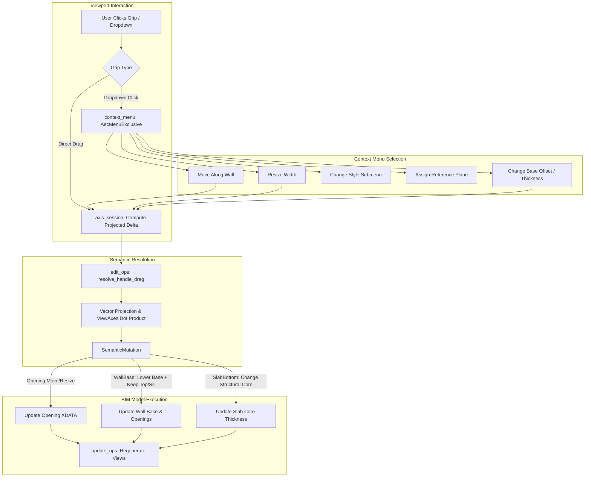

# Requirements

### Overview & Goals
Ziel dieses Plans ist die **Realisierung einer robusten, fehlertoleranten Interaktionslogik für assoziative Ansichten und 2D/3D-Bauteilmodellierung** (Schritt 1 der Roadmap). 

Anstelle eines unkontrollierten Direkt-Ziehens per Mausgriff, das zu unbeabsichtigten Modellverzerrungen führen kann, wird eine **Kontextmenü- und Dropdown-Architektur** etabliert (analog zu den bewährten Wandverschneidungs-Menüs `wall_junction_dropdown_grip`):
1. **Geführte Aktionen über Kontextmenüs & Dropdown-Griffe:** Beim Klick auf den Dropdown-Griff oder Rechtsklick auf ein Bauteil (Leibung, Wandbasis, Deckenkante) öffnet sich ein fokussiertes Kontextmenü mit gezielten Wahlmöglichkeiten:
   - **Öffnungen (Fenster / Türen):** *Verschieben entlang Wandachse*, *Öffnungsbreite ändern (Strecken)*, *Stil ändern*, *Bezugsebene / Brüstungshöhe anpassen*, *Aufschlag / Anschlag spiegeln*.
   - **Wandunterkante (`WallBase`):** *Wandbasis-Offset anpassen* (bei absolut fixierter Wandoberkante), *Bezugsebene zuweisen*, *Wandstil ändern*.
   - **Deckenunterkante (`SlabBottom`):** *Deckendicke der Tragschicht anpassen* (bei absolut fixierter Deckenoberkante), *Decke in Z versetzen*, *Bezugsebene zuweisen*, *Deckenstil ändern*.
2. **Mathematische Korrektur der 2D/3D-Achsenprojektionen:**
   - Dynamische Ermittlung der 2D-Wandachse im Grundriss (`OpeningLeftJamb`, `OpeningRightJamb`) unter vollständiger Berücksichtigung der Trägerdrehung (`carrier.rotation_rad`) und Wandrichtung, sodass sich Öffnungen auch auf vertikalen und schrägen Wänden reibungslos manipulieren lassen.
   - Richtungsbereinigung im Schnitt: Auswertung des Skalarprodukts zwischen Wandachse und Schnittblickrichtung (`dot(wall_dir, view_right)`), sodass Ziehen nach rechts immer die intuitive Richtung im 3D-Raum bewegt (selbst bei gespiegeltem Schnitt).
3. **Invarianz- und Integritätsregeln für Bauteilabhängigkeiten:**
   - Beim Absenken der Wandbasis (z. B. ins Fundament) verbleiben Fenster und Türen auf ihrer absoluten Geschosshöhe (`sill_height += delta_z`), anstatt in den Boden zu wandern.
   - Beim Anpassen der Deckenunterkante wird gezielt die tragende Kernschicht (`structural_layer_index`) vergrößert/verkleinert, während Oberbeläge und Deckenoberkanten unberührt bleiben.

---

### Scope

#### In Scope
- **Kontextmenüs & Dropdown-Griffe (UI/UX):**
  - Dropdown-Griffe (`GripShape::Dropdown`) an Öffnungsleibungen, Wandunterkanten und Deckenunterkanten im Grundriss und Schnitt.
  - Dedizierte Menüs in `src/modules/aec/ui/context_menu.rs` für Öffnungen, Wände und Decken.
  - Submenüs für schnellen Stilwechsel (`WallStyle`, `OpeningStyle`, `SlabStyle`) direkt am Objekt.
  - Aktionen zur Zuweisung von Bezugsebenen (Geschosse, Deckenbezug).
- **Geführte Drag-Interaktionen:**
  - Exakte Achsensperrung beim Ausführen von *Verschieben* oder *Strecken* im Viewport mit Live-Drahtvorschau (`WireModel::CYAN`).
  - Streck-Interaktion (`ResizeOpeningWidth`): Ändert die lichte Weite der Öffnung, während die gegenüberliegende Leibung unbewegt verankert bleibt.
- **Mathematische Projektionskorrektur in Grundriss und Schnitt:**
  - Grundriss: Projektion der Mausbewegung auf die 2D-Wandachse `(dir_x, dir_y)` unter Berücksichtigung von `carrier.rotation_rad` und Maßstab.
  - Schnitt: Projektion auf die horizontale Ansichtsachse unter Berücksichtigung des Skalarprodukts `dot(wall_dir, view_right)` und `flip_direction`.
- **Modell-Integrität & Invarianz:**
  - `WallBase`: Absenken/Anheben des Wandfußes bei fixierter Wandoberkante und automatischer Kompensation der Öffnungsbrüstungen (`sill_height += delta_z`).
  - `SlabBottom`: Anpassen der Deckendicke über `structural_layer_index` bei fixierter Deckenoberkante (`SetSlabThickness`).

#### Out of Scope
- Vollständiger grafischer Schnitt-Detail-Editor für 3D-Bewehrungsstäbe.
- Automatische Mehrfachkollisionsprüfung mit haustechnischen Durchbrüchen (TGA).

---

### User Stories
- **Als Architekt** möchte ich an einer Türleibung im Grundriss auf einen Dropdown-Griff klicken, um gezielt zwischen „Verschieben“, „Breite ändern“ oder „Stil ändern“ zu wählen, anstatt versehentlich beim Anklicken die Position zu verziehen.
- **Als Planer** möchte ich die Wandunterkante im Schnitt nach unten ins Fundament ziehen können, wobei die Wandoberkante und alle Fenster auf ihrer absoluten Geschosshöhe verharren und nicht nach unten rutschen.
- **Als Tragwerksplaner** möchte ich an der Deckenunterkante die Dicke der Stahlbeton-Tragschicht vergrößern, während der Fußbodenaufbau auf der Deckenoberseite unberührt bleibt.
- **Als CAD-Anwender** möchte ich Fenster auch auf schrägen und vertikalen Wänden im Grundriss zuverlässig entlang der Wandachse verschieben können, ohne dass die Bewegung auf die Welt-X-Achse blockiert wird.

---

### Functional Requirements
- **FR-1 (Öffnungs-Kontextmenü):** Beim Klick auf den Dropdown-Griff einer Öffnung oder Rechtsklick auf eine Leibung öffnet sich ein Menü mit: *Verschieben*, *Breite ändern*, *Stil ändern*, *Aufschlag spiegeln*, *Brüstungshöhe ändern*.
- **FR-2 (Wand-Kontextmenü):** Beim Klick auf den Dropdown-Griff der Wandbasis öffnet sich ein Menü mit: *Unterkante versetzen (Offset)*, *Wandhöhe anpassen*, *Bezugsebene zuweisen*, *Wandstil ändern*.
- **FR-3 (Decken-Kontextmenü):** Beim Klick auf den Dropdown-Griff der Deckenunterkante öffnet sich ein Menü mit: *Dicke der Tragschicht anpassen*, *Gesamte Deckenhöhe versetzen*, *Bezugsebene zuweisen*, *Deckenstil ändern*.
- **FR-4 (Dynamische Wandachsenprojektion):** Die Griffachse für `OpeningLeftJamb` und `OpeningRightJamb` im Grundriss richtet sich nach dem Richtungsvektor der Wandachse gedreht um `carrier.rotation_rad`.
- **FR-5 (Schnitt-Richtungsbereinigung):** Die Verschieberichtung im Schnitt wird mit `dot(wall_dir, view_right).signum()` multipliziert, sodass die optische Ziehrichtung mit der realen 3D-Verschiebung übereinstimmt.
- **FR-6 (Höheninvarianz bei Wandfuß):** Die Absenkung der Wandunterkante um $\Delta z$ verringert die Basiselevation um $\Delta z$, erhöht die Wandhöhe um $\Delta z$ und addiert $\Delta z$ auf die Brüstungshöhen aller enthaltenen Öffnungen.
- **FR-7 (Dickenanpassung der Tragschicht):** Das Ziehen der Deckenunterkante modifiziert die Tragschichtdicke (`structural_layer_index`) und lässt die Deckenoberkante fixiert.

---

### Non-Functional Requirements
- **Architekturtreue (AEC != Core):** Kontextmenüzeilen und Ausführungslogik liegen strikt in `src/modules/aec/**`.
- **Echtzeit-Feedback:** Mausbewegungen bei geführten Aktionen rendern eine flüssige Cyan-Drahtvorschau (`WireModel`) ohne vorzeitiges Re-Baken des Gesamtmodells.
- **Internationalisierung:** Sämtliche Menüeinträge und Tooltipps nutzen den Fluent-Lokalisierungskatalog (`locales/**`).

# Technical Design

### Current Implementation
- **Öffnungsleibungen in `properties.rs`:** In `append_derived_view_grips` ist `axis = Some(glam::DVec3::new(1.0, 0.0, 0.0))` statisch hinterlegt. Liegt eine Wand auf der Y-Achse, ist das Skalarprodukt 0 und die Öffnung lässt sich im Grundriss nicht verschieben.
- **Schnitt-Richtung in `edit_ops.rs`:** `delta_s` wird in vertikalen Ansichten vereinfachend mit `view_delta.x_m` gleichgesetzt. Verläuft die Wand von rechts nach links oder ist der Schnitt gespiegelt, bewegt sich das Bauteil invertiert.
- **Wandbasis in `edit_ops.rs`:** `WallBase` rechnet aktuell `wall.height += delta_z` ohne die Basiselevation zu verändern. Dadurch wächst die Wand nach oben, anstatt nach unten vergrößert zu werden.
- **Deckenbasis in `edit_ops.rs`:** `SlabBottom` führt `SetSlabElevation` aus und verschiebt die gesamte Decke, statt die Tragschichtdicke zu justieren.
- **Fehlende Dropdown-Menüs:** An abgeleiteten Kanten gibt es bisher nur Direkt-Drag-Griffe, jedoch keine `GripShape::Dropdown`-Griffe mit Aktionsmenüs wie bei Wandverbindungen.

---

### Key Decisions

1. **Dropdown-Griffe und fokussierte Kontextmenüs:**
   - *Entscheidung:* Anstelle von ungeführtem Blind-Drag erhalten Öffnungsleibungen, Wand- und Deckenkanten neben dem direkten Ziehgriff einen Dropdown-Griff (`GripShape::Dropdown`).
   - *Begründung:* Ermöglicht dem Anwender die explizite Auswahl zwischen Verschieben, Strecken, Stilwechsel und Bezugsebenen-Zuweisung, analog zum erfolgreichen Muster bei Wandverschneidungen (`junction_pick.rs`).
2. **Dynamische Achsentransformation im Grundriss:**
   - *Entscheidung:* Berechnung des Einheitsvektors der Wandachse im Grundriss:
     $\vec{u}_{\text{world}} = \frac{(x_1 - x_0, y_1 - y_0)}{\|P_1 - P_0\|}$
     Unter Berücksichtigung der Trägerdrehung $\theta$:
     $\vec{u}_{\text{carrier}} = (\cos\theta \cdot u_x - \sin\theta \cdot u_y, \; \sin\theta \cdot u_x + \cos\theta \cdot u_y, \; 0.0)$
   - *Begründung:* Gewährleistet einwandfreies Verschieben und Strecken unabhängig vom Wandwinkel und Trägerausrichtung.
3. **Richtungsauflösung im Schnitt:**
   - *Entscheidung:* Auswertung von $\operatorname{sign}(\vec{u}_{\text{wall}} \cdot \vec{u}_{\text{view,right}})$.
   - *Begründung:* Zieht der Nutzer nach rechts im Schnittfenster, wandert das Fenster garantiert in Blickrichtung nach rechts.
4. **Höheninvarianz für Öffnungen bei Wandbasisanpassungen:**
   - *Entscheidung:* Beim Ändern des Wandbasis-Offsets um $\Delta z$ wird `wall.base_offset += delta_z`, `wall.height -= delta_z` gesetzt und bei allen Öffnungen der Wand `opening.sill_height -= delta_z` kompensiert.
   - *Begründung:* Fenster und Türen bleiben exakt an ihrer absoluten Höhenkote im Raum stehen, während der Sockel verlängert wird.
5. **Selektive Tragschicht-Modifikation bei Decken:**
   - *Entscheidung:* `SetSlabThickness` ermittelt über `slab.structural_layer_index()` die tragende Schicht und passt ausschließlich deren Stärke an.
   - *Begründung:* Verhindert, dass Estrich- oder Putzschichten versehentlich auf unplausible Maße skaliert werden.

---

### Proposed Changes

#### 1. UI & Menü-Integration (`src/modules/aec/ui/context_menu.rs`, `src/app/update/viewport.rs`)
- Neue exklusive Menümuster in `AecMenuExclusive`: `OpeningGrip(Handle, usize)`, `WallBaseGrip(Handle)`, `SlabBottomGrip(Handle)`.
- Kontextmenü-Einträge:
  - Öffnung: *Entlang Wandachse verschieben*, *Öffnungsbreite ändern*, *Stil ändern* (Submenu), *Aufschlag spiegeln*, *Brüstungshöhe ändern*.
  - Wandbasis: *Unterkante versetzen (Offset)*, *Wandhöhe anpassen*, *Bezugsebene zuweisen*, *Wandstil ändern* (Submenu).
  - Deckenbasis: *Dicke der Tragschicht anpassen*, *Höhe versetzen*, *Bezugsebene zuweisen*, *Deckenstil ändern* (Submenu).
- Einbindung in `viewport.rs` beim Klick auf `GripShape::Dropdown` an abgeleiteten Primitives.

#### 2. Griff-Registrierung & Achsenberechnung (`src/modules/aec/properties.rs`)
- In `append_derived_view_grips`:
  - Dynamische Berechnung von `grip.axis` für Grundrisse anhand der Wandscheibengeometrie und `carrier.rotation_rad`.
  - Ergänzung von `dropdown_grip` neben dem Positions-/Streckgriff.
  - Zuweisung semantischer Grip-IDs für Dropdown-Aktionen.

#### 3. Semantische Modellmutationen & Richtungslogik (`src/modules/aec/engine/views/edit_ops.rs`)
- Implementierung von `SemanticMutation::ResizeOpeningWidth { element, handle, left_jamb, new_width, new_distance }`.
- Anpassung von `MoveOpeningAlongHost` mit Skalarprodukt `dot(wall_dir, view_right)`.
- Überarbeitung von `SetWallHeight` bei `WallBase`: Modifikation der Basishöhe/des Basis-Offsets bei fixierter Oberkante und Brüstungskompensation für Öffnungen.
- Überarbeitung von `SetSlabThickness`: Gezielte Anpassung der Tragschichtstärke bei unveränderter Deckenoberkante.

#### 4. Interaktive Vorschau & Commit (`src/modules/aec/walls/axis_session.rs`)
- Bereitstellung von Echtzeit-Drahtmodellen (`WireModel`) für Breitenstreckung von Öffnungen und Wandfußabsenkung während der Mausbewegung.
- Entkopplung der Menü-Aktionsaufrufe von unkoordinierten Drag-Gesten.

---

### Architecture Diagram

---

### File Structure
- `src/modules/aec/ui/context_menu.rs`: Menüzustände und Einträge für Öffnungs-, Wand- und Deckengriffe.
- `src/modules/aec/properties.rs`: Berechnung dynamischer 2D-Griffachsen und Platzierung von Dropdown-Griffen.
- `src/modules/aec/engine/views/edit_ops.rs`: Mathematische Projektionen, Öffnungsstreckung, Wandfuß-Invarianz und Deckentragkern-Dicke.
- `src/modules/aec/walls/axis_session.rs`: Interaktiver Dispatcher, Vorschau-Drahtmodelle und Menü-Hook-Verknüpfung.
- `locales/**/opencadstudio.ftl`: Lokalisierungsschlüssel für Menüoptionen in allen unterstützten Sprachen.

---

### Risks & Mitigations
- **Risiko: Unerwünschte Deckenverformung bei komplexen Mehrschichtaufbauten:**
  *Mitigation:* Falls kein expliziter Tragschicht-Tag existiert, wird die dickste Schicht als statischer Kern angenommen, anstatt die empfindliche Deckschicht zu modifizieren.
- **Risiko: Wandunterkante schneidet Öffnungen bei extremer Anhebung nach oben:**
  *Mitigation:* Validierungsprüfung in `edit_ops.rs`: Die Wandbasis darf nicht über die Brüstungshöhe der niedrigsten Öffnung angehoben werden.
- **Risiko: Menü-Überdeckung im Viewport:**
  *Mitigation:* Automatische Platzierung des Kontextmenüs am Klickpunkt mit Viewport-Randbegrenzung analog zu den Wandverschneidungen.

# Testing

### Validation Approach
1. **Mathematische Projektions-Tests:** Unit-Tests in `edit_ops.rs` für 0°, 45°, 90° und 135° gedrehte Wände im Grundriss sowie gespiegelte Schnitte (`flip_direction`).
2. **Invarianz-Tests für Wandbasis:** Prüfung, dass beim Absenken der Wandbasis um 0.50m die absolute Z-Koordinate von Wandoberkante und Fensterbrüstung auf den Millimeter identisch bleibt.
3. **Decken-Tragschicht-Tests:** Verifikation, dass bei einer dreischichtigen Decke (Estrich, Stahlbeton, Putz) ausschließlich die Stahlbetonschicht in ihrer Dicke angepasst wird.
4. **Öffnungsbreiten-Streckung:** Test der `ResizeOpeningWidth`-Mutation: Linke Leibung ziehen vergrößert die Öffnung, während die rechte Leibung fixiert bleibt.
5. **Kontextmenü-Aktionsabdeckung:** Überprüfung aller erzeugten Menüeinträge und der entsprechenden Nachrichten-Handler.

---

### Key Scenarios
- **Szenario 1: Tür auf vertikaler Wand im Grundriss verschieben:**
  - Wand verläuft entlang der Y-Achse (0,0) bis (0,10).
  - Türleibung anklicken und 1.0m nach oben ziehen.
  - *Erwartetes Ergebnis:* Die Tür verschiebt sich exakt um 1.0m entlang der Wandachse; keine Blockade auf der X-Achse.
- **Szenario 2: Fenster im Schnitt nach rechts ziehen:**
  - Schnitt von rechts nach links durch eine Wand.
  - Fensterleibung nach rechts ziehen.
  - *Erwartetes Ergebnis:* Das Fenster bewegt sich im Schnitt optisch nach rechts und im 3D-Modell synchron in die passende Richtung.
- **Szenario 3: Wandbasis absenken:**
  - Wand mit Brüstungshöhe 1.00m im Schnitt an der Basis um 0.30m nach unten ziehen.
  - *Erwartetes Ergebnis:* Die Wandbasis sinkt ab; Wandoberkante und Fensterbrüstung behalten ihre absolute Geschosshöhe.
- **Szenario 4: Deckenunterkante nach unten ziehen:**
  - Mehrschichtige Decke im Schnitt an der Unterkante um 0.10m nach unten ziehen.
  - *Erwartetes Ergebnis:* Die Dicke der Stahlbeton-Tragschicht wächst um 0.10m; die Deckenoberkante (Rohfußboden) bleibt unverändert.
- **Szenario 5: Kontextmenü an Fenster aufrufen:**
  - Klick auf den Dropdown-Griff der Fensterleibung.
  - *Erwartetes Ergebnis:* Kontextmenü öffnet sich mit Verschieben, Breitenänderung, Stilwechsel und Brüstungshöhe.

---

### Edge Cases
- **Kolineare Überlappungen an Wandecken:** Keine doppelten oder fraktionierten Liniensegmente bei verdeckten Kanten.
- **Öffnungen ohne Sturz (raumhoch):** Keine fälschliche Erzeugung von Überkopf-Linien, wenn die Öffnung bis zur Deckenunterkante reicht.
- **Schräge Wände im Grundriss:** Saubere Projektion bei Winkeln ungleich 90° ohne Koordinatensprünge.
- **Undo nach Leibungsverschiebung:** Vollständige Rücknahme der Bauteilverschiebung und Wiederherstellung der ursprünglichen 2D-Schnittzeichnung.

# Delivery Steps

### ✓ Step 1: Mathematische Korrektur der 2D/3D-Achsenprojektionen und Richtungsberechnungen
Grip-Ziehgesten im Grundriss und Schnitt sind mathematisch exakt entlang der Wandachsen ausgerichtet und richtungsstabil.

- Ermittlung des 2D-Wandachsenvektors in `src/modules/aec/properties.rs` für Öffnungsleibungen im Grundriss.
- Einbezug von `carrier.rotation_rad` und Maßstab in die Griffachsbeschränkung `grip.axis`.
- Richtungsbereinigung in `src/modules/aec/engine/views/edit_ops.rs` für vertikale Ansichten mittels `dot(wall_dir, view_right)`.
- Absicherung gegen Null-Vektoren und Degenerationen bei horizontalen und vertikalen Wänden.

### ✓ Step 2: Härtung der Modellmutationen für Wandbasis und Deckenunterkante
Grip-Ziehgesten im Grundriss und Schnitt sind mathematisch exakt entlang der Wandachsen ausgerichtet und richtungsstabil.

- Überarbeitung von `SetWallHeight` bei `WallBase` in `edit_ops.rs`: Absenken des Wandbasis-Offsets bei fixierter Oberkante.
- Invarianzanpassung für Öffnungen: Kompensation der Brüstungshöhen (`sill_height += delta_z`), sodass Fenster und Türen auf ihrer absoluten Geschosshöhe bleiben.
- Überarbeitung von `SetSlabThickness` bei `SlabBottom`: Gezielte Anpassung der Kernschicht (`structural_layer_index`) bei fixierter Oberkante.
- Unit- und Regressionstests für Wandfuß- und Deckendicken-Mutationen.

### ✓ Step 3: Kontextmenüs und Dropdown-Griffe für Öffnungsleibungen
Fenster- und Türleibungen bieten Dropdown-Griffe und geführte Menüoptionen für Verschieben, Strecken und Stilwechsel.

- Registrierung von `GripShape::Dropdown` an Öffnungsleibungen in `src/modules/aec/properties.rs`.
- Ergänzung von `AecMenuExclusive::OpeningGrip` in `src/modules/aec/ui/context_menu.rs` mit Aktionen für Verschieben, Breitenänderung, Stil-Submenu und Anschlag-Spiegelung.
- Implementierung der Streck-Mutation `ResizeOpeningWidth` in `edit_ops.rs` (feste Gegenseite).
- Anbindung des Klick-Handlers in `src/app/update/viewport.rs` an das Öffnungsmenü.

### ✓ Step 4: Kontextmenüs und Dropdown-Griffe für Wandbasis und Deckenunterkante
Wandunterkanten und Deckenunterkanten bieten geführte Menüs für Offset, Dicke, Bezugsebenen und Stile.

- Registrierung von `GripShape::Dropdown` an Wandbasis- und Deckenunterkanten in `properties.rs`.
- Ergänzung von `AecMenuExclusive::WallBaseGrip` und `AecMenuExclusive::SlabBottomGrip` in `context_menu.rs`.
- Aktionen für Wandbasis-Offset, Deckendicke, Zuweisung zu Geschossebenen und Submenüs für Wand-/Deckenstile.
- Anbindung der Dispatcher-Nachrichten in `src/modules/aec/update.rs`.

### ✓ Step 5: End-to-End-Integration, Lokalisierung und Validierung im Beispielhaus
Alle Interaktionen, Kontextmenüs und Mutationen sind vollständig lokalisiert und im Gesamtmodell verifiziert.

- Bereitstellung aller Lokalisierungsschlüssel in `locales/**/opencadstudio.ftl` für Deutsch und Englisch.
- Testen aller geführten Workflows an Wänden, Decken und Öffnungen im Beispielhaus (`test_generate_sample_project`).
- Ausführung der gesamten Testsuite (`cargo test --lib modules::aec`).