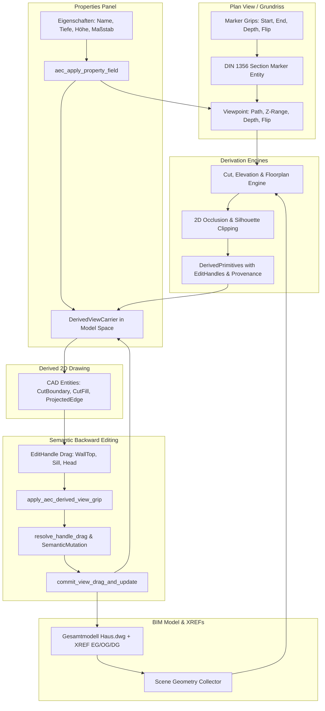

# Requirements

### Overview & Goals
Ziel dieses Pakets ist die **fundierte Überarbeitung, Fehlerbehebung und funktionale Komplettierung der modellassoziierten 2D-Schnitt-, Ansichts- und Grundriss-Erzeugung** in OpenCADStudio AEC.

Basierend auf den praktischen Tests und Rückmeldungen müssen die bisherigen Grundlagen um fehlende Interaktivitäts- und Qualitätsmerkmale ergänzt werden:
1. **Assoziative Schnitt- und Ansichtsmarkierungen im Grundriss (`Din1356SectionSymbol`):** Die im Plan erzeugten Schnittlinien, Richtungspfeile und Beschriftungen dürfen keine isolierten ("dummen") Linien sein, sondern müssen als parametrische AEC-Trägerobjekte mit Metadaten persistiert werden. Sie erhalten interaktive Viewport-Griffe für Anfangs-/Endpunkte, Schnittversätze (Jogs), Blicktiefe und Richtungsumkehr (Flip) sowie volle Anbindung an das Eigenschaften-Panel.
2. **Assoziative Modellgriffe an abgeleiteten Schnittkanten (Modell-Rückbearbeitung):** Beim Auswählen abgeleiteter Bauteile im Schnitt (z. B. Wandoberkanten, Deckenoberkanten, Fensterbrüstungen, Stürze) werden im Viewport echte Griffe (`EditHandle`) angezeigt. Das Ziehen dieser Griffe führt über `commit_view_drag_and_update` direkte semantische Änderungen am 3D-BIM-Modell aus.
3. **Nachträglich editierbare Blicktiefe, Z-Höhenbereiche und Grundriss-Schnitthöhen:** Sowohl über Griffe als auch über das Eigenschaften-Panel (`carrier_prop_section`, `marker_prop_section`) können Parameter wie Blicktiefe (`far_depth`), vertikaler Schnittbereich ($Z_{min}, Z_{max}$), Schnitthöhe (`z_cut`) und Maßstab nachträglich modifiziert werden; betroffene Ansichten werden unmittelbar aktualisiert.
4. **Koordinatenlokalisierung der Grundriss-Engine (`floorplan_engine.rs`):** Behebung von Darstellungs- und Versatzfehlern bei `AEC_FLOORPLAN` / `AEC_RCP` durch konsistente Transformation in den lokalen Ursprung des Viewpoints.
5. **Präzise Verdeckungsberechnung (2D-Occlusion / Silhouette):** Sauberes Abschneiden bzw. Entfernen verdeckter Hintergrundkanten hinter massiven Wandschichten und Decken sowie saubere Begrenzungskanten ohne visuelle Lücken.
6. **XREF-Planartensynchronisation & 3D-Körper-Stabilität:** Zuverlässiges Rendern von 3D-Volumenkörpern (ACIS SAT) und Schichtschraffuren im Gesamtmodell beim Umschalten zwischen Planarten und 2D/3D-Modus.

---

### Scope

#### In Scope
- **Assoziative Schnitt- und Ansichtsmarkierungen (`AEC_SECTION_MARKER` / `AEC_ELEVATION_MARKER`):**
  - Kapselung der DIN 1356 Geometrien in einer identifizierbaren AEC-Entität mit XDATA-Bindung an `Viewpoint` und `DerivedViewCarrier`.
  - Bereitstellung von Viewport-Griffen:
    - Schnittlinien-Anfangs- und Endgriff (Verschieben / Strecken).
    - Tiefengriff am Frustum-Begrenzungspolygon (Blicktiefe interaktiv ziehen).
    - Flip-Griff (Umkehren der Blickrichtung und Richtungspfeile).
    - Segment-Griffe bei gestuften Schnittlinien (Schnittversätze verschieben).
- **Semantische Modell-Rückbearbeitung im Schnitt (`edit_ops.rs` Viewport-Integration):**
  - Anzeige von interaktiven Ziehgriffen an abgeleiteten Kanten im Schnitt (`WallTop`, `SlabTop`, `OpeningSill`, `OpeningHead`, `OpeningLeftJamb`, `OpeningRightJamb`).
  - Anbindung an die zentrale Grip-Ereignisschleife (`apply_aec_derived_view_grip`), Validierung zulässiger Freiheitsgrade und Ausführung von Modelltransaktionen.
- **Vollständige Eigenschaften-Unterstützung (Properties Panel):**
  - Anzeige und Editierbarkeit von Schnitt-/Ansichtsparametern im Eigenschaften-Panel: Name, Maßstab, Tiefenbegrenzung / Distanz, Z-Bereich, Schnitthöhe, Update-Modus und Status.
  - Implementierung der Eigenschafts-Anwendung via `aec_apply_property_field` mit sofortiger automatischer Regenerierung.
- **Korrektur der Grundriss- und Horizontalschnitt-Engine:**
  - Lokale Koordinatentransformation relativ zum Viewpoint-Ursprung; Beseitigung von Skalierungs- und Versatzproblemen beim Platzieren.
  - Nachträgliche Justierung der Schnitthöhe (`z_cut`) und des Darstellungsbereichs über Griffe und Eigenschaften.
- **Härtung der Verdeckungs- und Schraffur-Engine:**
  - Verdeckungsschnitt (Clipping) von Hintergrundkanten gegen deckende 2D-Flächenmasken (`SurfaceFill` / `CutFill`).
  - Vollständige Begrenzungslinien (`CutBoundary`) für jede geschnittene Wandschicht und Deckenkante.
- **Gesamtmodell- & XREF-Härtung:**
  - Synchronisation der `DisplayConfig` über referenzierte Geschosse ohne Schraffurverlust.
  - Sicherstellung des 3D-Körper-Renderings (Solid3D / ACIS SAT) nach Planarten- und Ansichtswechseln.

#### Out of Scope
- Beliebig gekrümmte (kurvenförmige/splinebasierte) Schnittführungen.
- Vollautomatische Bewehrungsberechnung in Schalplänen.

---

### User Stories

- **Als Architekt** möchte ich eine Schnittlinie im Grundriss anklicken und an Griffen verschieben, strecken oder in der Blicktiefe anpassen können, sodass sich der Schnitt und die Pfeile automatisch anpassen.
- **Als Planer** möchte ich im Eigenschaften-Panel einer abgeleiteten Ansicht oder eines Schnitts den Maßstab (z. B. von 1:100 auf 1:50) oder die Blicktiefe ändern und sofort die aktualisierte Zeichnung sehen.
- **Als Konstrukteur** möchte ich im Schnitt die Wandoberkante oder die Brüstung eines Fensters per Griff nach oben ziehen können, damit das 3D-Modell, die Grundrisse und alle weiteren Ansichten synchron mitgeändert werden.
- **Als Zeichner** möchte ich einen horizontalen Grundriss (`AEC_FLOORPLAN`) an jedem beliebigen Einfügepunkt im Modellbereich platzieren können, ohne dass Geometrien versetzt oder unsichtbar sind.
- **Als Master-Modell-Bearbeiter** möchte ich zwischen Ausführungsplan, Schalplan und 3D-Ansicht umschalten, ohne dass Bauteile der referenzierten Geschosse (XREFs) verschwinden oder Schraffuren erst nach manuellem Neuladen sichtbar werden.

---

### Functional Requirements

- **FR-1: Assoziative Schnitt- und Ansichtsmarkierungen mit Viewport-Griffen:**
  - Speicherung von Schnittverläufen als verknüpfte Markierungsobjekte mit `AEC_SECTION_MARKER` XDATA.
  - Interaktive Griffe: Start-/Endpunktverschiebung, Versatzpunkte (Jogs), Blicktiefen-Polygon und Blickrichtungs-Spiegelung.
  - Synchrones Dirty-Tracking: Jede Geometrieänderung an der Markierung markiert den verknüpften `DerivedViewCarrier` als veraltet oder triggert bei automatischer Policy direkt die Neuberechnung.
- **FR-2: Semantische Griffe an abgeleiteten Schnittkanten:**
  - Erkennung von `DerivedPrimitive`-Entitäten bei Selektion und Bereitstellung von `EditHandle`-Griffen (Höhe Wand, Brüstung, Sturz, Deckenhöhe).
  - Umrechnung von 2D-Ziehvektoren in 3D-Modellmutationen via `resolve_handle_drag` und Transaktionscommit via `commit_view_drag_and_update`.
  - Visuelle Drahtvorschau während des Ziehens und Undo/Redo-Sicherheit.
- **FR-3: Parameter-Inspektion und -Änderung im Eigenschaften-Panel:**
  - Schnittmarkierung: Name, Kennbuchstabe, Blicktiefe, Z-Bereich ($Z_{min}, Z_{max}$), Planart, verknüpfter Carrier.
  - View-Carrier: Name, Maßstab (1:X), Status, Update-Modus, Button "Jetzt aktualisieren".
  - Abgeleitetes Bauteil: Quell-Element-ID, Schicht, Feature, editierbare Parameter (z. B. Wandhöhe, Brüstungshöhe).
  - Implementierung in `aec_apply_property_field` zur unmittelbaren Aktualisierung des Dokuments.
- **FR-4: Präzise Grundriss- und Horizontalschnitt-Ableitung:**
  - Lokale Transformation in das Koordinatensystem des Viewpoints vor der Carrier-Platzierung.
  - Unterstützung für nachträgliche Höhenanpassung der Schnittebene (`z_cut`) über Griffe und Eigenschaften.
- **FR-5: Saubere Kantenverdeckung und Schichtkonturen:**
  - 2D-Occlusion-Clipping aller sichtbaren Hintergrundkanten an deckenden Schnitt- und Flächenpolygonen.
  - Vollständige Begrenzungskanten um jede geschnittene Wandschicht und Decke.
- **FR-6: Stabile XREF- und Multi-Storey-Darstellung:**
  - Erhaltung von ACIS 3D-Meshes und Schalplan-/Materialschraffuren über alle referenzierten Geschosse beim Umschalten von Ansichten und Planarten.

---

### Non-Functional Requirements

- **AEC-Modul-Isolation:** Sämtliche Ansichts-, Schnitt-, Markierungs- und Provenienzlogik liegt strikt unter `src/modules/aec/**`. Core-Hooks in `properties.rs` und `viewport.rs` bleiben schlank und delegierend.
- **Performanz:** Bounding-Box-Vorfilterung und asynchroner bzw. schneller Re-Bake bei Griff- und Parameteränderungen.
- **Konsistente Lokalisierung:** Alle UI-Texte, Grifftipps, Eigenschaftsbezeichner und Statusmeldungen unterstützen Deutsch und Englisch.

# Technical Design

### Current Implementation Context
- **AEC-Bauteilmodelle:** Wände (`wall.rs`), Decken (`slab.rs`) und Öffnungen (`openings.rs`) liegen als parametrische Trägerobjekte mit XDATA-Metadaten vor.
- **Planarten & Darstellungsstile:** `DisplayConfig` und `DisplayProfile` in `src/modules/aec/engine/plan_view.rs` und `wall_style.rs` steuern die Schichtsichtbarkeit und Schraffuren für Grundrisse.
- **Geschoss- & Projektverwaltung:** `ProjectFile` (`.ocsproj`) und `StoreyRef` in `project.rs` verwalten Geschosshöhen (OKFF/OKRD) und verknüpfte Zeichnungsdateien.
- **Core-Integration:** Befehle werden über `spawn_command` registriert; Viewports im Papierbereich nutzen die `MVIEW`-Infrastruktur (`src/modules/layout/mview.rs`).

---

### Key Decisions

1. **Drei-Ebenen-Architektur (Viewpoint / ModelView / DerivedPrimitive):**
   - *Entscheidung:* Trennung zwischen rein geometrischem Schnittkörper (`Viewpoint`), fachlicher Darstellungsabsicht (`ModelView`) und flüchtiger Ergebnisgeometrie (`DerivedPrimitive`).
   - *Begründung:* Ermöglicht die mehrfache Nutzung desselben Schnitts für unterschiedliche Pläne (z. B. 1:100 Entwurf vs. 1:50 Schalplan) ohne Geometrieduplizierung.

2. **Gesamtmodell- & XREF-Aggregation als primäre Schnittquelle:**
   - *Entscheidung:* Die Schnitt-Engine (`cut_engine.rs`) arbeitet auf einer aggregierten Szene (`SceneGeometryCollector`), die sowohl native Modellbereichsobjekte als auch aufgelöste externe Referenzen (XREFs mit Höhenversatz $Z_{storey}$) verarbeitet.
   - *Begründung:* Schnitte und Ansichten entstehen in der architektonischen Praxis typischerweise im Gesamtmodell (`Haus.dwg`), in welchem die einzelnen Geschossdateien per XREF zusammengeführt sind.

3. **Assoziative Schnittmarkierungen mit Viewport-Griffen (`Din1356SectionMarker`):**
   - *Entscheidung:* Schnitt- und Ansichtsmarkierungen werden als eigenständige parametrische AEC-Entitäten mit `AEC_SECTION_MARKER` XDATA persistiert, gekoppelt an `viewpoint_id` und den zugehörigen Zeichnungsträger (`carrier_handle`).
   - *Begründung:* Schnittlinien dürfen keine "dummen" Linien sein; Anwender müssen Schnittverlauf, Schnitttiefe und Blickrichtung (Flip) direkt an Griffen im Grundriss manipulieren können.

4. **Viewport-Anbindung semantischer Modellgriffe (`apply_aec_derived_view_grip`):**
   - *Entscheidung:* Selektierte abgeleitete Kanten (Wandoberkante, Deckenhöhe, Brüstungslinie, Sturz) blenden im Viewport interaktive `EditHandle`-Griffe ein. Beim Ziehen führt Core über AEC-Hooks direkte semantische Mutationen (`commit_view_drag_and_update`) am 3D-BIM-Modell aus.
   - *Begründung:* Erfüllt die zentrale Anforderung der Modell-Rückbearbeitung ("keine dummen Linien"), ohne Core mit AEC-Fachlogik zu überfrachten.

5. **Bidirektionale Eigenschaften-Steuerung & Sofort-Aktualisierung:**
   - *Entscheidung:* Das Eigenschaften-Panel (`aec_apply_property_field`) unterstützt die Modifikation aller View-Parameter (Maßstab, Blicktiefe, Z-Bereich, Schnitthöhe `z_cut`, Planart) und löst eine synchrone Regenerierung der abgeleiteten Zeichnung aus.
   - *Begründung:* Maximale Flexibilität für Planer, um Ansichts- und Schnittparameter feingranular im Dialog nachzujustieren.

6. **Lokalisierte Viewpoint-Koordinaten in der Grundriss-Engine:**
   - *Entscheidung:* `floorplan_engine.rs` transformiert alle geschnittenen Bauteile in das lokale Koordinatensystem des Viewpoints relativ zum Viewpoint-Ursprung.
   - *Begründung:* Beseitigt Darstellungsabbrüche und extreme Positionsverschiebungen bei der Platzierung von Grundrissen (`AEC_FLOORPLAN`) und Deckenspiegeln (`AEC_RCP`).

7. **Präzises 2D-Occlusion-Clipping & vollständige Schichtkonturen:**
   - *Entscheidung:* Hintergrundkanten werden über Polygon-Clipping an vordergründigen Schnittflächen (`CutFill`) und opaken Oberflächenmasken (`SurfaceFill`) beschnitten. Jede Wandschicht und Decke erhält lückenlose Begrenzungskanten (`CutBoundary`).
   - *Begründung:* Verhindert durchscheinende Linien und stellt normgerechte Plandarstellungen nach DIN 1356 sicher.

8. **Wiederverwendung vorhandener AEC-Stile & Öffnungs-Slots:**
   - *Entscheidung:* Die Ableitungs-Engine greift direkt auf `WallStyle`, `SlabStyle`, `OpeningStyle` und `DisplayConfig` zu; Öffnungen nutzen Slots wie `ElevationContour2D`, `ElevationSwing2D` und `ElevationSill2D`.
   - *Begründung:* Konsistente Stildarstellung und Vermeidung redundanter Geometrieberechnungen.

---

### Data Models / Contracts

```rust
// In src/modules/aec/views/din1356.rs
pub struct Din1356SectionMarker {
    pub viewpoint_id: ViewpointId,
    pub carrier_handle: Option<Handle>,
    pub label: String,
    pub path: SectionPath,
    pub far_depth: Option<f64>,
    pub z_min: f64,
    pub z_max: f64,
    pub flip_direction: bool,
}

// Marker Grip Identifiers in src/modules/aec/properties.rs
pub const SECTION_MARKER_START_GRIP: usize = 0;
pub const SECTION_MARKER_END_GRIP: usize = 1;
pub const SECTION_MARKER_DEPTH_GRIP: usize = 2;
pub const SECTION_MARKER_FLIP_GRIP: usize = 3;
pub const SECTION_MARKER_JOG_BASE: usize = 100;

// Derived Primitive Edit Grip Identifiers
pub const DERIVED_VIEW_GRIP_BASE: usize = 50_000;

// In src/modules/aec/engine/views/viewpoint.rs
pub struct Viewpoint {
    pub id: ViewpointId,
    pub name: String,
    pub revision: Revision,
    pub origin: ViewOrigin,
    pub axes: ViewAxes,
    pub kind: ViewKind,
    pub z_range: VerticalRange,
    pub mapping: ProjectionMapping,
    pub crop: Option<Rect2>,
}

// In src/modules/aec/engine/views/provenance.rs
pub struct DerivedPrimitive {
    pub id: PrimitiveId,
    pub role: PrimitiveRole,
    pub geometry: Geometry2d,
    pub sources: SourceSet,
    pub depth: DepthInterval,
    pub style: ResolvedStyle,
    pub edit_handles: Vec<EditHandle>,
}

// In src/modules/aec/engine/views/edit_ops.rs
pub fn resolve_handle_drag(
    viewpoint: &Viewpoint,
    model_view: &ModelView,
    scene: &SceneGeometryCollector,
    primitive: &DerivedPrimitive,
    handle_idx: usize,
    view_delta: Vector2,
) -> Result<SemanticMutation, EditOpError>;

pub fn commit_view_drag_and_update(
    doc: &mut CadDocument,
    carrier_handle: Handle,
    mutation: &SemanticMutation,
) -> Result<DerivedViewCarrier, Box<dyn std::error::Error>>;
```

---

### Architecture Diagram



---

### File Structure & Components

- `src/modules/aec/views/`
  - `din1356.rs`: Assoziative `Din1356SectionMarker`-Entität, Griffdefinitionen und Vektorgenerierung.
  - `aec_section.rs`: Schnittbefehl, Marker-Erzeugung mit Koppelung an den View-Carrier.
  - `aec_elevation.rs`: Fassadenansichtsbefehl mit Blicktiefen-Polygon und assoziativer Markierung.
  - `aec_floorplan.rs`: Grundrissbefehl mit lokalisierter Platzierung und Höhenabfrage.
  - `aec_viewupdate.rs`: Aktualisierungsbefehl für veraltete Träger und Marker.
- `src/modules/aec/engine/views/`
  - `floorplan_engine.rs`: Horizontale Schnittberechnung mit relativer Viewpoint-Koordinatentransformation.
  - `cut_engine.rs`: Vertikalschnitte mit lückenlosen Schnittkanten (`CutBoundary`) und Hintergrundprojektion.
  - `elevation_engine.rs`: Ansichtsprojektion mit Öffnungs-Slots und opaken Masken.
  - `silhouette.rs`: Präzises 2D-Occlusion-Clipping für verdeckte Linien.
  - `carrier.rs`: Träger-Persistenz, Definitionsspeicherung und CAD-Entity-Synchronisation.
  - `edit_ops.rs`: Semantische Mutationen und Transaktions-Commit.
- `src/modules/aec/`
  - `properties.rs`: `append_section_marker_grips`, `append_derived_view_grips`, Eigenschaftspanel-Sektionen und `aec_apply_property_field`.
  - `walls/axis_session.rs` / `spawn.rs`: Dispatching von Marker- und Bauteil-Grips.
- `src/app/`
  - `properties.rs`: Hook zur Übergabe von AEC-Marker- und View-Griffen an das UI.
  - `update/viewport.rs`: Hook zur Ausführung von Marker- und abgeleiteten Modellgriffen während des Ziehens.

---

### Risks & Mitigations

- **Degenerierte Griffe bei schrägen Ansichten:**
  - *Risiko:* Ziehen eines Höhengriffs in einer nicht-vertikalen Ansicht könnte undefinierte 3D-Geometrie erzeugen.
  - *Mitigation:* Strikte Capability- und Achsenprüfung in `resolve_handle_drag` – bei degenerierten Blickwinkeln wird der Griff gesperrt oder ausgeblendet.
- **Mehrfach-Regenerierung bei interaktivem Ziehen:**
  - *Risiko:* Komplette Schnittneuberechnung bei jedem Pixel-Mausmove könnte die Bildrate beeinträchtigen.
  - *Mitigation:* Während des Ziehens wird eine schlanke Live-Drahtvorschau (`preview_wires`) gerendert; die vollständige Schnittregenerierung erfolgt atomar erst beim Loslassen der Maustaste (Commit).

# Testing

### Validation Approach
Die Validierung erfolgt mehrstufig:
1. **Unit-Tests für Datenmodelle und Marker:** Testen der Marker-Serialisierung, Griff-Berechnung und Koordinatentransformationen.
2. **Schnitt- & Verdeckungs-Tests:** Verifikation geschlossener Schnittkonturen, Schraffuren und des Occlusion-Clippings.
3. **Grip- & Modell-Rückbearbeitungstests:** Prüfung, dass Drag-Deltas an Wandoberkanten, Brüstungen und Decken korrekte Modelloperationen ausführen und XDATA sauber aktualisieren.
4. **Eigenschaften-Tests:** Verifikation, dass Parameteränderungen im Dialog sofortige Aktualisierungen an Markern und Carriern auslösen.
5. **End-to-End-Test im Beispielprojekt:** Gesamtablauf im mehrgeschossigen Modell mit XREFs, Umschaltung von Planarten und 2D/3D-Darstellung.

---

### Key Scenarios

- **Szenario 1: Schnittlinie im Grundriss per Griff verändern:**
  - Schnitt A–A im Grundriss auswählen; Tiefengriff um 2,0 m nach hinten ziehen.
  - *Erwartetes Ergebnis:* Tiefenpolygon vergrößert sich; Schnitt aktualisiert sich und zeigt nun zusätzliche dahinterliegende Bauteile.
- **Szenario 2: Schnittrichtung umkehren (Flip):**
  - Flip-Griff an der Schnittmarkierung anklicken.
  - *Erwartetes Ergebnis:* Richtungspfeile zeigen in die entgegengesetzte Richtung; Schnittansicht wird gespiegelt neu generiert.
- **Szenario 3: Wandoberkante im Schnitt anheben:**
  - Wandoberkante im Schnitt anklicken und den Höhengriff um 0,5 m nach oben ziehen.
  - *Erwartetes Ergebnis:* Wandhöhe im 3D-Modell ändert sich von 2,80 m auf 3,30 m; alle abhängigen Ansichten und das 3D-Modell sind synchron.
- **Szenario 4: Fensterbrüstung im Schnitt verschieben:**
  - Brüstungslinie eines Fensters im Schnitt nach oben ziehen.
  - *Erwartetes Ergebnis:* Brüstungshöhe im Quellbauteil wird angepasst; Öffnungshöhe bleibt erhalten; Grundriss und Fassade aktualisieren sich.
- **Szenario 5: Maßstab und Blicktiefe im Eigenschaften-Panel ändern:**
  - View-Carrier auswählen und Maßstab von 1:50 auf 1:100 ändern.
  - *Erwartetes Ergebnis:* Schraffurskalierung, Linienstärken und Detaildarstellung passen sich sofort an.
- **Szenario 6: Grundriss platzieren:**
  - `AEC_FLOORPLAN` ausführen und an Punkt (50, 0) im Modellbereich platzieren.
  - *Erwartetes Ergebnis:* Die Grundrissgeometrie erscheint exakt an der gewählten Einfügeposition mit allen Wandschichten, Türanschlägen und Schraffuren.

---

### Edge Cases

- **Drag an Element aus schreibgeschützter XREF:**
  - Versuch, eine Wand aus einer externen Referenz im Schnitt zu ziehen, meldet verständlichen Hinweis (`XrefReadOnly`) und verhindert ungültige Schreiboperationen.
- **Verdeckung bei koplanaren Wänden:**
  - Wandflächen, die in gleicher Tiefe aneinanderstoßen, erzeugen keine doppelten oder flackernden Trennlinien.
- **Minimalmaße bei Öffnungen:**
  - Ein Griffzug nach unten begrenzt die Brüstungshöhe auf $\ge 0{,}0\,\text{m}$ und verhindert negative oder unzulässige Werte.

---

### Test Changes
- Ergänzung von Unit-Tests in `src/modules/aec/engine/views/` für Marker-Grips, semantische Rückbearbeitung und lokalisierte Grundrisstransformation.
- Testfälle in `properties.rs` zur Überprüfung aller `carrier_` und `marker_` Parameteränderungen.

> **Stand 2026-11-07:** Markierungen, Modellgriffe und Grundriss liegen im Code. Die geführte Interaktion ist in `continue-derived-views-and-sections.md` abgeschlossen.

# Delivery Steps

### ✓ Step 1: Assoziative Schnitt- und Ansichtsmarkierungen mit Viewport-Griffen & Properties
Die Schnitt- und Ansichtsmarkierungen im Grundriss (`Din1356SectionSymbol`) sind als parametrische AEC-Objekte persistiert und bieten interaktive Griffe für Schnittverlauf, Tiefe und Richtung sowie volle Eigenschaften-Unterstützung.

- Persistierung der DIN 1356 Schnitt- und Ansichtsmarkierungen als Trägerobjekte mit `AEC_SECTION_MARKER` / `AEC_ELEVATION_MARKER` XDATA unter Koppelung an `Viewpoint` und `DerivedViewCarrier`.
- Implementierung der Griffe in `src/modules/aec/properties.rs` (`append_section_marker_grips`): Anfangs-/Endgriff, Jog-Segmentgriffe, Frustum-Tiefengriff und Flip-Griff für Blickrichtungspfeile.
- Integration der Viewport-Grip-Handler in `src/modules/aec/walls/axis_session.rs` / `viewport.rs` (`apply_aec_section_marker_grip`) mit automatischer Markierung des Carriers als veraltet bzw. Sofort-Neuberechnung.
- Erweiterung des Eigenschaften-Panels (`marker_prop_section`, `carrier_prop_section`, `aec_apply_property_field`) zur direkten Änderung von Schnittname, Blicktiefe, Z-Bereich und Maßstab.

### ✓ Step 2: Viewport-Anbindung semantischer Modellgriffe an abgeleiteten Schnittkanten
Ausgewählte abgeleitete Kanten im Schnitt (Wandoberkanten, Brüstungen, Stürze, Decken) bieten aktive Modellgriffe, deren Manipulation das 3D-BIM-Modell direkt verändert.

- Erweiterung von `append_derived_view_grips` in `src/modules/aec/properties.rs`, um für ausgewählte `DerivedPrimitive`-Entitäten ihre `edit_handles` als interaktive Ziehgriffe anzuzeigen.
- Implementierung von `apply_aec_derived_view_grip` in Core-Dispatch (`viewport.rs`), das über `resolve_handle_drag` und `commit_view_drag_and_update` (`edit_ops.rs`) atomare Modellmutationen ausführt.
- Bereitstellung einer Live-Drahtvorschau während des Ziehens (z. B. Wandoberkantenlinie oder Brüstungsrechteck) ohne vorzeitiges Zerstören der bestehenden Schnittgrafik.
- Vollständige Einbindung in das Undo/Redo-System und automatische Aktualisierung abhängiger Ansichten nach dem Commit.

### ✓ Step 3: Lokalisierte Koordinatentransformation & Korrektur der Grundriss-Engine
`AEC_FLOORPLAN` und `AEC_RCP` generieren exakt positionierte 2D-Grundrisse und Deckenspiegel am gewählten Einfügepunkt mit nachträglich anpassbarer Schnitthöhe.

- Anpassung von `floorplan_engine.rs` zur relativen Projektion aller Schnittpolygone, Leibungen und Öffnungssymbole in das lokale Koordinatensystem des Viewpoints (`p - origin`).
- Korrektur der Bounding-Box- und Einfügepunkt-Zuordnung in `carrier.rs` (`transform_pt`), sodass der vom Anwender gewählte Klickpunkt exakt der Ursprung der platzierten 2D-Zeichnung ist.
- Unterstützung der nachträglichen Höhenänderung der Schnittebene (`z_cut`, Z-Range) sowohl über Eigenschaften (`view_cut_height`) als auch über interaktive Griffe.
- Validierung der Decken-, Wand- und Öffnungsdarstellung (inkl. Anschlagssymbole und Türöffnungswinkel) in 2D-Grundrissen.

### ✓ Step 4: Härtung der Verdeckungsberechnung, Schichtkonturen & XREF-Planartensynchronisation
Verdeckte Kanten werden sauber beschnitten, geschnittene Bauteile besitzen geschlossene Konturen und XREF-Geschosse bleiben bei Planartenwechseln stabil gerendert.

- Präzisierung des 2D-Occlusion-Clippings in `silhouette.rs` und `cut_engine.rs` gegen opake Flächenmasken (`SurfaceFill` / `CutFill`) zur Vermeidung durchscheinender Hintergrundlinien.
- Sicherstellung geschlossener Randkonturen (`CutBoundary`) für jede einzelne Wandschicht und Deckenkante auch an Öffnungsleibungen und Stufenübergängen.
- Härtung des XREF-Geometrie- und Tessellierungs-Caches im Gesamtmodell: Erhaltung von 3D-Meshes (ACIS SAT) und Schichtschraffuren beim Hin- und Herschalten zwischen Entwurf, Ausführung, Schalplan und 3D.
- Aktualisierung des Generator- und Testmoduls (`sample_project.rs`) zur dauerhaften Absicherung aller Korrekturen im Multi-Geschoss-Szenario.

### ✓ Step 5: End-to-End-Validierung, Beispielprojekt-Aktualisierung & Dokumentation
Das Gesamtsystem für Schnitte, Ansichten, Grundrisse und Modellrückbearbeitung ist vollständig integriert, getestet und im Beispielprojekt verifiziert.

- Aktualisierung und Validierung aller automatisierten Unit- und Integrationstests in `modules::aec::views` und `modules::aec::engine::views`.
- Neugenerierung des Beispielprojekts `Beispielprojekt` und `examples/beispiel_haus/` mit den neuen assoziativen Schnitt- und Ansichtsmarkierungen.
- Überprüfung des vollständigen Arbeitsablaufs: Schnittmarkierungs-Grips, Höhengriffe im Schnitt, Parameteranpassung im Properties-Panel und Planarten-Sync.
- Aktualisierung der Dokumentation und Kurzanleitungen für die Anwenderbedienung.