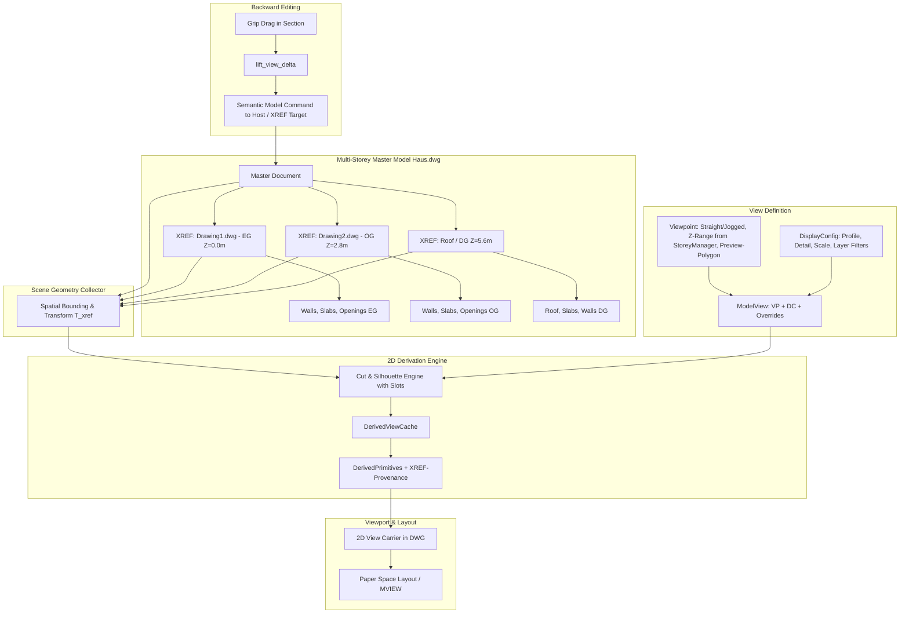

# Requirements

### Overview & Goals
Ziel dieses Pakets ist die Einführung **modellassoziierter 2D-Darstellungen (Grundrisse, Schnitte, Ansichten, Deckenspiegel und Schalpläne)** in OpenCADStudio AEC. 

Basierend auf den Prinzipien führender Architektur-CAD-Systeme (Revit, Archicad, Allplan, AutoCAD Architecture) und den fundierten Vorrecherchen wird ein **drei-stufiges Assoziativitätsmodell** implementiert:
1. **Viewpoint (Geometrische Sicht):** Definition von Lage, Blickrichtung, Schnittebene, Höhen-/Tiefenbereich und Begrenzung im Raum.
2. **ModelView (Fachliche Planansicht):** Verknüpfung des Viewpoints mit einer Planart (`DisplayConfig`), Maßstab, Detaillierungsgrad, Schichtfiltern und lokalen Darstellungsüberschreibungen.
3. **DerivedPrimitive & Provenance (Herkunftsgekoppelte Darstellung):** Generierte 2D-Vektorgeometrien (Linien, Schraffuren, Kanten) mit lückenloser Rückverfolgbarkeit auf Quellbauteile (`element_id`), Schichten (`component_id`) und Features (`feature_key`).

Dadurch wird nicht nur die automatisierte, konsistente Planerstellung aus dem 3D-Gebäudemodell ermöglicht, sondern auch die **semantische Rückbearbeitung des Modells direkt aus Schnitten und Ansichten** (z. B. Ziehen von Wandoberkanten oder Fensterbrüstungen).

---

### Scope

#### In Scope
- **Gesamtmodell- & XREF-Verarbeitung (Multi-Geschoss-Modell):** Ableitung von Gebäudeschnitten und -ansichten aus dem Gesamtmodell (`Haus.dwg`), in dem Einzelgeschosse (EG, OG, DG), Dächer oder Fachmodelle als externe Referenzen (XREFs) mit Z-Versatz platziert sind. Traversierung aller referenzierten Bauteile unter Berücksichtigung ihrer Transformationsmatrizen ($T_{xref}$).
- **Geometrische Viewpoints:** Gerade und gestufte Vertikalschnitte (`Section` mit Schnittversatz / Jogged Sections), Fassadenansichten (`Elevation`), Grundrisse mit Schnitthöhe (`FloorPlan`) und Deckenspiegel (`ReflectedCeilingPlan`).
- **Interaktives Preview-Polygon & Höhenbereich:** Visuelle Eingabe von Schnittlinie, Blickrichtung und Blicktiefe über ein dynamisches Sichtbereichs-Polygon in der 2D-Zeichnung; interaktive Höhenfestlegung des Schnittkörpers mit automatischer Vorgabe der Gesamtgebäudehöhe aus dem Geschossmanager (`ProjectFile`).
- **Bauteilstile & Planarten-Integration (auch über XREFs):** Volle Berücksichtigung der Bauteilstile (Wände, Decken, Öffnungen, künftige Bauteile) und der aktiven `DisplayConfig` / `DisplayProfile` (Materialschraffuren, Schichtfilter, Linienstärken, Sichtbarkeiten für Ausführung 1:50, Entwurf 1:100, Schalplan/Rohbau 1:50) über alle referenzierten Geschosse hinweg.
- **Öffnungs-Darstellungskomponenten (Slots):** Auswertung und Darstellung der in den Öffnungsstilen definierten 2D/3D-Slots (z. B. Fenster- und Türansichten mit `ElevationContour2D`, `ElevationSwing2D`, `ElevationSill2D`, `ElevationMuntins2D` sowie Blocks/Generators/Skizzen) in Ansichten und Schnitten.
- **Fachliche ModelViews:** Mehrere Planarten aus demselben Viewpoint (z. B. Schnitt A–A als Ausführungsplan 1:50, Entwurfsplan 1:100 und Schalplan 1:50).
- **Herkunftsverfolgung (Provenance mit XREF-Bezug):** Speicherung von Bauteil-, XREF-/Dateiquellen-, Schicht- und Feature-Referenzen an jedem erzeugten 2D-Grafikelement.
- **Schnitt- & Projektionsberechnung:**
  - Exakter 3D-Schnitt durch mehrschichtige Wände und Decken aller Geschosse mit Schichtgrenzen und Materialschraffuren (auch für gestufte Schnittverläufe).
  - Berücksichtigung von Wandöffnungen, Fenster-/Türprofilen und Nischen über alle Geschossebenen.
  - Tiefenbegrenzte Projektion sichtbarer Kanten im Hintergrund (`silhouette`).
- **Assoziative View-Carrier:** Modellbereichsblöcke mit XDATA-Metadaten für automatische oder manuelle Aktualisierung (`UpdatePolicy`).
- **Semantische Modellgriffe & Rückbearbeitung:** Bearbeitung von Wandoberkanten, Deckenhöhen und Öffnungsbrüstungen direkt im Schnitt (mit Zielzuordnung auf native Entitäten bzw. referenzierte Quelldokumente).
- **Interaktive Befehle & UI:** `AEC_SECTION`, `AEC_ELEVATION`, `AEC_FLOORPLAN`, `AEC_RCP`, `AEC_VIEWUPDATE` sowie DIN 1356 Schnittverlaufs- und Pfeilsymbole.
- **Layout- & Blatt-Integration:** Platzierung von ModelViews auf Papierbereich-Layouts (`MVIEW`) mit Maßstabsbindung.

#### Out of Scope
- Beliebig gekrümmte (kurvenförmige/splinebasierte) Schnittführungen (vorgesehen für ein separates Folgepaket; orthogonale/gestufte Schnittlinien sind in Scope).
- Perspektivische oder axonometrische 2D-Schnittableitungen.
- Vollautomatische Bewehrungsgenerierung in Schalplänen.

---

### User Stories

- **Als Architekt** möchte ich im Gesamtmodell (`Haus.dwg`) mit referenzierten Geschossen eine Schnittlinie durch das gesamte Gebäude ziehen (`AEC_SECTION`), damit alle Geschosse (EG, OG, DG, Dach) mit ihren korrekten Z-Höhenlagen, Deckenauflagern und Wandschichten geschnitten und dargestellt werden.
- **Als Planer** möchte ich denselben Gebäudeschnitt in verschiedenen Maßstäben und Planarten darstellen (1:100 Übersicht, 1:50 Ausführung, 1:50 Rohbau/Schalplan), ohne den Schnitt mehrfach neu konstruieren zu müssen.
- **Als Konstrukteur** möchte ich im Schnitt die Brüstungshöhe eines Fensters oder die Oberkante einer Wand per Griff verschieben, sodass das 3D-Modell, die Grundrisse und alle weiteren Schnitte synchron aktualisiert werden.
- **Als Zeichner** möchte ich Schnitte und Ansichten direkt auf Papierbereich-Layouts platzieren (`AEC_PLACE_VIEW`), wobei Maßstab und Plankopf assoziativ gekoppelt bleiben.

---

### Functional Requirements

- **FR-1: Viewpoint-Definition, Gestufte Schnitte & Preview-Polygon:**
  - Interaktive Definition von Schnitten und Ansichten über ein dynamisches Preview-Polygon (Schnittverlauf, Blickrichtung und Blicktiefe `far_depth` / `depth`) in der Grundrisszeichnung.
  - Unterstützung für **gestufte Schnittlinien (Schnittversatz / Jogged Sections)** mit mehreren parallelen Schnittebenen und Verbindungsabschnitten.
  - Einstellbare obere und untere Höhenbegrenzung (Z-Schnittbereich), standardmäßig initialisiert mit der Gesamtgebäudehöhe aus dem Geschossmanager (`ProjectFile`).
  - Ursprung (`ViewOrigin`, welt- oder geschossrelativ), orthogonale Achsen (`right`, `up`, `forward`) und Begrenzungsrahmen (`crop`).
  - Automatische Nachführung geschossrelativer Schnitte bei Höhenänderungen von Stockwerken.
- **FR-2: Schnitt- und Projektions-Engine mit Multi-XREF-, Stile- & Slot-Berücksichtigung:**
  - **Multi-Geschoss- & XREF-Traversierung:** Die Engine scannt und schneidet native Modellbereichs-Objekte sowie alle in Block-Definitionen referenzierten XREF-Geschosse. Bauteile werden über die Transformationsmatrix $T_{xref}$ (Einfügepunkt $X, Y, Z$, Drehung, Skalierung) in den globalen Modell-Raum transformiert.
  - Berechnung der Schnittpolygone (`CutBoundary`) und Schichtfüllungen (`CutFill`) für alle durchdrungenen Wände und Decken anhand der aktiven `DisplayConfig` (z. B. Kern/Structural im Schalplan vs. alle Schichten mit Materialschraffuren im Ausführungsplan).
  - Volle Integration der **Öffnungs-Slots** (`OpeningComponentSlot`):
    - Im Schnitt: Schnittflächen durch Rahmen, Flügel, Glas und Füllungen sowie Laibungsdetails.
    - In der Ansicht/Projektion: Verwendung der definierten Ansichtskomponenten wie `ElevationContour2D`, `ElevationSwing2D` (Öffnungsrichtungssymbol/Flügelaufschlag), `ElevationSill2D` (Fenstersims/Sohle), `ElevationMuntins2D` (Sprossen) und parametrischen Blöcken/Generatoren.
  - Projektion sichtbarer Bauteilkanten im Hintergrund bis zur definierten Schnitttiefe mit Tiefenstaffelung.
- **FR-3: Lückenlose Provenienz (Herkunftsdaten mit XREF-Identifikation):**
  - Jedes 2D-Primitive erhält ein `SourceSet` mit Quellangabe (`element_id`, optionaler `xref_source` / `document_id`), Schicht-ID (`component_id`) und Feature (`feature_key`, z. B. `WallTop`, `OpeningSill`, `LayerFace`).
  - Schnittlinien und Bemaßungen binden sich an stabile semantische Features statt flüchtiger Vertex-IDs, auch über externe Referenzen hinweg.
- **FR-4: Assoziative Aktualisierung & Dirty-Tracking:**
  - Änderungen am 3D-Modell (Wand versetzt, Öffnung geändert) markieren betroffene Schnitte als veraltet (`is_outdated`).
  - Unterstützung für automatische Neuberechnung (`UpdatePolicy::Automatic`) oder manuelle Aktualisierung (`UpdatePolicy::Manual` / `AEC_VIEWUPDATE`).
- **FR-5: Direkte Modellbearbeitung im Schnitt:**
  - Bereitstellung interaktiver Griffe für zulässige Freiheitsgrade (z. B. vertikale Höhenänderung von Wänden, Decken und Brüstungen).
  - Umrechnung von 2D-Ziehvektoren in 3D-Modelloperationen (`lift_view_delta`) unter voller Einbindung in das Undo/Redo-System.
- **FR-6: Planbeschriftung & DIN 1356:**
  - Generierung normgerechter Schnittverlaufslinien im Grundriss mit Kennbuchstaben (z. B. A–A) und Blickrichtungspfeilen.
  - Automatische Höhenkoten- und Beschriftungssymbole im Schnitt.

---

### Non-Functional Requirements

- **AEC-Modul-Isolation:** Sämtliche Ansichts-, Schnitt- und Provenienzlogik liegt strikt unter `src/modules/aec/**`.
- **Performanz & Caching:** Caching der generierten 2D-Geometrien im `DerivedViewCache`, sodass beim Öffnen von Zeichnungen keine vollständige Neuberechnung erforderlich ist.
- **Robuste Fehlerbehandlung & Validierung:** Strikte Gültigkeitsprüfungen für Koordinatensysteme (keine Singularitäten, orthonormale Achsen, endliche Fließkommazahlen).
- **Konsistente Lokalisierung:** Alle UI-Texte, Eingabeaufforderungen und Fehlermeldungen unterstützen Deutsch und Englisch via `locales/`.

# Technical Design

### Current Implementation Context
- **AEC-Bauteilmodelle:** Wände (`wall.rs`), Decken (`slab.rs`) und Öffnungen (`openings.rs`) liegen als parametrische Trägerobjekte mit XDATA-Metadaten vor.
- **Planarten & Darstellungsstile:** `DisplayConfig` und `DisplayProfile` in `src/modules/aec/engine/plan_view.rs` und `wall_style.rs` steuern die Schichtsichtbarkeit und Schraffuren für Grundrisse.
- **Geschoss- & Projektverwaltung:** `ProjectFile` (`.ocsproj`) und `StoreyRef` in `project.rs` verwalten Geschosshöhen (OKFF/OKRD) und verknüpfte Zeichnungsdateien.
- **Core-Integration:** Befehle werden über `spawn_command` registriert; Viewports im Papierbereich nutzen die `MVIEW`-Infrastruktur (`src/modules/layout/mview.rs`).

---

### Key Decisions

1. **Drei-Ebenen-Architektur (Viewpoint / ModelView / DerivedPrimitive):**
   - *Entscheidung:* Trennung zwischen rein geometrischem Schnittkörper (`Viewpoint`), fachlicher Darstellungsabsicht (`ModelView`) und flüchtiger Ergebnisgeometrie (`DerivedPrimitive`).
   - *Begründung:* Ermöglicht die mehrfache Nutzung desselben Schnitts für unterschiedliche Pläne (z. B. 1:100 Entwurf vs. 1:50 Schalplan) ohne Geometrieduplizierung.

2. **Gesamtmodell- & XREF-Aggregation als primäre Schnittquelle:**
   - *Entscheidung:* Die Schnitt-Engine (`cut_engine.rs`) arbeitet auf einer aggregierten Szene (`SceneGeometryCollector`), die sowohl native Modellbereichsobjekte als auch aufgelöste externe Referenzen (XREFs mit Höhenversatz $Z_{storey}$) verarbeitet.
   - *Begründung:* Schnitte und Ansichten entstehen in der architektonischen Praxis typischerweise im Gesamtmodell (`Haus.dwg`), in welchem die einzelnen Geschossdateien per XREF zusammengeführt sind.

3. **Gestufte Schnittpfade (Jogged Sections) & Sichtkörper-Polygon:**
   - *Entscheidung:* `ViewKind::Section` unterstützt segmentierte Schnittpfade (`SectionPath::Segmented(Vec<SectionSegment>)`) mit versetzten parallelen Ebenen. Der Schnittkörper wird im Grundriss als geschlossenes interaktives Preview-Polygon (Bounding Frustum) visualisiert.
   - *Begründung:* Architektonische Schnitte müssen häufig versetzt geführt werden, um Treppenhäuser, Fensterachsen und Wandversprünge in einem Plan abzubilden.

4. **Wiederverwendung vorhandener AEC-Stile & Öffnungs-Slots:**
   - *Entscheidung:* Die Ableitungs-Engine greift direkt auf `WallStyle`, `SlabStyle`, `OpeningStyle` und `DisplayConfig` (`WallComponentSlot`, `OpeningComponentSlot`) zu. Ansichts- und Schnittgeometrien von Öffnungen nutzen vorhandene Slot-Generatoren (`bake_opening_generators_with_doc`), Blöcke (`SlotGeometry::Block`) und Skizzen.
   - *Begründung:* Verhindert Daten- und Logikduplizierung; Stilanpassungen (z. B. geänderte Fensterbank oder Materialschraffur) wirken unmittelbar in allen abgeleiteten Ansichten.

5. **Gebäudehöhen-Vorgabe aus Geschossmanager:**
   - *Entscheidung:* Bei Erstellung von Schnitten und Ansichten wird der vertikale Schnittbereich ($Z_{min}$ bis $Z_{max}$) standardmäßig aus den aggregierten Geschosshöhen (OKRD/OKFF) der `ProjectFile` ermittelt, bleibt jedoch manuell im Befehl oder per Griff anpassbar.
   - *Begründung:* Schnitte erfassen standardmäßig das gesamte Bauwerk, ohne manuelle Höhenraterei bei der Eingabe.

6. **Lückenlose Herkunftsverfolgung mit XREF-Unterstützung (Provenance):**
   - *Entscheidung:* Jedes erzeugte 2D-Element referenziert die Quellbauteil-ID, optionale XREF-/Dokumentenreferenz, Schicht-ID und das semantische Feature (`FeatureKey`).
   - *Begründung:* Essentiell für assoziative Bemaßung und direkte Modell-Rückbearbeitung aus der 2D-Schnittansicht über Dateigrenzen hinweg.

7. **Assoziativer View-Carrier im Modellbereich:**
   - *Entscheidung:* Speicherung abgeleiteter 2D-Schnitte als eigenständige Blockstrukturen (`DerivedViewCarrier`) mit `OPENCAD_AEC`-Metadaten.
   - *Begründung:* Maximale DWG/DXF-Kompatibilität bei gleichzeitiger Beibehaltung der Modellbindung.

8. **Semantische Modell-Rückbearbeitung statt 2D-zu-3D-Inversion:**
   - *Entscheidung:* Keine freie Geometrietransformation von 2D-Linien, sondern gezielte, capability-geprüfte Modellbefehle (`SetWallHeight`, `SetOpeningSillHeight`).
   - *Begründung:* Orthografische Projektionen verlieren die Tiefeninformation; nur semantisch definierte Freiheitsgrade garantieren ein konsistentes 3D-Modell.

---

### Data Models / Contracts

```rust
// In src/modules/aec/engine/views/viewpoint.rs
pub struct Viewpoint {
    pub id: ViewpointId,
    pub name: String,
    pub revision: Revision,
    pub origin: ViewOrigin,
    pub axes: ViewAxes,
    pub kind: ViewKind,
    pub z_range: VerticalRange, // Untere und obere Z-Grenze (Default: Gesamtgebäude aus Geschossmanager)
    pub mapping: ProjectionMapping,
    pub crop: Option<Rect2>,
}

pub enum ViewKind {
    FloorPlan { range: PlanRange },
    ReflectedCeilingPlan { range: CeilingRange },
    Section {
        path: SectionPath, // Gerade oder gestufte Schnittlinie (mit Versatz)
        far_depth: Option<PositiveMetres>,
    },
    Elevation {
        depth: DepthRange,
    },
}

pub enum SectionPath {
    Straight {
        start: Point2,
        end: Point2,
    },
    Jogged {
        segments: Vec<SectionSegment>, // Parallele Hauptschnitte und Querversätze
    },
}

pub struct SectionSegment {
    pub start: Point2,
    pub end: Point2,
    pub is_jog_transition: bool,
}

pub struct VerticalRange {
    pub z_min: Metres,
    pub z_max: Metres,
}

pub enum ViewOrigin {
    World(Point3),
    StoryRelative {
        story: StoryRef,
        xy_world: Point2,
        offset: Metres,
    },
}

// In src/modules/aec/engine/views/model_view.rs
pub struct ModelView {
    pub id: ModelViewId,
    pub name: String,
    pub viewpoint_id: ViewpointId,
    pub profile_id: ViewProfileId,
    pub scale: ScaleDenominator,
    pub detail: DetailPolicy,
    pub excluded_elements: BTreeSet<ElementRef>,
    pub graphic_overrides: Vec<GraphicOverride>,
    pub annotation_ids: Vec<AnnotationId>,
    pub update_policy: UpdatePolicy,
    pub revisions: ViewRevisions,
}

// In src/modules/aec/engine/views/provenance.rs
pub struct SourceReference {
    pub element: ElementRef,
    pub xref_source: Option<XrefSourceRef>, // Herkunft aus referenziertem Geschoss (XREF)
    pub component_id: Option<ComponentId>,
    pub feature: Option<FeatureKey>,
    pub display_component_id: Option<DisplayComponentId>,
}

pub struct XrefSourceRef {
    pub block_record_name: String,
    pub source_path: Option<std::path::PathBuf>,
    pub transform: Mat4,
}

pub enum FeatureKey {
    WallTop,
    WallBottom,
    OpeningSill,
    OpeningHead,
    OpeningJambLeft,
    OpeningJambRight,
    LayerFace,
    SlabTop,
    SlabBottom,
}

pub struct DerivedPrimitive {
    pub id: PrimitiveId,
    pub role: PrimitiveRole,
    pub geometry: Geometry2d,
    pub sources: SourceSet,
    pub depth: DepthInterval,
    pub style: ResolvedStyle,
    pub edit_handles: Vec<EditHandle>,
}
```

---

### Architecture Diagram



---

### File Structure & Components

- `src/modules/aec/engine/views/`
  - `mod.rs`: Modul-Export und Typdefinitionen.
  - `viewpoint.rs`: Geometrische Schnittkörper, Schnittpfade (gerade & gestuft), Z-Bereiche und Preview-Polygone.
  - `model_view.rs`: Fachliche Planansichten, Maßstäbe und grafische Überschreibungen.
  - `scene_collector.rs`: Aggregation und räumliche Filterung nativer Entitäten und referenzierter XREF-Geschosse mit Transformationsmatrizen ($T_{xref}$).
  - `provenance.rs`: Herkunftsverfolgung (`SourceReference`, `XrefSourceRef`), Features und Rollen.
  - `cut_engine.rs`: 3D-Schnittflächenberechnung für mehrschichtige Bauteile, gestufte Schnitte und Öffnungs-Slots über alle Geschossebenen.
  - `elevation_engine.rs`: Ansichtsberechnung mit Einbindung von `OpeningComponentSlot` (`ElevationContour2D`, `ElevationSwing2D`, `ElevationSill2D`).
  - `silhouette.rs`: Verdeckungsprüfung und Projektion sichtbarer Hintergrundkanten.
  - `carrier.rs`: XDATA-Kapselung und Verwaltung des assoziativen 2D-Zeichnungsträgers.
  - `edit_ops.rs`: Semantische Modellrückbearbeitung und Drag-Delta-Transformationen.
- `src/modules/aec/views/`
  - `aec_section.rs`: Interaktiver Befehl zur Schnittlinienerstellung (inkl. Versatz, Gesamtmodell-Erfassung & Preview-Polygon).
  - `aec_elevation.rs`: Interaktiver Befehl für Gebäude- und Raumansichten mit Blicktiefe-Polygon.
  - `aec_viewupdate.rs`: Aktualisierungsbefehl für veraltete Ansichten.
  - `sheet_placement.rs`: Layout-Platzierung und Ansichtsfensterkopplung.
- `locales/de.json` & `locales/en.json`: Lokalisierung aller Befehlsabfragen, Menüs und Fehlermeldungen.

---

### Risks & Mitigations

- **Performanz bei komplexen Gebäudemodellen:**
  - *Risiko:* Schnitt- und Silhouette-Berechnung kann bei vielen Bauteilen Rechenzeit beanspruchen.
  - *Mitigation:* Räumlicher Index (Bounding-Box-Filterung gegen das Sichtvolumen) vor der B-Rep-Auswertung sowie Zwischenspeicherung im `DerivedViewCache`.
- **Verlust von Bemaßungsbezügen bei Modelländerungen:**
  - *Risiko:* Stark veränderte Geometrien können Linienhandles ungültig machen.
  - *Mitigation:* Bindung assoziativer Bemaßungen an semantische Features (`FeatureKey`) statt Vertex-Indizes; sichtbare Kennzeichnung verwaister Maße.

# Testing

### Validation Approach
Die Validierung erfolgt mehrstufig über automatisierte Unit-Tests im AEC-Modul, Schnitt- und Geometrietests sowie End-to-End-Befehlsszenarien:
1. **Unit-Tests für Datenmodelle:** Validierung von Koordinatensystemen, Serde-Serialisierung und `lift_view_delta`-Transformationen.
2. **Geometrie- & Schnitt-Engine-Tests:** Verifikation der Schichtdurchdringung, Materialschraffuren und Aussparungen bei Wänden und Decken.
3. **Herkunfts- & Assoziativitätsprüfungen:** Sicherstellung, dass jedes erzeugte 2D-Primitive seine korrekten `SourceReference`-Einträge trägt.
4. **Modell-Rückbearbeitungstests:** Testen von Modelltransaktionen (Änderung der Wandhöhe oder Brüstungshöhe im Schnitt) und deren Auswirkung auf das 3D-Modell.

---

### Key Scenarios

- **Szenario 1: Mehrgeschossiges Gesamtmodell mit XREFs und gestuftem Schnitt:**
  - Gesamtmodell (`Haus.dwg`) mit referenziertem EG (`Drawing1.dwg`, $Z=0,0\,\text{m}$) und OG (`Drawing2.dwg`, $Z=2,8\,\text{m}$) sowie Geschossdecken aufbauen.
  - `AEC_SECTION` mit versetzter Schnittlinie über das gesamte Gebäude platzieren.
  - *Erwartetes Ergebnis:* Schnittflächen beider Geschosse und der Zwischendecke werden mit korrekten Z-Höhenlagen, Materialschraffuren und Schichtgrenzen dargestellt; die Herkunftsmetadaten referenzieren die jeweilige Quell-XREF-Datei.
- **Szenario 2: Fassadenansicht mit Öffnungs-Slots über mehrere Geschosse:**
  - Gebäudeansicht mit `AEC_ELEVATION` über ein Blicktiefen-Polygon im Gesamtmodell erstellen.
  - *Erwartetes Ergebnis:* Alle Fenster und Türen aus EG und OG stellen ihre konfigurierten Ansichtselemente dar (`ElevationContour2D`, Flügelaufschlag `ElevationSwing2D`, Fensterbank `ElevationSill2D`); Geschossübergänge und Fassadenbekleidungen schließen nahtlos an.
- **Szenario 3: Drei Planarten aus einem Schnitt:**
  - Erzeugen eines Schnitts mit ModelViews für Entwurf (1:100), Ausführung (1:50) und Schalplan (1:50).
  - *Erwartetes Ergebnis:* 1:100 zeigt vereinfachte Kontur, 1:50 zeigt alle Schichten und Schraffuren, Schalplan 1:50 filtert Bekleidungen heraus und stellt nur Beton-/Rohbaukörper dar.
- **Szenario 4: Modelländerung aus dem Schnitt (Modellgriff):**
  - Im Schnitt die Wandoberkante per Griff um 0,5 m anheben.
  - *Erwartetes Ergebnis:* Wandhöhe im 3D-Modell ändert sich; Grundriss und andere Schnitte sind als dirty markiert und aktualisieren sich synchron.
- **Szenario 5: Fensterbrüstung im Schnitt verschieben:**
  - Im Schnitt die Brüstungslinie eines Fensters nach oben ziehen.
  - *Erwartetes Ergebnis:* `sill_height` der Quellöffnung im 3D-Modell wird aktualisiert; Wandöffnung passt sich in allen Ansichten an.

---

### Edge Cases

- **Schnittlinie schneidet genau durch Öffnungslaibung:**
  - Robuste Schnittflächenberechnung ohne Singularitäten oder numerische Lücken an tangentialen Schnittpunkten.
- **Wandachse liegt exakt parallel zur Blickrichtung:**
  - Korrekte Projektion der Wandstirnseite als Ansichtsfläche (`silhouette`); Sperrung unzulässiger Querverschiebungen bei Modellgriffen.
- **Geschossverschiebung im Projekt:**
  - Ändert sich die lichte Geschosshöhe in der Projektdatei (`.ocsproj`), führen geschossrelative Viewpoints ihre Höhenlage automatisch mit.

---

### Test Changes
- Ergänzung der Testsuite `src/modules/aec/engine/views/` um mindestens 30 Unit-Tests für Viewpoint-Validierung, Schnittberechnung, Herkunftsauflösung und Rückbearbeitungsoperationen.
- Integrationstests für das Zusammenspiel mit bestehenden `WallStyle`-, `SlabStyle`- und `DisplayConfig`-Definitionen.

# Delivery Steps

### ✓ Step 1: View-Datenmodell, Gestufte Schnitte & Provenienz mit XREF-Bezug
Das typisierte Datenmodell für persistente Viewpoints, gestufte Schnittpfade, profilgebundene ModelViews und herkunftsgekoppelte Primitives (inkl. XREF-Quellreferenzen) ist im AEC-Modul integriert und unit-getestet.

- Implementierung von `Viewpoint`, `ViewAxes`, `ViewKind` (Section, Elevation, FloorPlan, ReflectedCeilingPlan), `SectionPath` (Straight & Jogged), `VerticalRange` und `ViewOrigin` (World vs. Storey-Relative) in `src/modules/aec/engine/views/viewpoint.rs`.
- Implementierung von `ModelView`, `GraphicOverride`, `GraphicPatch` und `DetailPolicy` in `src/modules/aec/engine/views/model_view.rs` unter Nutzung der vorhandenen `DisplayConfig`-IDs.
- Implementierung von `SourceReference` (mit `XrefSourceRef` für externe Referenzen), `SourceSet`, `FeatureKey`, `PrimitiveRole` und `EditHandle` in `src/modules/aec/engine/views/provenance.rs`.
- Integration der View-Definitionen in die Projektdatei `ProjectFile` (`.ocsproj`) in `src/modules/aec/engine/project.rs`.
- Bereitstellung umfassender Unit-Tests für Validierung, Koordinatentransformationen (`lift_view_delta`) und Serde-Serialisierung.

### ✓ Step 2: Schnitt- & Projektions-Engine mit Multi-XREF-Aggregation, Stilen & Öffnungs-Slots
Die Schnitt- und Projektions-Engine schneidet beliebige 3D-AEC-Bauteile (Wände, Decken, Öffnungen) aus dem Gesamtmodell und referenzierten Geschossen (XREFs), wickelt gestufte Schnitte ab und extrahiert Schichtgrenzen, Materialschraffuren sowie Öffnungs-Slots.

- Implementierung von `scene_collector.rs` zur Transformation und Aggregation von Bauteilen aus nativen Modellbereichen und referenzierten Geschoss-XREFs ($T_{xref}$).
- Implementierung des 3D-Schnitts (`cut_engine.rs`) für mehrschichtige Wände und Decken mit Berücksichtigung gerader und gestufter Schnittpfade (`SectionPath::Jogged`) über alle Geschosse.
- Einbindung der Bauteilstile (`WallStyle`, `SlabStyle`, `OpeningStyle`) und `DisplayConfig`-Filter (Schalplan/Rohbau vs. Entwurf vs. Ausführung) über alle referenzierten Geschosse.
- Anbindung der Öffnungs-Darstellungskomponenten (`OpeningComponentSlot` wie `ElevationContour2D`, `ElevationSwing2D`, `ElevationSill2D`, `ElevationMuntins2D`, Rahmen/Flügel) in `elevation_engine.rs` und `cut_engine.rs` via Generator-/Block-Baking.
- Implementierung der Hintergrund- und Kantenprojektion (`silhouette.rs`) für Objekte im sichtbaren Tiefenbereich (`DepthRange`) mit Tiefenklassifizierung und Verdeckung.

### ✓ Step 3: Assoziative View-Carrier & Modellbereich-Verwaltung
Abgeleitete 2D-Schnittzeichnungen werden als assoziative Trägerblöcke im Modellbereich verwaltet und bei Modelländerungen zielgerichtet aktualisiert.

- Implementierung von `DerivedViewCarrier` in `src/modules/aec/engine/views/carrier.rs` zur Kapselung der erzeugten 2D-Linien, Schraffuren und Textsymbole unter `OPENCAD_AEC` XDATA.
- Aufbau des Dependency- und Dirty-Tracking-Systems (`update_ops.rs`), das betroffene Schnitte bei Geometrie-, Stil- oder Geschossänderungen als aktualisierungsbedürftig markiert.
- Synchronisation der 2D-Geometrie im Modellbereich ohne Zerstörung bestehender Anwender-Layer oder manueller Ergänzungen.
- Bereitstellung des automatischen und manuellen Neuberechnungsmodus (`UpdatePolicy::Automatic` / `Manual`).

### ✓ Step 4: Semantische Modell-Rückbearbeitung aus Schnittansichten
Interaktive Griffe an Schnittkanten (z. B. Wandoberkanten, Fensterbrüstungen, Deckenhöhen) führen Änderungen direkt auf die 3D-Quellbauteile zurück.

- Implementierung von `EditHandle`-Interaktionen im Viewport für ausgewählte abgeleitete Kanten und Profile.
- Bereitstellung semantischer Modelloperationen (`SetWallHeight`, `SetOpeningSillHeight`, `MoveOpeningAlongHost`, `SetSlabElevation`) in `src/modules/aec/engine/views/edit_ops.rs`.
- Schutz vor ungültigen Rücktransformationen durch Richtungs- und Capability-Prüfungen (z. B. Sperre bei degenerierten Blickwinkeln quer zur Wandachse).
- Integration in das Transaktions- und Undo/Redo-System der Kernanwendung.

### ✓ Step 5: Interaktive Befehle mit Preview-Polygon, Gebäudehöhe & Layout-Platzierung
Anwender können Schnitte (gerade und gestuft) sowie Ansichten über dynamische Sichtbereich-Preview-Polygone interaktiv definieren, aktualisieren und auf Layouts platzieren.

- Implementierung der interaktiven Befehle `AEC_SECTION`, `AEC_ELEVATION`, `AEC_FLOORPLAN` und `AEC_RCP` mit visueller Eingabe des Schnittpfads (inkl. Jogged Sections / Schnittversatz) und des Blicktiefe-/Preview-Polygons.
- Automatische Vorbelegung der Schnitthöhe / Z-Begrenzung aus den aggregierten Geschosshöhen des Geschossmanagers (`ProjectFile`) mit interaktiver Anpassungsmöglichkeit.
- Erstellung des Aktualisierungsbefehls `AEC_VIEWUPDATE` für ausgewählte oder alle veralteten Ansichten.
- Bereitstellung des Layout-Platzierungsbefehls `AEC_PLACE_VIEW` zur automatischen Erstellung konfigurierter Ansichtsfenster (`MVIEW`) mit Maßstabsbindung auf Planblättern.
- Einbindung der Symbole für Schnittführungen, Blickrichtungspfeile und Schnittbezeichnungen nach DIN 1356 in Grundrisszeichnungen.