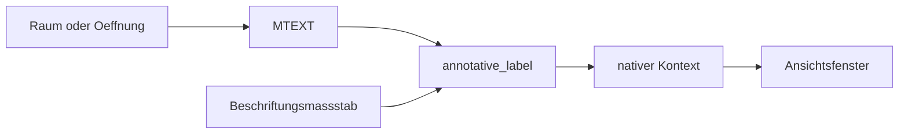

# Requirements

### Overview & Goals

Abgeleitete Grundrisse, Schnitte und Ansichten tragen keine Gesamtmaße mehr. Die beiden Maßlinien, die nach dem Träger-Sync angehängt werden, entfallen bei Neuerzeugung und bei der nächsten Aktualisierung.

Raumstempel und Öffnungskennzeichen werden annotativer Text des Kerns. Die gespeicherte Texthöhe bleibt die heutige Modellhöhe. Der Beschriftungsmaßstab der Zeichnung bestimmt, bei welchem Maßstab diese Höhe gilt. Ein Ansichtsfenster mit anderem Maßstab hält die Papiergröße, ohne `ModelView.scale` und ohne die Planart zu lesen.

### Scope

#### In Scope
- Entfernen der Gesamtmaße aus Grundriss, Schnitt, Ansicht, Aktualisierung und Beispielgenerator.
- Raumstempel in `room_regen.rs` und Öffnungskennzeichen in `opening_display.rs` als annotatives `MTEXT`.
- Beibehalten der Modellhöhen `0.22` und `0.15`. Eine Neuerzeugung übernimmt den schon gespeicherten nativen Maßstab, statt ihn still auf den gerade aktiven umzuschreiben.

#### Out of Scope
- Stempel oder Kennzeichen in die abgeleitete Geometrie kopieren. Sie bleiben an Raum und Öffnung.
- Ansichtsgriff, Schnittführung und Höhenkoten. Die Raute ist ein Modellgriff fester Größe; annotativer Text daneben würde sich von ihr lösen.
- Tür- und Fensterlisten, Planart, Tiefenmaske, Schichtregeln, Core-API und das Neuzeichnen der Beispiel-DWG.
- Eine zweite Maßstabsregel aus `ModelView.scale`.

### User Stories
- Als Planer will ich an einer erzeugten Ansicht keine Gesamtmaße mehr sehen, auch nicht nach dem Aktualisieren.
- Als Planer will ich, dass Raumstempel und Öffnungskennzeichen im Ansichtsfenster dieselbe Papiergröße behalten, wenn ich den Maßstab wechsle.
- Als Planer will ich, dass ein Regenerieren der Wand oder des Raums den schon gewählten Beschriftungsmaßstab des Stempels nicht umschreibt.

### Functional Requirements
- Nach dem Sync enthält `derived_handles` keine `DimensionLinear` auf `AEC_VIEW_DIM`. Eine Aktualisierung löscht vorhandene Gesamtmaße, weil ihre Handles schon in `derived_handles` stehen und `sync_carrier_primitives` diese Kinder entfernt.
- Ein neuer Raumstempel und ein neues Öffnungskennzeichen sind `MTEXT` mit `is_annotative` und genau einem nativen Beschriftungskontext.
- Liegt der aktuelle Beschriftungsmaßstab vor und ist nicht `1:1`, ist er dieser native Kontext. Fehlt er oder ist er `1:1`, gilt `1:100`. Die Höhen `0.22` und `0.15` bleiben Modellhöhen dieses Kontexts, nicht Papierhöhen.
- Ein Regenerationslauf, der den Text löscht und neu anlegt, liest den nativen Maßstab vorher und schreibt ihn auf den neuen Text. Nur ein erstes Erzeugen verwendet die Regel oben.
- Im gebundenen Maßstab sieht der Text aus wie heute. In einem anderen Ansichtsfenster bleibt die Papiergröße. Im Modellraum bei Beschriftungsmaßstab `1:1` wird ein an `1:100` gebundener Stempel auf Papiergröße verkleinert. Das ist das Kernverhalten, keine zweite AEC-Regel.

### Non-Functional Requirements
- Keine neue öffentliche Core-API. `create_annotation_context` und `ensure_scale_object` bleiben die einzigen Kernaufrufe.
- Die Umstellung liegt in `src/modules/aec/`. `update.rs` bleibt Verteiler.

# Technical Design

### Current Implementation

`append_overall_dimensions` in `src/modules/aec/engine/views/sheet_annotation.rs` hängt nach `sync_carrier_primitives` zwei `DimensionLinear` an `derived_handles`, Layer `AEC_VIEW_DIM`. Aufgerufen wird das aus `aec_floorplan.rs`, `aec_section.rs`, `aec_elevation.rs`, `update_ops.rs` und sechsmal aus `sample_project.rs`. Der native Kontext ist `header.current_annotation_scale`, sonst `1:1`. `ModelView.scale` wird nicht gelesen.

Der Raumstempel entsteht in `regenerate_room_representation_with_display` als `MTEXT` mit Höhe `0.22`, `rectangle_width = 0` und Anhang `MiddleCenter`. `remove_room_display_children` löscht ihn vor jedem Neuaufbau. Das Öffnungskennzeichen entsteht in `regenerate_opening_display` als `MTEXT` mit Höhe `0.15`, ebenfalls nach `erase_entities` der alten `OPENING_REP`-Kinder. Beide Texte setzen `is_annotative` nicht.

Der Kern skaliert annotatives `MTEXT` über `create_annotation_context` und `text_context_ratio`: gezeichnete Modellhöhe = gespeicherte Höhe × (aktiver Faktor / nativer Faktor). `ensure_scale_object` legt einen fehlenden `AcDbScale` an. `Scale::new("1:100", 1.0, 100.0)` ist die vorhandene Form dafür.

### Key Decisions
- Die Gesamtmaße entfallen an allen drei Ableitungen, nicht nur an Schnitt und Ansicht. Dieselbe Funktion hängt sie auch an den Grundriss.
- Stempel und Kennzeichen bleiben am Raum und an der Öffnung. Die Ableitung bekommt keine zweite Textkopie.
- Die Höhen bleiben `0.22` und `0.15` als Modellhöhe des nativen Kontexts. Sie werden nicht mit dem Beschriftungsfaktor multipliziert, sonst wächst der Text in der heutigen Ansicht.
- Nativer Maßstab ist der aktuelle Beschriftungsmaßstab, wenn er existiert und nicht `1:1` ist. Sonst `1:100`. Ein Regenerieren übernimmt den schon geschriebenen nativen Maßstab, weil der Text jedes Mal gelöscht wird.
- Der Ansichtsgriff bleibt nicht annotativ. Die Raute hat eine feste Modellgröße; der Text daneben würde sich bei `1:1` auf Papiergröße verkleinern und den Griff unlesbar machen.

### Proposed Changes

Die Maßanhänger und `sheet_annotation.rs` verschwinden. `views/mod.rs` verliert `pub mod sheet_annotation`. Tests, die genau diese zwei Maße zaehlen, fallen mit dem Modul weg. Tests, die nach einem Befehl die Entity-Zahl fest verdrahtet haben, werden nur angepasst, wenn sie die Maße mitgezählt haben.

Neu ist `src/modules/aec/engine/annotative_label.rs`. Es arbeitet auf `CadDocument` und nutzt dieselbe Umwandlung nach `codec::Document`, die `sheet_annotation.rs` schon für `create_annotation_context` verwendet. Vor dem Löschen der Kinder liest der Aufrufer den nativen Maßstab des alten `MTEXT`. Nach `add_entity` setzt der Helfer `is_annotative` und genau einen Kontext. Fehlt ein übernommener Maßstab, gilt die Regel aus den Entscheidungen. `1:100` wird über `ensure_scale_object` angelegt, wenn die Maßstabsliste ihn noch nicht hat.

`room_regen.rs` ruft das für den Stempel auf, nur wenn `display.stamp` den Text wirklich anlegt. `opening_display.rs` ruft es für `OpeningLabel2D` auf, nachdem der Text in der Szene liegt. Schraffur, Schwelle und Öffnungsgeometrie bleiben unannotativ.

### Data Models / Contracts

```rust
pub fn native_annotation_scale(doc: &CadDocument, entity: Handle) -> Option<Handle>;

pub fn bind_annotative_mtext(
    doc: &mut CadDocument,
    entity: Handle,
    retained_scale: Option<Handle>,
) -> bool;
```

`bind_annotative_mtext` gibt `false` zurück, wenn das Entity kein `MTEXT` ist. Es ändert Höhe, Text und Einfügepunkt nicht. Ein zweiter Aufruf für denselben Maßstab legt kein zweites Blatt an; `create_annotation_context` ist dafür schon idempotent.

### Architecture Diagram



### File Structure

Neu:

- `src/modules/aec/engine/annotative_label.rs`

Geändert:

- `src/modules/aec/engine/mod.rs` für das neue Modul
- `src/modules/aec/engine/room_regen.rs`
- `src/modules/aec/engine/opening_display.rs`
- `src/modules/aec/engine/views/mod.rs`
- `src/modules/aec/engine/views/update_ops.rs`
- `src/modules/aec/views/aec_floorplan.rs`
- `src/modules/aec/views/aec_section.rs`
- `src/modules/aec/views/aec_elevation.rs`
- `src/modules/aec/engine/sample_project.rs`

Entfernt:

- `src/modules/aec/engine/views/sheet_annotation.rs`

### Risks
- Ein Stempel, dessen nativer Maßstab `1:100` ist, wird im Modellraum bei Beschriftungsmaßstab `1:1` auf Papiergröße gezeichnet. Das ist beabsichtigt und muss im Test festgehalten werden, damit es nicht als Höhenfehler korrigiert wird.
- Wird der alte Maßstab erst nach `erase_entities` gelesen, ist er weg. Die Abfrage muss vor dem Löschen der Kinder stehen.
- Die Dokumentumwandlung darf nur das `CadDocument` ersetzen, nicht die Szenen-Caches daneben. Dasselbe Muster nutzt der bisherige Maßanhang bereits auf `scene.document`.
- Beispielzeichnungen behalten alte Maße, bis die Ansicht aktualisiert oder die Datei neu erzeugt wird. Dieses Paket erzeugt die DWG nicht neu.

# Testing

### Validation Approach

Tests liegen neben dem Helfer, der Raum- und der Öffnungsregeneration. Ausgeführt wird `cargo test --lib -- aec::engine::annotative_label aec::engine::room_regen aec::engine::opening_display aec::engine::views`. Kein GUI-Lauf.

### Key Scenarios
- Nach Grundriss, Schnitt, Ansicht und `regenerate_carrier` gibt es kein `DimensionLinear` auf `AEC_VIEW_DIM`. `ModelView.scale` bleibt unverändert.
- Ein neuer Raumstempel und ein neues Öffnungskennzeichen sind annotativ. Bei aktuellem Maßstab `1:50` ist das der native Kontext, die Höhe bleibt `0.22` bzw. `0.15`.
- Ohne aktuellen Maßstab oder bei `1:1` ist der native Kontext `1:100`.
- Ein zweiter Regenerationslauf bei inzwischen anderem aktuellem Maßstab behält den ersten nativen Kontext.

### Edge Cases
- Raum ohne Stempel, weil die Planart den Stempel ausblendet: kein annotativer Text und kein Panic.
- Öffnung ohne sichtbares `OpeningLabel2D`: kein Kennzeichen.
- Leere Hülle einer Ansicht: weiter kein Maß, auch kein Ersatztext.
- Zweimaliges Binden desselben Texts erzeugt kein zweites Kontextblatt.

### Test Changes
- Die Tests in `sheet_annotation.rs` entfallen mit der Datei.
- Neue Fälle in `annotative_label.rs` für Maßstabswahl, Beibehalten und idempotentes Binden.
- Ein Raum- und ein Öffnungstest prüfen Höhe, Flag und nativen Kontext nach zwei Regenerationsläufen.

# Delivery Steps

### ✓ Step 1: Remove derived overall dimensions
Grundriss, Schnitt und Ansicht haben nach dem Erzeugen und nach dem Aktualisieren keine Gesamtmaße mehr.

- Alle Aufrufe von `append_overall_dimensions` in `aec_floorplan.rs`, `aec_section.rs`, `aec_elevation.rs`, `update_ops.rs` und `sample_project.rs` entfernen.
- `sheet_annotation.rs` und `pub mod sheet_annotation` entfernen.
- Tests, die die zwei Maße oder ihre Entity-Zahl erwarten, auf das Fehlen der Maße umstellen. `ModelView.scale` bleibt unangetastet.
- Keine Beispiel-DWG neu erzeugen.

### ✓ Step 2: Bind room stamps to one annotation scale
Ein Raumstempel ist annotatives `MTEXT` und behält seinen nativen Maßstab über eine Neuerzeugung.

- `annotative_label.rs` mit `native_annotation_scale` und `bind_annotative_mtext` anlegen und in `engine/mod.rs` einhängen.
- Vor `remove_room_display_children` den nativen Maßstab des alten Stempels lesen und nach dem Anlegen an den neuen Text binden.
- Höhe `0.22`, Text und Position nicht ändern.
- Test: `1:50` bleibt nativ; ohne Maßstab gilt `1:100`; der zweite Lauf überschreibt den Kontext nicht.

### ✓ Step 3: Bind opening labels the same way
Das Öffnungskennzeichen folgt derselben annotativen Regel wie der Raumstempel.

- In `regenerate_opening_display` den nativen Maßstab des alten `OpeningLabel2D` vor `erase_entities` lesen.
- Nach dem Anlegen des neuen `MTEXT` `bind_annotative_mtext` aufrufen. Höhe `0.15` bleibt.
- Schwung, Rahmen und Schraffur nicht annotativ machen.
- Test: zwei Regenerationsläufe, der erste native Maßstab bleibt, die Höhe bleibt `0.15`.