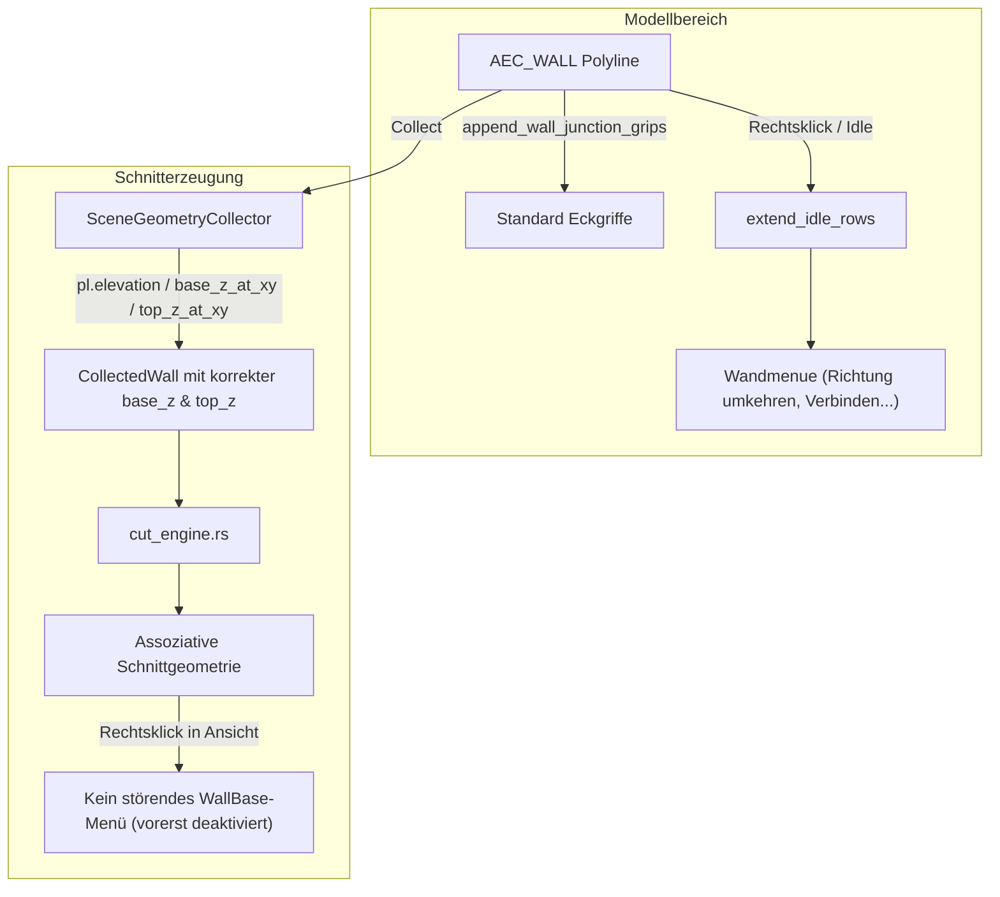

# Requirements

### Overview & Goals
In abgeleiteten Schnitten und Ansichten traten zwei Kernprobleme auf:
1. **Falsche Z-Positionen von Wänden im Schnitt:** Wände wurden teilweise auf falscher Höhe geschnitten oder dargestellt (z. B. auf Z = 0 statt Geschosshöhe, fehlerhafte Einbindung von `BasePlane`, `BaseOffset` oder `TopPlane` sowie doppelte Höhenaufschläge bei Geschoss-XREFs).
2. **Unerwünschte Menüüberlagerung im Modell:** Das in einem vorigen Schritt eingeführte Kontextmenü für Wandbasis-Interaktionen überlagerte im Modellbereich das etablierte Wandmenü. Das Standardmenü mit Aktionen wie „Richtung umkehren“ (`AEC_WALLREVERSE`), „Wände verbinden“ etc. war nicht mehr zugänglich. Zudem soll das Kontextmenü für assoziative Wände in Schnitten und Ansichten vorerst deaktiviert werden.

Ziel dieser Maßnahme ist es, die Z-Höhenberechnung von Wänden im AEC-Szenenkollektor robust zu korrigieren und das Standard-Kontextmenü für Wände im Modell wiederherzustellen, während die experimentellen Menüs an assoziativen Wänden in Schnitten deaktiviert werden.

---

### Scope
- **In Scope:**
  - Robustere Ermittlung von `base_z` und `top_z` in `src/modules/aec/engine/views/scene_collector.rs` (Berücksichtigung von `pl.elevation`, `base_plane_id`, `base_offset`, `top_plane_id`, `top_offset` und Dachschrägen).
  - Beseitigung von doppelten Höhenaufschlägen bei XREF-Geschossen (z. B. in `sample_project.rs`).
  - Deaktivierung des neuen Wandbasis-Kontextmenüs (`WallBaseGrip`) für abgeleitete Wände in Ansichten und Schnitten.
  - Entfernung des Dropdown-Griffs `WALL_BASE_DROPDOWN_GRIP_ID` von Wänden im regulären Modell.
  - Wiederherstellung des Standard-Kontextmenüs mit „Richtung umkehren“ (`AEC_WALLREVERSE`) bei Rechtsklick auf Wände im Modell.
  - Ergänzung gezielter Modultests zur Absicherung beider Teilbereiche.
- **Out of Scope:**
  - Änderungen am Öffnungs- oder Decken-Kontextmenü (Fenster/Türen und Deckenunterkanten bleiben wie spezifiziert erhalten).
  - Einführung neuer Zeichenwerkzeuge oder GPU-Shader.

---

### User Stories
- **Als CAD-Konstrukteur** möchte ich einen Schnitt durch ein Gebäude legen und sicher sein, dass alle Wände (auch im Obergeschoss, mit Schichtversätzen oder unter Dachschrägen) auf ihrer korrekten Z-Höhe geschnitten und dargestellt werden, damit die Werkplanung geometrisch exakt ist.
- **Als Anwender** möchte ich im normalen Modell mit der rechten Maustaste auf eine Wand klicken können, um wie gewohnt die Wandrichtung umzukehren („Richtung umkehren“), Wände zu verbinden oder Öffnungen hinzuzufügen, ohne durch ein unpassendes Griff-Menü blockiert zu werden.

---

### Functional Requirements
1. **Wand-Kontextmenü im Modell:**
   - Wenn eine oder mehrere Wände im Modell selektiert sind oder angeklickt werden, muss das Idle-Kontextmenü den `wall_block` anbieten:
     - *Richtung umkehren* (`AEC_WALLREVERSE`)
     - *Wände verbinden* (`AEC_WALLJOIN`)
     - *Wand verlängern* (`AEC_WALLEXTEND`)
     - *Fenster hinzufügen* (`AEC_WINDOW`), *Tür hinzufügen* (`AEC_DOOR`), *Öffnung hinzufügen* (`AEC_OPENING`)
     - *Ausrichtung ändern* (`WallJustification`)
   - Kein exklusives `WallBaseGrip`-Menü darf diese Optionen im Modell überschreiben.
2. **Deaktivierung an assoziativen Wänden:**
   - An assoziativen Wand-Primitiven (`FeatureKey::WallBase`) in Schnitten und Ansichten wird kein `AecMenuExclusive::WallBaseGrip` angeboten und kein Dropdown-Griff angezeigt.
3. **Z-Höhenermittlung im Schnitt:**
   - Der Szenenkollektor (`SceneGeometryCollector`) ermittelt die Basishöhe `base_z` einer Wand unter Berücksichtigung von:
     - `pl.elevation` der Träger-Polyline (wenn `base_origin[2]` uninitialisiert ist),
     - `wall.base_z_at_xy` bei Vorhandensein einer Bezugsebene (`base_plane_id`) oder Facetten,
     - `wall.base_offset`.
   - Die Wandoberkante `top_z` wird bei definierter `top_plane_id` oder Schrägen über `wall.top_z_at_xy` bzw. `wall.top_origin[2]` ermittelt, anstatt pauschal `base_z + wall.height` anzunehmen.
   - Bei Geschoss-XREFs darf keine doppelte Verschiebung auftreten, wenn Bauteile bereits absolute Höhen besitzen.

---

### Non-Functional Requirements & Architecture
- **AEC ≠ Core:** Alle fachlichen Anpassungen erfolgen ausschließlich in `src/modules/aec/**`. Keine neuen AEC-Felder in Core-Strukturen.
- **Robustheit:** Fehlertolerante Fallbacks, falls Wände aus älteren DXF/DWG-Dateien stammen oder unvollständige XDATA aufweisen.

# Technical Design

### Current Implementation & Root Cause Analysis

#### Ursache 1: Z-Höhenermittlung in `scene_collector.rs`
In `src/modules/aec/engine/views/scene_collector.rs` (Zeilen 335–341) wurde die Wandhöhe bisher wie folgt ausgelesen:
```rust
let mut base_z = wall.base_origin[2];
let mut top_z = base_z + wall.height;
if let Some(xref) = &xref_source {
    let (_, _, z_t) = xref.transform_coords(0.0, 0.0, base_z);
    base_z = z_t;
    top_z = base_z + wall.height;
}
```
Hierbei treten folgende Fehler auf:
1. **Ungebundene / importierte Wände:** Bei Wänden, die auf Geschossebene gezeichnet oder importiert wurden, liegt die Höhe in `pl.elevation` (z. B. 2,80 m). `wall.base_origin[2]` ist standardmäßig `0.0`. Der Kollektor übernahm `0.0` und schnitt die Wand 2,80 m zu tief.
2. **Bezugsebenen & Dachschrägen:** Bei Wänden mit `base_plane_id` oder Dachschrägen (`top_plane_id`) variiert die Höhe entlang der Wand. Die Auswertung über `wall.base_z_at_xy` und `wall.top_z_at_xy` fehlte völlig; `top_z` wurde immer starr auf `base_z + wall.height` gesetzt, wodurch Dachverschnitte und geneigte Ebenen ignoriert wurden.
3. **Doppelzählung bei XREFs in `sample_project.rs`:** In `sample_project.rs` wurden die Wände in `OG.dwg` bereits mit `z = 2.80` erzeugt. Beim Einfügen in das Gesamtmodell wurde der XREF-Insert zusätzlich mit `z_offset = 2.80` versehen. Der Kollektor addierte beide Werte (2,80 + 2,80 = 5,60 m), wodurch das OG im Schnitt schwebte und das DG (5,60 + 5,60 = 11,20 m) außerhalb des Schnittbereichs lag.

#### Ursache 2: Menüverdrängung im Modell
In `src/modules/aec/properties.rs` wurde in `append_wall_junction_grips` jeder Wand der Griff `WALL_BASE_DROPDOWN_GRIP_ID` hinzugefügt:
- Beim Überfahren oder Anklicken wurde `self.aec.aec_active_grip_menu = Some(WallBaseGrip)` gesetzt.
- In `src/app/update/context_menu.rs` führte `exclusive != None` dazu, dass das Menü vorzeitig mit den exklusiven Zeilen zurückkehrte.
- Die Methode `extend_idle_rows`, die bei `snap.only_walls == true` die Standardaktionen („Richtung umkehren“, „Wände verbinden“, „Wand verlängern“ etc.) einhängt, wurde dadurch komplett umgangen.

---

### Proposed Changes

#### 1. `src/modules/aec/properties.rs`
- **Entfernen von `WALL_BASE_DROPDOWN_GRIP_ID` aus `append_wall_junction_grips`:** Wände im Modell erhalten nur noch die Eck- und Verbindungspunkte. Keine störenden Dropdown-Griffe auf der Wandachse.
- **Entfernen des Dropdowns an assoziativen Wänden:** In `append_derived_view_grips` wird für `FeatureKey::WallBase` kein Dropdown-Griff mehr erzeugt.

#### 2. `src/modules/aec/ui/context_menu.rs` & `src/app/update/context_menu.rs`
- In `derived_view_dropdown_menu` und `derived_primitive_context_menu`: Bei `FeatureKey::WallBase` wird `None` zurückgegeben (Deaktivierung an assoziativen Wänden in Ansichten/Schnitten).
- Im Modell: Durch den Wegfall des Griffs bleibt `exclusive == AecMenuExclusive::None`, wodurch bei Wandselektion verlässlich `only_walls` greift und das Standard-Kontextmenü mit `AEC_WALLREVERSE` („Richtung umkehren“) gerendert wird.

#### 3. `src/modules/aec/engine/views/scene_collector.rs`
- Überarbeitung der Z-Ermittlung in `collect_scope`:
  ```rust
  let mid_p = Point2::new(
      (axis_points[0].x_m + axis_points[axis_points.len() - 1].x_m) * 0.5,
      (axis_points[0].y_m + axis_points[axis_points.len() - 1].y_m) * 0.5,
  );
  let raw_base = if wall.base_plane_id.is_some() || !wall.base_facets.is_empty() {
      wall.base_z_at_xy(mid_p.x_m, mid_p.y_m)
  } else if wall.base_origin[2].abs() > 1e-6 {
      wall.base_origin[2] + wall.base_offset
  } else if pl.elevation.abs() > 1e-6 {
      pl.elevation + wall.base_offset
  } else {
      wall.base_offset
  };

  let raw_top = if wall.top_plane_id.is_some() || !wall.top_facets.is_empty() {
      wall.top_z_at_xy(mid_p.x_m, mid_p.y_m)
  } else {
      raw_base + wall.height + wall.top_offset
  };
  ```
- Robuste XREF-Transformation unter Vermeidung von Doppelzählungen.

#### 4. `src/modules/aec/engine/sample_project.rs`
- Bereinigung der XREF-Einfügungen bzw. Basis-Höhen in `sample_project.rs`, sodass `build_master_geometry` und die Geschosse konsistent auf das globale Höhenmodell abgestimmt sind.

---

### Architecture Diagram



# Testing

### Validation Approach
Die Validierung erfolgt zweistufig:
1. **Automatisierte Modultests (`cargo test`):**
   - Gezielte Unit-Tests für `scene_collector.rs` mit verschiedenen Kombinationen von Polylinien-Elevation, `base_plane_id`, `top_plane_id` und Offsets.
   - Unit-Tests für `context_menu.rs`, die verifizieren, dass `snap.only_walls` das Standard-Wandmenü (`AEC_WALLREVERSE` etc.) erzeugt und `derived_primitive_context_menu` für Wände `None` liefert.
   - Ausführung der bestehenden Test-Suites für Schnitt- und Wandoperationen.
2. **Kompilierungs- und Konsistenzprüfung:**
   - Vollständiger Durchlauf von `cargo check` zur Sicherstellung der Typ- und Schnittstellenkorrektheit über das gesamte Projekt.

---

### Key Scenarios

#### Szenario 1: Schnitt durch Geschoss-Wand mit Polylinien-Elevation
- **Gegeben:** Eine Wand liegt auf einer Polyline mit `pl.elevation = 2.80`, `base_origin[2] = 0.0` und Höhe 2,80 m.
- **Erwartung:** `SceneGeometryCollector` ermittelt `base_z = 2.80` und `top_z = 5.60`. Der Schnitt schneidet die Wand exakt im Intervall [2.80, 5.60] und platziert eventuelle Fenster/Türen auf der korrekten absoluten Brüstungshöhe.

#### Szenario 2: Schnitt durch Wand mit Bezugsebene & Dachschräge
- **Gegeben:** Eine Wand ist an eine geneigte Dachebene gebunden.
- **Erwartung:** `top_z` wird aus `wall.top_z_at_xy` ermittelt und nicht starr über `base_z + wall.height` abgeschnitten.

#### Szenario 3: Wand-Kontextmenü im Modellbereich
- **Gegeben:** Der Anwender wählt eine Wand im Modell aus und öffnet das Kontextmenü.
- **Erwartung:** Das Menü zeigt zuverlässig „Richtung umkehren“ (`AEC_WALLREVERSE`), „Wände verbinden“, „Wand verlängern“, „Fenster hinzufügen“, „Tür hinzufügen“, „Öffnung hinzufügen“ und das Untermenü zur Ausrichtung.

#### Szenario 4: Interaktion mit assoziativer Wand im Schnitt
- **Gegeben:** Der Anwender interagiert mit einer assoziativen Wand im Schnitt.
- **Erwartung:** Es wird kein blockierendes exklusives Wandbasis-Kontextmenü angezeigt; das Standardverhalten bleibt stabil.

---

### Test Changes
- `src/modules/aec/engine/views/scene_collector.rs`: Neuer Test `test_wall_elevation_and_plane_offsets_collection`.
- `src/modules/aec/ui/context_menu.rs`: Aktualisierung/Erweiterung der Tests für `derived_primitive_context_menu` und `wall_block`.

# Delivery Steps

### ✓ Step 1: Wand-Kontextmenüs korrigieren und Standardmenü im Modell wiederherstellen
Stellt das klassische Wand-Kontextmenü mit „Richtung umkehren“ im Modell wieder her und deaktiviert das experimentelle Menü an assoziativen Wänden in Schnitten.

- In `src/modules/aec/properties.rs`: Den Dropdown-Griff `WALL_BASE_DROPDOWN_GRIP_ID` aus `append_wall_junction_grips` entfernen, sodass Wände im Modellbereich keinen störenden Dropdown-Griff auf der Achsenmitte erhalten.
- In `src/modules/aec/properties.rs`: In `append_derived_view_grips` den Dropdown-Griff für `FeatureKey::WallBase` entfernen.
- In `src/modules/aec/ui/context_menu.rs`: In `derived_view_dropdown_menu` und `derived_primitive_context_menu` die Erzeugung von `AecMenuExclusive::WallBaseGrip` für `FeatureKey::WallBase` deaktivieren (Rückgabe von `None`).
- In `src/app/update/context_menu.rs`: Sicherstellen, dass bei selektierten Wänden im Modell `exclusive` den Wert `AecMenuExclusive::None` behält und `extend_idle_rows` mit `wall_block` („Richtung umkehren“, „Wände verbinden“, „Wand verlängern“ etc.) zuverlässig angezeigt wird.
- Modultests in `src/modules/aec/ui/context_menu.rs` aktualisieren, um das reguläre Erscheinen des Wandmenüs und das Ausbleiben des Wandbasis-Menüs in Ansichten abzusichern.

### ✓ Step 2: Z-Positionen von Wänden im Schnitt- und Szenenkollektor korrigieren
Gewährleistet die fehlerfreie vertikale Positionierung (Z-Basis und Z-Oberkante) von Wänden bei der Schnitterzeugung unter voller Berücksichtigung von Bezugsebenen, Offsets und Polylinien-Elevationen.

- In `src/modules/aec/engine/views/scene_collector.rs`: Die Berechnung von `base_z` und `top_z` für `CollectedWall` grundlegend überarbeiten:
  - Wenn `wall.base_origin[2]` uninitialisiert (0,0) ist, aber die Polylinie eine `pl.elevation` besitzt, wird `pl.elevation` als Referenzhöhe herangezogen.
  - Wenn eine Bezugsebene (`base_plane_id`) oder Facetten vorhanden sind, wird `wall.base_z_at_xy` an der Wandachsenmitte ausgewertet.
  - Berücksichtigung von `wall.base_offset`, falls dieser nicht bereits in `base_origin` enthalten ist.
  - `top_z` wird bei Vorhandensein von `top_plane_id` oder Facetten über `wall.top_z_at_xy` ermittelt (anstelle von pauschalem `base_z + wall.height`), um Dachschrägen und Höhenbeschneidungen korrekt zu erfassen.
- In `src/modules/aec/engine/wall.rs`: Überprüfung und Absicherung von `base_z_at_xy` und `top_z_at_xy`, sodass `base_offset` und `top_offset` auch ohne vorherigen Re-Bake konsistent einbezogen werden.
- In `src/modules/aec/project/wall_planes.rs`: Beim Zuweisen von Bezugsebenen (`apply_wall_plane_choice` und `apply_wall_base_z`) sicherstellen, dass `pl.elevation` synchron mit `wall.base_origin[2]` gehalten wird.
- Modultests für `scene_collector.rs` hinzufügen, die Wände mit Elevation, BasePlanes und Offsets in Schnitten validieren.

### ✓ Step 3: XREF-Geschosshöhen harmonisieren und Gesamtabnahme durchführen
Bereinigt Geschosstransformationen bei XREFs gegen Doppelzählungen und verifiziert alle Schnitt- und Ansichtsoperationen end-to-end.

- In `src/modules/aec/engine/sample_project.rs`: Die Einfügepunkte der Geschoss-XREFs in `build_master_geometry` bzw. die Höhen in `build_og_geometry` und `build_dg_geometry` harmonisieren, sodass Geschosshöhen nicht doppelt (in der DWG und im Insert) aufgeschlagen werden.
- In `src/modules/aec/engine/views/cut_engine.rs`: Überprüfen, dass Layer-Offsets (`bottom_offset`/`top_offset`) und Öffnungsunterkanten (`sill_height`) auf der korrigierten `base_z` aufsetzen.
- Ausführung der bestehenden und neuen Modultests (`cargo test cut_engine`, `cargo test scene_collector`, `cargo test edit_ops`, `cargo test context_menu`) sowie Validierung des sauberen Builds (`cargo check`).