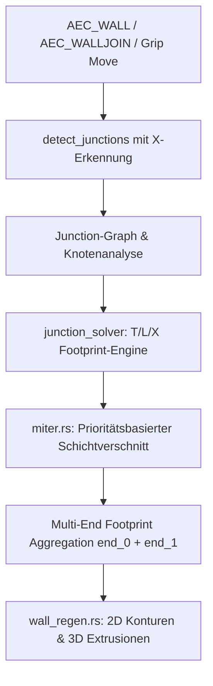

# Requirements

### Overview & Goals
Ziel dieser Überarbeitung ist die Beseitigung geometrischer und topologischer Fehler bei Wandverschneidungen im AEC-Modul. Insbesondere werden fehlerhafte Schichtdurchdringungen bei T-Verbindungen (Durchtunnelung), nicht greifende manuelle Kantenverschneidungen (`NearFace`/`FarFace`), fehlende oder unsaubere X-Kreuzungen sowie das versehentliche Zerstören bestehender Wandverbindungen bei Neuverbindungen behoben. Sowohl die 2D-Grundrissdarstellung als auch die 3D-Volumengeometrie werden synchron und artefaktfrei aktualisiert.

### Scope
- **In Scope:**
  - Korrektur der automatischen Schichtverschneidung bei T-Stößen in `miter.rs` (Tragschicht-Stoß an Kern, Finish-Stoß an Außenkante, Vermeidung von Überständen/Durchtunnelungen).
  - Korrektur der manuellen Kantenwahl (`NearFace`, `FarFace`, `Butt`) im Junction-Editor und Kontextmenü.
  - Erkennung und Auflösung von X-Kreuzungen (4-Wege-Knoten) mit durchgehender Hauptwand und T-Anschlüssen.
  - Umstellung der Verbindungslogik auf einen kaskadierenden Junction-Graph-Solver in `join_ops.rs`, der bestehende Nachbarknoten schützt.
  - Synchrone Aktualisierung von 2D-Schichtpolygonen, Schraffuren und 3D-Volumenkörpern.
- **Out of Scope:**
  - Änderung des IFC-Export-Schemas oder der XDATA-Grundstruktur.
  - Freiform-Gehrung von Wänden mit veränderlicher Dicke entlang der Achse.

### User Stories
- **Als Anwender** möchte ich, dass beim Auftreffen einer Innen- oder Zwischenwand auf eine mehrschichtige Außenwand (T-Stoß) keine Schichten unkontrolliert durch die Außenwand hindurchragen.
- **Als Anwender** möchte ich im Junction-Editor oder Kontextmenü gezielt „Nähere Kante“ oder „Fernere Kante“ für einzelne Wandschichten wählen können, sodass die Schicht exakt an der gewünschten Kante der Kopfwand stoppt.
- **Als Anwender** möchte ich Kreuzungen von zwei Wänden (X-Stoß) zeichnen können, wobei eine Wand durchgeht und die kreuzende Wand sauber beidseitig anschließt.
- **Als Anwender** möchte ich neue Wände anbinden oder verschieben können, ohne dass bereits bestehende Verbindungen an den anderen Enden der Wände zerstört werden.

### Functional Requirements
- **FR1 (T-Stoß Schichtlogik):** Die Tragschicht der Stammwand stoppt exakt an der dem Stoß zugewandten Kante der Tragschicht der Kopfwand. Nicht-tragende Schichten (Dämmung, Putz) stoppen an der vorderen Begrenzungskante der Kopfwand und dürfen nicht in fremde Schichten durchtunneln.
- **FR2 (Manuelle Kantenverschneidung):** Die Optionen `JoinOverrideStyle::NearFace`, `JoinOverrideStyle::FarFace` und `JoinOverrideStyle::Butt` müssen geometrisch exakt die entsprechenden Schichtbegrenzungslinien der Kopfwand ansteuern.
- **FR3 (X-Kreuzungen):** Sich kreuzende Wandachsen (auch ohne vorherigen Achsenschnittpunkt) werden von `detect_junctions` erkannt und als 4-Wege-Junction aufgelöst (eine dominante Durchgangswand und zwei logische T-Stammanschlüsse).
- **FR4 (Topologieschutz & Kaskadierung):** Modifikationen an einer Wand (z. B. Auto-Join eines neuen Segments oder `AEC_WALLJOIN`) dürfen Verbindungen an anderen Endpunkten derselben Wand nicht überschreiben oder löschen, sondern müssen alle betroffenen Knoten des Junction-Graphen gemeinsam aktualisieren.
- **FR5 (2D/3D-Konsistenz):** Die berechneten mitered Footprints werden für 2D-Begrenzungslinien, Schraffuren und 3D-Extrusionen gleichermaßen verwendet.

### Non-Functional Requirements
- **Robustheit:** Keine Panics bei kollinearen, parallelen oder spitzwinkligen Wänden (< 5°).
- **Performance:** Lokale Kaskadierung statt globalem Rebuild des gesamten Dokuments (auf benachbarte Knoten im Snap-Radius begrenzt).
- **Rückwirkungsfreiheit:** Sämtliche bestehenden AEC-Unit-Tests bleiben grün.

# Technical Design

### Current Implementation
Aktuell basiert das Wandverschneidungssystem auf mehreren Subsystemen:
- `src/modules/aec/engine/join.rs`: Erkennt 2-Wege- und Mehrwege-Knoten anhand von Achsendpunkten (`detect_junctions`). Achsen werden an Schnittpunkten getrimmt (`apply_junction_to_axes`).
- `src/modules/aec/engine/junction_solver.rs`: Berechnet für gefundene Knoten die Miter-Footprints der beteiligten Wände.
- `src/modules/aec/engine/miter.rs`: Erzeugt 2D-Schicht-Polygone für L- und T-Verbindungen (`mitered_layer_footprints_with_override_and_bulges`, `t_junction_layer_footprints`, `through_wall_cutout_footprints_with_gaps`).
- `src/modules/aec/engine/join_ops.rs`: Enthält `try_auto_join_nearby_walls`, `auto_join_committed_wall_segment` und `join_two_walls_in_document`.

**Bestehende Schwachstellen:**
1. In `t_junction_layer_footprints` fallen Finish-Schichten ohne exakten Material-Match auf `outer_target` zurück. Dies führt bei bestimmten Schichtfolgen dazu, dass Schichten der Stammwand über die Kopfwand hinausragen oder in Schichten auf der Gegenseite hineinlaufen.
2. In `miter.rs` nutzt `layer_face_line` für `NearFace` Projektionen, die bei asymmetrischen Mehrschichtwänden die falsche Konturlinie anvisieren können.
3. In `detect_junctions` werden nur Endpunkt-Cluster betrachtet. Reines Durchkreuzen zweier Wände im Segmentinneren wird nicht als Junction erfasst.
4. Bei `join_two_walls_in_document` wird `regenerate_wall_representation_with_precomputed_miters` mit nur den Footprints des aktuellen Paares aufgerufen. Hat eine Wand an ihrem anderen Ende bereits eine Verbindung, wird diese bei der Regeneration überschrieben.

---

### Key Decisions
- **Decision 1 (Zentraler Graph-Solver):** Jede Wand verwaltet ihre Footprints für beide Enden (`end_0`, `end_1`) sowie Durchdringungen (`span`). Änderungen triggern eine kaskadierende Neuberechnung der verbundenen Knoten, ohne isolierte Enden zu überschreiben.
- **Decision 2 (Prioritätsbasierter T-Schichtstoß):** Tragschichten (Structural) stoßen an den Kern der Kopfwand; Bekleidungen/Dämmungen stoppen an der Anströmkante (NearFace). Ein Durchtunneln in die entgegengesetzte Wandseite wird geometrisch durch Clipping an der Kopfwand-Mittellinie/Kernkante unterbunden.
- **Decision 3 (X-Kreuzung als Through + 2x T):** Eine Kreuzung wird modelliert, indem die priorisierte Wand als `Through` erhalten bleibt und die kreuzende Wand in zwei logische T-Anschlüsse aufgeteilt wird, die beidseitig an die Kopfwand stoßen.

---

### Architecture Diagram


---

### Proposed Changes

#### 1. Schichtverschnitt & Kantenwahl in `src/modules/aec/engine/miter.rs`
- In `t_junction_layer_footprints`:
  - Tragschicht-Pairing anpassen: Der Kern der Stammwand dockt an den Kern der Kopfwand an; falls die Kopfwand auf der Annäherungsseite Schichten vor dem Kern hat, stoppt der Kern an der Kernvorderkante und stanzt vorherige Schichten aus (`through_wall_cutout_footprints`).
  - Nicht-tragende Schichten werden strikt an die äußere Vorderkante (`near_face`) der Kopfwand begrenzt und dürfen nicht über `outer_target` hinausreichen.
- In `layer_face_line` und `through_outer_face_line`:
  - Robuste Richtungsprüfung des Annäherungsvektors (`to_stem`), damit `NearFace` zuverlässig die dem Stoß zugewandte Kante der gewählten Schicht trifft.

#### 2. X-Kreuzungen in `src/modules/aec/engine/join.rs` und `junction_solver.rs`
- In `detect_junctions`:
  - Erkennung von Segment-Segment-Schnittpunkten im Inneren von Wänden (`find_segment_intersections`).
  - Erzeugung von 4-Wege-Junctions mit Rollen `Through` für die durchgehende Wand und `Endpoint` bzw. geteilte T-Rollen für die kreuzende Wand.
- In `junction_solver.rs`:
  - Aussparung beidseitiger Finish-Schichten auf der Durchgangswand und Stoß der kreuzenden Wände von beiden Seiten.

#### 3. Kaskadierender Junction-Graph in `src/modules/aec/engine/join_ops.rs`
- Speicherung und Zusammensetzung von Miter-Footprints an beiden Wandenden (`merge_miter_footprints_for_both_ends`), sodass ein Join an Ende 1 die Geometrie an Ende 0 intakt lässt.
- Kaskadierende Neuberechnung: Bei Achsenanpassung einer Wand werden alle am gleichen Knoten hängenden Wände sowie die an deren Gegenseite hängenden Knoten aktualisiert.
- Bereinigung von `try_auto_join_nearby_walls` und `auto_join_committed_wall_segment`.

#### 4. UI & Kontextmenü in `src/modules/aec/ui/`
- Sicherstellung, dass im Junction-Editor (`aec_junction_editor.rs`) und im Kontextmenü (`context_menu.rs`) die Bezeichnungen „Nähere Kante“ (`NearFace`), „Fernere Kante“ (`FarFace`) und „Stoß“ (`Butt`) eindeutig auf die korrigierten Solver-Methoden verweisen.

---

### Data Models / Contracts
- `JunctionRole` wird erweitert oder präzisiert für X-Kreuzungen:
  ```rust
  pub enum JunctionRole {
      Endpoint(usize),
      Through(usize),
  }
  ```
- `WallJoinInput` und `SolvedPair` / `SolvedJunction` transportieren konsistent beide Endpunkt-Zustände.

---

### Risks
- **Rundungsungenauigkeiten bei Beinahe-Schnittpunkten:** Bei sehr spitzen Winkeln können Miter-Schnittpunkte weit außerhalb liegen.
  *Mitigation:* Begrenzung des Miter-Offsets auf maximal das Dreifache der Wanddicke (Miter-Limit mit Kappen-Rückfall).
- **Zirkuläre Kaskadierung:** Geschlossene Wandringe (z. B. 4 Wände eines Raums) könnten sich gegenseitig endlos anstoßen.
  *Mitigation:* Verfolgung besuchter Wand-Handles (`visited_set`) und Abbruch bei Konvergenz.

# Testing

### Validation Approach
Die Validierung erfolgt primär über automatisierte Unit- und Integrationstests im Modul `src/modules/aec/engine/` sowie über die Ausführung der gesamten AEC-Testsuite.

### Key Scenarios
1. **T-Stoß mehrschichtige Wand an Außenwand:**
   - Stammwand mit Tragschicht (20 cm) + Innenputz (1,5 cm) trifft auf Außenwand mit Außenputz (1,5 cm) + WDVS (16 cm) + Tragschicht (24 cm) + Innenputz (1,5 cm).
   - *Erwartung:* Innenputz der Außenwand wird ausgespart, Tragschicht der Stammwand stoppt an Tragschicht der Außenwand, Putz der Stammwand stoppt an Innenputz der Außenwand. Keine Schicht ragt nach außen.
2. **Manuelle Kantenwahl `NearFace`:**
   - Zuweisung eines Overrides `JoinOverrideStyle::NearFace` auf eine Dämmschicht.
   - *Erwartung:* Dämmschicht stoppt exakt an der Außenkante der Kopfwand.
3. **X-Kreuzung:**
   - Zwei Wände kreuzen sich rechtwinklig im Modell.
   - *Erwartung:* Durchgehende Wand behält Kern; kreuzende Wand schließt beidseitig sauber an; Finish-Schichten werden korrekt getrimmt.
4. **Schutz bestehender Verbindungen:**
   - Wand A ist an Ende 0 mit Wand B verbunden (L-Ecke).
   - Wand A wird an Ende 1 mit Wand C verbunden (T-Stoß).
   - *Erwartung:* Die L-Ecke an Ende 0 bleibt vollständig erhalten und formschlüssig.

### Edge Cases
- **Spitzwinklige T-Stöße (z. B. 30° und 45°):** Saubere Gehrungskappen ohne endlose Spitzen.
- **Wände mit umgekehrter Achsrichtung (Reversed):** Richtige Orientierung der `NearFace`/`FarFace`-Kanten unabhängig von der Zeichenrichtung.
- **Einfachschichtige an mehrschichtige Wand:** Rückfall auf sauberen Kantenstoß ohne Panics.

### Test Changes
- Ergänzung neuer Tests in `src/modules/aec/engine/miter.rs` für Schichtdurchdringungsstopp.
- Ergänzung neuer Tests in `src/modules/aec/engine/join.rs` für X-Kreuzungserkennung.
- Neue Kaskadierungs- und Erhaltungstests in `src/modules/aec/engine/wall_command_tests.rs`.
- Validierung aller 956+ AEC-Tests via `cargo test --lib modules::aec`.

# Delivery Steps

### ✓ Step 1: T-Stoß Schichtverschnitt & Manuelle Kantenverschneidung
The T-junction footprint algorithm strictly prevents stem layers from penetrating through-wall layers and correctly resolves manual `NearFace`, `FarFace`, and `Butt` overrides.

- Fix `t_junction_layer_footprints` and `approach_finish_match` in `src/modules/aec/engine/miter.rs` so structural stem layers butt cleanly against the near face of the through structural core, while non-structural finish/insulation layers terminate at the approach-side outer finish without tunneling into core or opposite layers.
- Correct `layer_face_line` and `through_outer_near_face_line` calculation for `NearFace` and `FarFace` in `miter.rs` so explicit manual overrides selected in the UI (`aec_junction_editor.rs` and `context_menu.rs`) snap to the exact geometric layer face of the through wall.
- Ensure `through_wall_cutout_footprints_with_gaps` notches only the approach-side through finish layers that are directly impacted by the stem core.
- Add unit tests for multi-layer T-joins with various layer thicknesses, reversed wall orientations, and manual overrides in `miter.rs` and `wall_command_tests.rs`.

### ✓ Step 2: X-Kreuzungen & 4-Wege-Verschneidung
Four-way intersections and X-crossings are detected and resolved with a continuous through-wall and split T-connections.

- Extend `detect_junctions` in `src/modules/aec/engine/join.rs` to detect interior-interior axis crossings (X-crossings) in addition to endpoint clusters.
- Implement X-crossing resolution in `src/modules/aec/engine/junction_solver.rs` by assigning through priority to one wall and treating the crossing wall as two logical T-stems meeting the through wall.
- Integrate multi-layer notch and butt calculations so the through wall keeps its structural core intact while finish layers on both sides receive proper cutouts for crossing stems.
- Add unit tests verifying 4-way crossings, asymmetrical multi-layer wall intersections, and diagonal X-angles in `join.rs` and `junction_solver.rs`.

### ✓ Step 3: Zentraler Junction-Graph & Kaskadierende Auflösung
A multi-junction graph solver resolves interconnected wall networks without breaking existing corner miters or endpoint joins.

- Refactor junction resolution in `src/modules/aec/engine/join_ops.rs` and `src/modules/aec/engine/junction_solver.rs` to maintain multi-end footprint state (`end_0` and `end_1`) for every wall axis.
- Replace destructive pairwise overwrites in `try_auto_join_nearby_walls` with a cascade solver that re-resolves and updates all neighboring junctions connected to a modified wall.
- Ensure `join_junction_in_document` and `apply_junction_override_and_rebuild` preserve existing valid overrides and footprints at the opposite end of each participant wall.
- Add regression tests covering chained walls (e.g. U-shapes, Z-shapes, and rooms) where adding or joining a new wall must not alter existing corners at other vertices.

### ✓ Step 4: Interaktion, 2D/3D-Synchronisation & Gesamttests
Interactive commands (`AEC_WALL`, `AEC_WALLJOIN`, grip stretch) cleanly update the wall network and regenerate 2D plan and 3D solids synchronously.

- Update `auto_join_committed_wall_segment` and `AEC_WALLJOIN` dispatch in `src/modules/aec/walls/join.rs` and `join_ops.rs` to invoke the multi-junction graph solver.
- Ensure `wall_regen.rs` generates matching 2D contour/hatch boundaries and 3D extruded solids with identical mitered and notched footprints.
- Verify grip editing, wall extension (`AEC_WALLEXTEND`), and reversal (`AEC_WALLREVERSE`) seamlessly trigger graph re-resolution without dropping junction overrides.
- Execute the full AEC test suite to confirm zero regressions across all 2D and 3D wall representations.