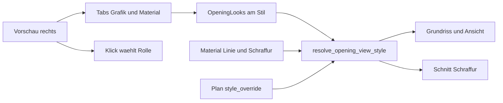

# Requirements

### Overview & Goals
Öffnungsstile bekommen optische Attribute pro Bauteil: Linientyp und Linienfarbe für die 2D-Grafik, plus eine Materialreferenz für Schraffur und 3D. Der Stilmanager zeigt diese Felder nicht mehr als eine lange Spalte, sondern in Tabs, mit einer großen, klickbaren Vorschau daneben.

Maße bleiben absolut am Stil. Die Planart entscheidet weiter nur, wie grob gezeichnet wird. Ein gesetztes Material oder eine gesetzte Linie ändert die Stärke nicht.

### Scope

#### In Scope
- `OpeningLooks` am `OpeningStyle`: pro Rolle Linientyp, Linienfarbe und optionale Material-Id.
- Auflösung in `resolve_opening_view_style`: Rolle, dann gesetzte Linie, sonst die Linie des Materials, danach der bestehende Plan-Override.
- Schnitt-Schraffur von Zarge, Bank, Brett, Schwelle, Rolladenkasten und Sturz aus dem Material der Rolle.
- Stilmanager-Tabs Maße, Grafik, Material, Teilungen, Symbol. Identität bleibt über den Tabs.
- Vorschau als rechte Spalte über die volle Formhöhe. Klick trifft eine Rolle, hebt sie hervor und springt zur passenden Zeile.
- Schnitt-Schema in der Vorschau, damit Bank, Kasten und Sturz sichtbar sind.
- Texte in `locales/`. Tests neben den AEC-Dateien.

#### Out of Scope
- Keine zweite Optik an der Planart. `ComponentRuleSet.style_override` bleibt und gewinnt, wird aber nicht neu editiert.
- Keine Linienstärke, kein ByLayer-Editor, keine Optik pro Zelle.
- Kein schattiertes 3D-Material-Viewport. Die 3D-Vorschau färbt nur die vorhandenen Drähte.
- Keine Blockauswertung, keine Änderung der Darstellungsstufen, kein Achsraster.
- Kein eigenes Vorschau-Modal.

### User Stories
- Als Planer will ich Festrahmen, Flügel, Glas, Aufschlag, Teilung, Bank, Brett, Schwelle, Kasten und Sturz jeweils mit Linientyp, Farbe und Material belegen, damit Grundriss, Ansicht und Schnitt dieselbe Optik lesen.
- Als Planer will ich leere Linienfelder vom Material erben, damit ich nicht Farbe und Schraffur zweimal pflege.
- Als Planer will ich Maße, Grafik, Material und Teilungen getrennt sehen, ohne die Identität des Stils zu verlieren.
- Als Planer will ich in einer großen Vorschau eine Komponente anklicken und sofort ihre Grafik- oder Materialzeile treffen.

### Functional Requirements
- Rollen, geschlossen: `FixedFrame`, `Leaf`, `Glazing`, `Swing`, `Division`, `ExteriorSill`, `InteriorBoard`, `Threshold`, `ShutterBox`, `Lintel`.
- Jede Rolle hat `line_type: Option<String>`, `line_color: Option<AcadColor>`, `material_id: Option<String>`. Leer heißt nicht gesetzt.
- Ist die Linie leer und ein Material gesetzt, gelten `Material.line_type` und `Material.line_color`. Die Schraffur kommt immer aus dem Material, nie aus der Linienfarbe.
- Ein Plan-`style_override` auf dem bisherigen Slot gewinnt nach dem Stil. Fehlt er, bleibt die Stiloptik.
- Der Sturz liest `looks.lintel.material_id`. Ein alter Wert in `LintelDimensions.material_id` gilt nur, wenn die Look-Id leer ist. Die Maße-Maske editiert die Material-Id nicht mehr.
- Vorschau-Klick mappt den getroffenen `OpeningComponentSlot` auf die Rolle. Die Rolle wird hervorgehoben. Liegt der Tab auf Maße, Teilungen oder Symbol, wechselt er auf Grafik. Liegt er auf Material, bleibt er dort und markiert dieselbe Rolle.
- Die Vorschau zeichnet Linien in der aufgelösten Farbe. Gefüllte Schnittflächen nutzen die Schraffurfarbe des Materials, sonst die Linienfarbe mit Alpha.
- Ein leerer Look ändert die heutige Zeichnung nicht: Defaults bleiben `AEC_OPENING`, ByLayer, bisherige Gewichte.

### Non-Functional Requirements
- AEC-Logik bleibt in `src/modules/aec/**`. Keine neuen Felder auf `CadApp`.
- Farbwahl über `AecColorPickTarget`, Materialwahl über `StylePickerTarget`. Kein Core-Farbdialog.
- UI-Texte über `locales/de-DE` und `locales/en-US`.
- Tests in `opening_style.rs`, `style_resolver.rs`, `cut_engine.rs` und `opening_style_manager.rs`, nicht in Core-`update`.

# Technical Design

### Current Implementation
`OpeningStyle` in `src/modules/aec/engine/opening_style.rs` hält `parts`, `grid`, `levels` und `symbols`. Optik pro Bauteil gibt es nicht. Nur `LintelDimensions.material_id` steuert die Sturzschraffur in `views/cut_engine.rs`.

`resolve_opening_view_style` in `views/style_resolver.rs` setzt Slot-Defaults (Layer `AEC_OPENING`, Aufschlag gestrichelt, Verglasung dünn) und legt danach `ComponentRuleSet.style_override` darüber. Der Stil selbst liefert keine Farbe.

Die Vorschau in `ui/style_manager/forms/opening.rs` ist 200 px hoch und zeichnet alle Pfade in der Theme-Textfarbe. `hit_slot` veröffentlicht `AecOpeningStyleManagerPreviewSlotSelect`, der Handler in `styles/opening_style_manager.rs` ist leer. Die Wandvorschau in `forms/wall_preview.rs` ist das Vorbild: Klick wählt eine Schicht und fokussiert die Zeile.

`linetype_field` und `acad_color_to_editor_string` in `ui/aec_ui_util.rs` sind schon die Editoren. Der Linientyp-Katalog liegt in `styles.material_linetype_items`. `AecColorPickTarget` kennt nur `Material` und `MaterialHatch`. `StylePickerTarget` kennt Schicht-Materialien, aber keine Öffnungsrolle.

### Key Decisions
- Tabs nach Aufgabe, nicht nach Bauteil. Maße, Grafik, Material, Teilungen und Symbol sind verschiedene Fragen. Ein Tab pro Bauteil würde Teilungen und Symbole verstecken und die Vorschau wiederholen.
- Vorschau bleibt im Dialog, als rechte Spalte mit `height(Fill)`, mindestens die bisherige Formhöhe. Kein Modal: der Klick soll die Zeile daneben treffen, und die Wandvorschau macht das genauso.
- Eine Look-Rolle, nicht 18 Slot-Schlüssel. Mehrere Slots derselben Rolle teilen Linientyp, Farbe und Material. `Frame2D`, der Ansichtsrahmen und die Schnittzarge sind `FixedFrame`.
- Linie und Material sind unabhängig. Gesetzte Linie gewinnt für den Strich. Leere Linie erbt vom Material. Schraffur kommt nur vom Material.
- Plan-Overrides bleiben die letzte Stufe und werden in diesem Plan nicht neu gebaut.

### Proposed Changes
`OpeningStyle` bekommt `looks: OpeningLooks`. Seeds lassen die Looks leer, damit die heutige Default-Optik stehen bleibt.

`resolve_opening_view_style` mappt den Slot auf die Rolle, liest den Look und überschreibt `line_type` und `line_color`, bevor der Plan-Override kommt. `cut_engine` liest für jede Schnittfläche die Material-Id der Rolle und setzt `hatch_pattern`, `hatch_color` und `hatch_scale` so, wie es der Sturz heute schon tut.

Der Öffnungsdialog behält Name, Art, Elternstil und die Instanz-Vorschauwerte über den Tabs. Darunter eine Button-Leiste im Stil der bestehenden Vorschau-Modi. Der Inhalt des gewählten Tabs scrollt. Rechts daneben die Vorschau.

Die Grafik-Tabelle listet die Rollen mit `linetype_field` und Farbbutton. Die Material-Tabelle listet dieselben Rollen mit dem bestehenden Style-Picker. Die Maße-Tabelle verliert das Sturz-Materialfeld.

### Data Models / Contracts
```rust
pub enum OpeningLookRole {
    FixedFrame, Leaf, Glazing, Swing, Division,
    ExteriorSill, InteriorBoard, Threshold, ShutterBox, Lintel,
}

pub struct OpeningComponentLook {
    pub line_type: Option<String>,
    pub line_color: Option<acadrust::types::Color>,
    pub material_id: Option<String>,
}
```

`OpeningLooks` hat genau ein Feld pro Rolle, `#[serde(default)]`. Ein fehlendes Feld beim Laden ist ein leerer Look.

Slot-Zuordnung, eine Richtung:

| Slot | Rolle |
|---|---|
| `Frame2D`, `ElevationContour2D`, `Frame3D` | `FixedFrame` |
| `Leaf2D`, `Leaf3D` | `Leaf` |
| `Glazing2D`, `Glazing3D` | `Glazing` |
| `Swing2D`, `ElevationSwing2D` | `Swing` |
| `ElevationMuntins2D` und Grundriss-Teilungen | `Division` |
| `Sill2D`, `ElevationSill2D` | `ExteriorSill` |
| Schnitt-Innenbrett | `InteriorBoard` |
| Schnitt-Schwelle | `Threshold` |
| Schnitt-Kasten | `ShutterBox` |
| Sturz | `Lintel` |

Auflösung des Strichs:

1. Slot-Default wie heute.
2. Gesetzte Look-Linie ersetzt Typ und Farbe.
3. Sonst, wenn `material_id` auf ein Bibliotheksmaterial zeigt, dessen `line_type` und `line_color`.
4. `style_override` des Plans ersetzt danach, was er setzt.

Schraffur: nur Schritt 3, und nur `hatch_pattern`, `hatch_color`, `hatch_scale`. Kein Linienfeld schreibt eine Schraffur.

### Components
- `forms/opening.rs` — Tabs, Grafik- und Materialzeilen, geteiltes Layout, farbige und hervorgehobene Vorschau, Schnitt-Schema.
- `styles/opening_style_manager.rs` — Buffer laden und speichern, Tabwechsel, Klick setzt die gewählte Rolle.
- `ui/color_pick.rs` — Ziel `OpeningComponent(OpeningLookRole)`.
- `state.rs` — `StylePickerTarget::OpeningComponentMaterial(OpeningLookRole)`, Tab und gewählte Rolle im Style-UI-State.
- `views/style_resolver.rs` und `views/cut_engine.rs` — Auflösung. Grundriss und Ansicht rufen den Resolver schon auf und brauchen keine zweite Optik.

### File Structure
Geändert, alles unter `src/modules/aec/`:

- `engine/opening_style.rs` — `OpeningLookRole`, `OpeningComponentLook`, `OpeningLooks`.
- `engine/views/style_resolver.rs` — Strichauflösung.
- `engine/views/cut_engine.rs` — Schraffur der Schnittrollen.
- `styles/opening_style_manager.rs` — Buffer und Klick.
- `ui/style_manager/forms/opening.rs` — Dialog und Vorschau.
- `ui/style_manager/ui_state.rs`, `ui/modal_views.rs`, `message.rs`, `update.rs` — Tab, Zeilen, Picker.
- `ui/color_pick.rs`, `state.rs` — Picker-Ziele.
- `locales/de-DE/opencadstudio.ftl`, `locales/en-US/opencadstudio.ftl` — Tab- und Rollennamen.

Keine neue Datei, solange `opening.rs` lesbar bleibt. Wird die Vorschau so lang wie `wall_preview.rs`, wandert sie nach `forms/opening_preview.rs`.

### Architecture Diagram



### GUI
Die Form ist eine Zeile: links der scrollende Tab-Inhalt, rechts die Vorschau mit fester Breite von etwa 360 px und `height(Fill)`.

Über den Tabs bleiben Name, Elternstil, Art, Form, Band, Winkel und die Vorschau-Maße. Die Tabs sind `Maße`, `Grafik`, `Material`, `Teilungen`, `Symbol`, als `button::primary` für den aktiven Tab, sonst `button::secondary`. Das ist dasselbe Muster wie die Modi Grundriss, Ansicht und 3D.

- Maße: die heutigen absoluten Felder, ohne Sturz-Material.
- Grafik: eine Zeile pro Rolle, Linientyp und Farbe. Leer zeigt „vom Material“ bzw. ByLayer.
- Material: eine Zeile pro Rolle, Name aus der Bibliothek, Picker wie bei Wandschichten. Löschen setzt die Id leer.
- Teilungen und Symbol: der heutige Inhalt, unverändert in der Sache.

Die Vorschau behält Grundriss, Ansicht und 3D und bekommt `Schnitt`. Der Schnitt ist ein Schema aus den Bauteilmaßen: Wanddicke, Zarge, Außenbank, Innenbrett, Kasten, Schwelle, Sturz. Kein zweiter Cut-Engine-Lauf.

Klick nutzt den vorhandenen `hit_slot`. Die getroffene Rolle bekommt einen dickeren Akzentstrich. Der Mauszeiger wird `Pointer`, wenn er über einem Pfad liegt. Ein Klick ins Leere hebt die Auswahl auf.

Ein Modal entfällt. Es würde die Zeile verdecken, die der Klick öffnen soll.

### Risks
- Mehrere Slots einer Rolle teilen eine Optik. Ein gestrichelter Grundrissrahmen ist dann auch in der Ansicht gestrichelt. Das ist gewollt. Getrennte Optik pro Ansicht wäre ein zweites Modell und kommt nicht.
- Ein Material ohne gesetzte Linie überschreibt den Slot-Default. Der Test muss „Linie leer, Material gesetzt“ und „beides leer“ unterscheiden.
- `LintelDimensions.material_id` und `looks.lintel.material_id` dürfen nicht divergieren. Die Maske schreibt nur den Look. Der alte Feldwert ist nur Lesefallback.
- Die Schnittvorschau ist ein Schema, keine echte Schnittgeometrie. Sie darf keine Koten aus `cut_engine` nachbauen.
- Ein Plan-Override, der nur den Layer setzt, darf die Stilfarbe nicht löschen. Er ersetzt nur Felder, die er selbst setzt. Das ist das heutige Verhalten und bleibt es.

# Testing

### Validation Approach
Tests prüfen die aufgelöste `ResolvedStyle` und die gespeicherten Looks. Die Pixel der Vorschau werden nicht geprüft. Die Klick-Zuordnung Slot → Rolle ist eine reine Funktion und wird getestet.

### Key Scenarios
- Leerer Look: `Frame2D` bleibt auf dem heutigen Default, Sturz ohne Material-Id schraffiert nicht neu.
- Gesetzter Linientyp und Farbe an `FixedFrame`: Grundrissrahmen und Ansichtsrahmen lesen dieselben Werte.
- Linie leer, Material gesetzt: Strich erbt `line_type` und `line_color`, Schnittzarge erbt `hatch_pattern`.
- Plan-`style_override` auf `Swing2D` ersetzt den Stil-Linientyp.
- Speichern aus den Buffern schreibt Look und lässt die Rahmenbreite unverändert.
- `Frame2D` mappt auf `FixedFrame`, `ElevationSwing2D` auf `Swing`, `Sill2D` auf `ExteriorSill`.

### Edge Cases
- Unbekannte Material-Id: Look gilt als ohne Material, Slot-Default bleibt, kein Panic.
- `ByLayer` und ACI-Index überleben den Farbbuffer über `acad_color_to_editor_string`.
- Alter Sturz mit nur `LintelDimensions.material_id`: Schraffur bleibt, bis der Look eine eigene Id hat.
- Klick auf einen Pfad ohne Slot-Zuordnung wählt nichts.

### Test Changes
- Neue Tests in `opening_style.rs` für Default-Look und Serde eines fehlenden `looks`.
- Neue Tests in `style_resolver.rs` für Erbe, gesetzte Linie und Plan-Vorrang.
- `cut_engine`-Test ergänzen: Bank oder Kasten liest ein anderes Material als der Sturz.
- Manager-Test: Grafik- und Materialbuffer rundreisen, Rahmenbreite bleibt.
- Kein Core-`update`-Test.

# Delivery Steps

### ✓ Step 1: Component look on the opening style
OpeningStyle stores a line type, a line color and a material id per component role, and the view resolver applies them.

- Add `OpeningLookRole`, `OpeningComponentLook` and `OpeningLooks` to `engine/opening_style.rs`, with serde defaults so a missing field is an empty look.
- Map `OpeningComponentSlot` to a role. `Frame2D`, `ElevationContour2D` and `Frame3D` share `FixedFrame`. Swing slots share `Swing`. Sill slots share `ExteriorSill`.
- In `views/style_resolver.rs`, apply a set look line after the slot default and before `style_override`. If the line is empty and the material exists, inherit `line_type` and `line_color`.
- Keep `LintelDimensions.material_id` as a read fallback when `looks.lintel.material_id` is empty.
- Tests: empty look keeps the current default; a set frame color is shared by plan and elevation; a plan override still wins.

### ✓ Step 2: Section hatch and preview colors from the look
Section bodies hatch from the role material, and the style preview strokes in the resolved color.

- In `views/cut_engine.rs`, resolve hatch pattern, color and scale for section frame, exterior sill, interior board, threshold, shutter box and lintel from the role material. Do not let a line color invent a hatch.
- Draw `OpeningPreviewCanvas` paths with the resolved line color. Filled section faces use the material hatch color when set.
- Add a `Section` preview mode that draws a schematic from part sizes: wall thickness, frame, sills, shutter box, threshold and lintel. Do not call the cut engine.
- Tests: sill and lintel can carry different materials; an unknown material id does not panic and does not change the default stroke.

### ✓ Step 3: Tabbed opening style editor
The opening dialog edits dimensions, graphics and materials on separate tabs, and saves them back onto the style.

- Add an editor-tab value and one line/color/material buffer per role on the style UI state.
- Replace the single scrolling column in `forms/opening.rs` with tabs `Maße`, `Grafik`, `Material`, `Teilungen`, `Symbol`. Keep identity and preview sizes above the tabs.
- Graphics rows use `linetype_field` and `AecColorPickTarget::OpeningComponent`. Material rows use `StylePickerTarget::OpeningComponentMaterial`. Remove the lintel material field from the dimensions tab.
- Load and save buffers in `opening_style_manager.rs`. Strings go through `locales/`.
- Tests: a graphics and material round-trip does not change `fixed_frame.face_width`.

### ✓ Step 4: Split preview and click-to-select
The preview fills the right side of the dialog, and a click selects the component role it hit.

- Place the canvas in a right column about 360 px wide with `height(Fill)`, beside the scrolling tab body. Do not add a modal.
- Highlight the selected role with a thicker accent stroke. Set the cursor to pointer when it is over a path.
- Wire `AecOpeningStyleManagerPreviewSlotSelect` to the role map. From Maße, Teilungen or Symbol, switch to Grafik. On Material, keep the tab and mark the same role. A miss clears the selection.
- Test the slot-to-role map, including a slot that has no role.