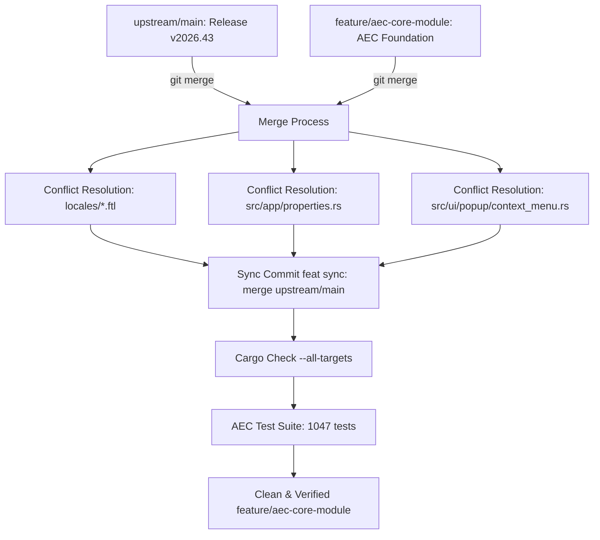

# Requirements

### Overview & Goals
The upstream repository `upstream/main` has been updated to **Release v2026.43** (commit `dbd50b200`, introducing 111 changed files, ~6.8k insertions). The goal of this task is to integrate these upstream updates into our working branch `feature/aec-core-module` in the safest, most efficient, and most reliable way possible.

---

### Strategy Evaluation: Merge vs. Rebase (Utilitarian Calculus)

To maximize overall utility (minimizing engineering risk, cognitive load, time loss, and friction while maximizing traceability and safety), we evaluate the two candidate synchronization methods:

| Criteria | 3-Way Merge (`git merge upstream/main`) | Interactive Rebase (`git rebase upstream/main`) |
| :--- | :--- | :--- |
| **Execution Risk** | **Low:** Single atomic integration step; all conflicts resolved once with immediate global testability. | **High:** Re-applies 100+ AEC commits sequentially over new upstream base; risks cascading conflict loops and intermediate broken states. |
| **History & Provenance** | **High Utility:** Preserves exact original commit SHAs, author timestamps, and existing sync points (e.g. `feat(sync): merge upstream/main (v2026.42)`). | **Negative Utility:** Rewrites commit history, changes all commit hashes, and requires dangerous force-push (`git push --force`). |
| **Collaboration & Safety** | **High:** Safe for multi-developer branches and downstream tracking branches without breaking remote tracking. | **Disruptive:** Invalidates any existing checked-out copies or derived test branches. |
| **Established Project Standard** | **Aligned:** Follows existing repository practice (see commit `1d6ebd2dd`). | **Divergent:** Unnecessary divergence from established project workflow. |

**Conclusion:** A **3-Way Merge (`git merge upstream/main`)** provides optimal net utility.

---

### Scope
- **In Scope:**
  - Merging `upstream/main` into `feature/aec-core-module`.
  - Resolving identified merge conflicts in `locales/*/opencadstudio.ftl` (32 locale files).
  - Resolving merge conflicts in `src/app/properties.rs` (transparency dropdown) and `src/ui/popup/context_menu.rs` (idle menu hatch actions + AEC menu hooks).
  - Validating compiler sanity and executing the complete AEC test suite (1,047 tests).
- **Out of Scope:**
  - Functional redesign of existing AEC modules or introducing new AEC features during this sync.

# Technical Design

### Current Implementation & Upstream Delta
Upstream release `v2026.43` introduces significant enhancements across core subsystems:
1. **Hatch Trimming Engine:** `src/modules/draw/modify/trim_hatch_region.rs` and double-click hatch editing.
2. **Dynamic Blocks:** Array action evaluation bounds (`src/scene/block_actions/array.rs`) and formula preservation in lookup tables (`src/scene/block_lookup/expressions.rs`).
3. **Clipboard & Styles:** MLeader and DimStyle transfer on paste (`src/app/command_driver/clipboard.rs`).
4. **Properties & UI:** Dynamic entity transparency options and tooltip improvements.

---

### Key Decisions
1. **Adopt 3-Way Merge Strategy:** Perform `git merge upstream/main` and record a structured sync commit message: `feat(sync): merge upstream/main (v2026.43) into feature/aec-core-module`.
2. **Preserve `AEC ≠ Core` Separation:** Keep AEC hooks minimal and non-intrusive when integrating upstream changes in `src/ui/popup/context_menu.rs` and `src/app/properties.rs`.
3. **Lossless Locale Resolution:** Retain both upstream's newly added keys (`block-array`, `quoted-help`) and the AEC localization block (`aec-ui`) across all 32 locale files.

---

### Proposed Changes & Conflict Resolution

#### 1. Localization Files (`locales/*/opencadstudio.ftl`)
- **Upstream addition:** Added `block-lookup.quoted-help` and `block-array.limit-error`.
- **AEC branch addition:** Added extensive `aec-ui = ...` strings.
- **Resolution:** Keep both sections appended cleanly in every affected `.ftl` file.

#### 2. Property Inspector (`src/app/properties.rs`)
- **Upstream change:** Replaced hardcoded `vec!["ByLayer", "ByBlock"]` with `crate::scene::creation_style::current_transparency_label(...)` and `transparency_options()`.
- **Resolution:** Accept upstream's dynamic implementation.

#### 3. Context Menu (`src/ui/popup/context_menu.rs`)
- **Upstream change:** Added `single_hatch: bool` parameter to `idle_rows(...)` for context-sensitive hatch editing.
- **AEC branch change:** Extends idle rows with AEC commands via `aec_menu::extend_idle_rows(&mut rows, aec, open_submenu)`.
- **Resolution:** Combine both changes: pass `*single_hatch` to `idle_rows(...)` and maintain the AEC row extension immediately after.

---

### Architecture Diagram

# Testing

### Validation Approach
Automated compilation and test suites will be used to ensure that merging upstream `v2026.43` creates zero regressions in either core functionality or AEC domain features.

---

### Key Scenarios & Verification Steps
1. **Compilation Check:**
   - Execute `cargo check --all-targets` across the entire workspace to ensure all types, macros, and API signatures match.
2. **AEC Test Suite Execution:**
   - Run `cargo test --lib -- aec` to verify that all 1,047 AEC unit and integration tests (analytical control planes, wall joins, dynamic slab structures, room schedules, floor transitions, cut engines) pass with 100% success.
3. **Core Regression Suite:**
   - Execute core tests (`cargo test --test integration` or standard test suite) to ensure hatch editing, clipboard, and block actions operate correctly.
4. **Git Tree Cleanliness:**
   - Confirm via `git status` that all conflicts are resolved, staged, committed, and no untracked artifacts remain.

# Delivery Steps

### ✓ Step 1: Execute 3-way merge and resolve localization conflicts
All 32 localization files (`locales/*/opencadstudio.ftl`) have upstream additions and AEC translation blocks merged without conflict markers.

- Initiate `git merge upstream/main` on the active branch `feature/aec-core-module`.
- Resolve merge conflicts across all 32 `locales/*/opencadstudio.ftl` files by preserving upstream's newly added `block-array` and `quoted-help` entries while retaining the complete `aec-ui` localization sections.
- Stage the resolved translation files into the Git index.

### ✓ Step 2: Resolve Core UI & context menu conflicts and finalize merge commit
Application properties and context menu hooks seamlessly combine upstream v2026.43 features with thin AEC modular extensions, and the merge commit is finalized.

- Resolve `src/app/properties.rs` by adopting upstream's dynamic transparency options (`crate::scene::creation_style::current_transparency_label` and `transparency_options()`).
- Resolve `src/ui/popup/context_menu.rs` by passing upstream's new `*single_hatch` parameter to `idle_rows(...)` while retaining the subsequent `aec_menu::extend_idle_rows(&mut rows, aec, open_submenu)` call to respect the `AEC ≠ Core` boundary.
- Stage all remaining resolved files and complete the merge commit with the Conventional Commit message `feat(sync): merge upstream/main (v2026.43) into feature/aec-core-module`.

### ✓ Step 3: Compilation verification and AEC test suite validation
The integrated codebase builds cleanly and passes all AEC module tests and core regressions without regressions.

- Run `cargo check --all-targets` to confirm compilation integrity across all crates, examples, and plugins.
- Execute `cargo test --lib -- aec` to verify that all 1,047 AEC unit and integration tests (wall joins, sloped planes, slabs, room detection) pass without error.
- Verify that `git status` reports a clean working tree on `feature/aec-core-module`.