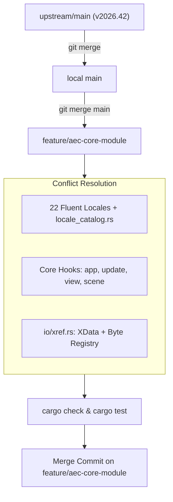

# Requirements

### Overview & Goals
The goal of this task is to update OpenCADStudio to the latest upstream release (`v2026.42` from `HakanSeven12/OpenCADStudio`, 1,224 commits ahead of the current merge base). The update must be integrated into the active development branch `feature/aec-core-module` while strictly preserving AEC module hooks, architectural isolation, and existing functionality.

### Scope
#### In Scope
- Synchronizing local `main` with `upstream/main` (`v2026.42`).
- Merging updated `main` into `feature/aec-core-module` via a standard merge commit (no rebase, preserving commit history).
- Reconciling merge conflicts across 22 Fluent localization files (`locales/*/opencadstudio.ftl`) and `src/locale_catalog.rs`.
- Reconciling Core Rust conflicts in `src/app/**`, `src/scene/**`, and `src/io/xref.rs` while maintaining AEC hooks and boundaries.
- Verifying workspace compilation (`cargo check`), automated tests (`cargo test`), and known regression checkpoints (ViewCube, Wall style inspector, Wall joins).

#### Out of Scope
- Rebasing `feature/aec-core-module` or rewriting branch history.
- Force-pushing to remote branches.
- Modifying or loosening AEC module isolation boundaries (AEC logic remains strictly inside `src/modules/aec/**`).
- Committing temporary build artifacts, AppImage bundles, or `.idea` workspace files.

### User Stories
- **As a CAD developer**, I want `feature/aec-core-module` to include the latest 1,224 upstream improvements, bug fixes, and features from `v2026.42` so that AEC tools operate on the most current CAD engine.
- **As an AEC user**, I want wall drawing, wall styling, storey management, and 3D view cube manipulation to remain completely functional without regressions after the upstream sync.

### Functional Requirements
- **Upstream Feature Ingestion**: Bring in all upstream changes up to `v2026.42`, including dimension conversion, UCS enhancements, sketch tools, and web/in-session xref caching.
- **AEC Hook Preservation**: Maintain all thin Core hooks (`Message::Aec`, `aec::update`, `spawn_command`, `properties::extend`, and `AecState` lifecycle).
- **Localization Coexistence**: Ensure all AEC translation keys (`aec-ui`, `project-explorer`) and newly added upstream strings coexist in `locales/` and `src/locale_catalog.rs`.
- **Clean Workspace**: Ensure `cargo check` and `cargo test` pass with no compiler warnings or broken tests.

### Non-Functional Requirements
- **Architectural Separation**: Conform strictly to repository guidelines: no AEC domain logic placed into `src/app/**`, `src/scene/**`, or `src/command.rs`.
- **Clean Git History**: Retain commit graph integrity using non-destructive merge commits with English Conventional Commit messages.

# Technical Design

### Current Implementation
- **Branch Topology**:
  - `upstream/main`: commit `66dfd5eb7` (tag `v2026.42`, release with dimension conversion, xref registry, sketch UCS enhancements).
  - Local `main`: commit `472bb988a` (1,224 commits behind upstream).
  - `feature/aec-core-module`: commit `9b5342600` (based on `472bb988a` with ~73 AEC commits implementing walls, openings, slabs, storeys, and project explorer).
- **AEC Integration Points**:
  - `src/app/mod.rs` & `src/app/update/mod.rs`: contains `AecState` initialization, lifecycle events, and message dispatch (`Message::Aec`).
  - `src/app/commands/draw.rs` & `src/app/update/command.rs`: command driver hooks dispatching AEC entity commands.
  - `src/app/view/overlay.rs` & `src/app/update/viewport.rs`: ViewCube rendering conditions and AEC overlay rendering.
  - `src/io/xref.rs`: remapping handles stored in extended data (`XData`) for AEC wall and opening entities.
  - `src/scene/pick/selection_state.rs`: AEC wall package picking and selection cache.

### Key Decisions
- **Decision 1: Merge Local Main First, Then Feature Branch**:
  - *Rationale*: Updates local `main` directly from `upstream/main` to establish a clean reference point, before merging `main` into `feature/aec-core-module`.
- **Decision 2: Merge Commit Strategy (No Rebase)**:
  - *Rationale*: `feature/aec-core-module` contains existing merge commits and complex conflict resolutions from prior syncs. Rebasing would re-trigger conflicts commit-by-commit and risk regressions.
- **Decision 3: Maintain AEC Hooks and XData Handling**:
  - *Rationale*: Upstream refactored `src/io/xref.rs` for web in-session caching and updated `src/app/view/` rendering. We will keep both the upstream web caching logic and the AEC XData handle remapping logic.

### Proposed Changes

#### Conflict Analysis & Resolution Matrix
| File | Conflicting Aspects | Resolution Strategy |
|---|---|---|
| `.gitignore` | Local AppImage / log patterns vs upstream additions | Combine both sets of ignore patterns. |
| `locales/*/opencadstudio.ftl` (22 files) | Upstream new messages vs AEC UI messages (`aec-ui.*`) | Preserve both upstream additions and AEC message blocks. |
| `src/locale_catalog.rs` | String-to-attribute mappings | Merge upstream string entries with AEC attribute mappings. |
| `src/app/mod.rs` | Struct fields & initialization | Retain `aec_state` field and AEC message routing; adopt upstream state additions. |
| `src/app/update/mod.rs` | Message dispatch | Keep `Message::Aec` handler and AEC update hooks; adopt upstream message handlers. |
| `src/app/update/command.rs` & `draw.rs` | Command driver dispatch | Retain AEC command routes; integrate upstream sketch/dimension commands. |
| `src/app/update/viewport.rs` | Viewport & ViewCube updates | Preserve ViewCube surface checks and AEC overlay updates. |
| `src/app/view/mod.rs` & `overlay.rs` | UI rendering & overlays | Preserve AEC overlay rendering hooks alongside upstream render changes. |
| `src/scene/pick/selection_state.rs` | Entity selection caching | Preserve AEC wall package picking and selection cache helpers. |
| `src/io/xref.rs` | Web xref byte registry vs XData remapping | Retain upstream in-session registry and integrate AEC handle remapping. |

### Data Models / Contracts
- In `src/io/xref.rs`:
  ```rust
  // Preserve AEC XData handle remapping during xref entity import:
  for &new_h in entity_handle_map.values() {
      if let Some(entity) = target.entities.get_mut(&new_h) {
          aec_remap_xdata_handles(&mut entity.extended_data, &entity_handle_map);
      }
  }
  ```
- In `src/app/update/mod.rs`:
  ```rust
  // Preserve thin AEC dispatch hook:
  Message::Aec(msg) => {
      crate::modules::aec::update(app, msg);
  }
  ```

### Architecture Diagram


### Risks & Mitigations
- **Risk: ViewCube & 3D viewport regressions**:
  - *Mitigation*: Ensure `src/app/update/viewport.rs` and `src/app/view/overlay.rs` retain the surface destination check that prevents ViewCube rendering errors in 2D/3D transitions.
- **Risk: Wall property panel breakage**:
  - *Mitigation*: Verify `properties::extend` hook remains wired in `src/app/view/mod.rs` so dynamic AEC wall styles populate the property inspector.
- **Risk: Locale syntax errors**:
  - *Mitigation*: Run `python3 scripts/export-locales.py` to validate Fluent formatting and ensure static web/desktop labels stay in sync.

# Testing

### Validation Approach
Verification consists of automated compiler and lint checks, automated test suites (Core and AEC), and targeted manual inspection of known regression areas.

### Key Scenarios
1. **Compilation & Cargo Dependencies**:
   - `cargo check --workspace`: Must pass with 0 compilation errors.
   - `cargo check --tests`: Test targets must compile cleanly.
2. **Automated Test Suite**:
   - `cargo test --lib`: All unit tests in Core and `src/modules/aec/**` pass.
   - Specific AEC test execution: `cargo test --lib -- modules::aec`.
3. **AEC Feature Inspection**:
   - **Wall Drawing**: Wall command creates wall entities with correct baseline and thickness.
   - **Properties Inspector**: Selecting an AEC wall displays wall style, height, and offset properties.
   - **Wall Joins**: Intersecting walls automatically update their mitered geometry.
   - **ViewCube**: 3D rotation, face picking, and view switching operate smoothly without panics.
   - **Xref Import**: DWG/DXF files containing AEC extended data preserve entity references on load.

### Edge Cases
- **Duplicate Locale Keys**: Verify that no duplicate Fluent entries exist across the 22 languages and `src/locale_catalog.rs`.
- **Xref Registry vs XData Remapping**: Verify that remapping handles inside extended data operates on resolved xref documents without crashing when an xref is missing.

### Test Commands & Checks
```bash

# Verify workspace compilation

cargo check

# Run all unit tests

cargo test --lib

# Run AEC-specific unit tests

cargo test --lib -- modules::aec

# Run locale export script to ensure catalog consistency

python3 scripts/export-locales.py --check
```

# Delivery Steps

### ✓ Step 1: Sync local main branch with upstream
The local `main` branch is updated to match `upstream/main` (`v2026.42`), resolving the minor `.gitignore` conflict.

- Fetch latest upstream changes and tags with `git fetch upstream --tags`.
- Check out `main` and execute `git merge upstream/main`.
- Resolve the `.gitignore` conflict by retaining local ignore entries (e.g., AppImage, scratch logs) alongside upstream additions.
- Validate that the updated `main` branch builds cleanly with `cargo check`.

### ✓ Step 2: Reconcile Fluent translations and locale catalog
All 22 conflicting Fluent (`.ftl`) translation files and `src/locale_catalog.rs` are reconciled without losing AEC strings or upstream localization.

- Check out `feature/aec-core-module` and initiate `git merge main`.
- Resolve conflicts across `locales/*/opencadstudio.ftl` by retaining AEC sections (`aec-ui`, `project-explorer`, AEC property labels) and integrating upstream additions.
- Reconcile `src/locale_catalog.rs` by combining AEC attribute mappings with upstream's new message definitions without key duplicates.
- Run `python3 scripts/export-locales.py` to ensure desktop and web metadata exports reflect the combined catalogs.

### ✓ Step 3: Resolve Core Rust conflicts preserving AEC hooks
All Core Rust conflict files compile cleanly with AEC hooks and upstream features intact.

- Resolve `src/app/mod.rs` and `src/app/update/mod.rs`: preserve `AecState`, `Message::Aec` dispatch, and hook points while adopting upstream state management updates.
- Resolve `src/app/commands/draw.rs` and `src/app/update/command.rs`: maintain AEC tool routing alongside upstream sketch and dimension commands.
- Resolve `src/app/update/viewport.rs`, `src/app/view/mod.rs`, and `src/app/view/overlay.rs`: preserve ViewCube 3D surface destination checks and AEC overlay hooks.
- Resolve `src/scene/pick/selection_state.rs`: preserve AEC wall package picking and selection state caches.
- Resolve `src/io/xref.rs`: preserve AEC extended data (XData) handle remapping within `merge_source_entities` alongside upstream's in-session xref byte registry.

### ✓ Step 4: Validate build, test AEC regressions, and complete merge
OpenCADStudio compiles with zero errors, unit tests pass, and the merge commit is finalized on `feature/aec-core-module`.

- Execute `cargo check` and `cargo test --lib` across Core and AEC crates (`src/modules/aec/**`).
- Verify key AEC workflows: wall creation, wall style switching in the properties inspector, joined wall miter updates, and 3D ViewCube interaction.
- Stage all resolved files and finalize the merge commit using a Conventional Commit message (`feat(sync): merge upstream/main (v2026.42) into feature/aec-core-module`).